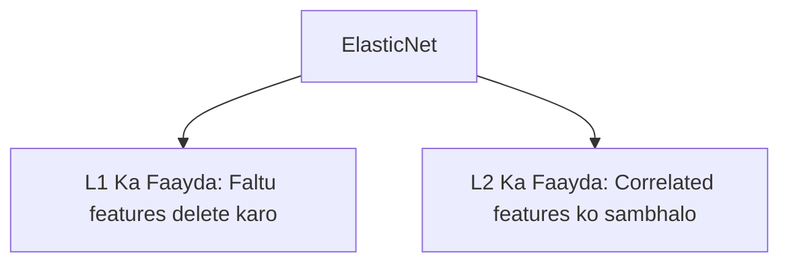

# Notes_24.12: ElasticNet Overview (L1 Aur L2 Ka Hybrid) [Hinglish]

## 📌 Topic Overview
Is lecture mein Shraddha ma'am ne **ElasticNet** ka concept samjhaya hai: kaise Lasso (L1) aur Ridge (L2) dono ko milakar ek hybrid model banaya jata hai taaki dono ke faayde ek sath mil sakein.

---

### 📋 Is Topic Mein Hum Kya Seekhenge?
- ElasticNet ki zaroorat kyu padi?
- `l1_ratio` parameter ka matlab.
- Correlated features par Lasso ki kamzori aur ElasticNet ka solution.
- Formula aur use case.

---

### 🔍 Har Ek Point Ka Simple & Detailed Explanation

#### 1. ElasticNet Kya Hai?
- Lasso features ko delete karne mein achha hai.
- Ridge correlated features ko handle karne mein achha hai.
**ElasticNet dono ko jod deta hai**:

$$
\text{Cost} = \text{MSE} + \text{Penalty(L1)} + \text{Penalty(L2)}
$$

- `l1_ratio = 1`: Poora Lasso ban jayega.
- `l1_ratio = 0`: Poora Ridge ban jayega.
- `l1_ratio = 0.5`: 50% Lasso aur 50% Ridge!

---

### 📊 Visual Flowchart: Hybrid Model



---

### 💻 Python Code

```python
from sklearn.linear_model import ElasticNet
import numpy as np

def demonstrate_elastic_net(l1_ratio=0.5):
    """
    Demonstrates ElasticNet (Hybrid L1 + L2 Regularization):
    Cost = MSE + alpha * [ l1_ratio * L1 + 0.5*(1 - l1_ratio) * L2 ]
    
    Combines Lasso's feature selection with Ridge's grouped selection stability.
    """
    np.random.seed(42)
    X = np.random.randn(80, 5)
    y = 3.0 * X[:, 0] + 2.0 * X[:, 1] + np.random.normal(0, 0.5, size=80)
    
    en = ElasticNet(alpha=0.5, l1_ratio=l1_ratio, random_state=42)
    en.fit(X, y)
    
    return {
        'l1_ratio': l1_ratio,
        'coefficients': [round(c, 3) for c in en.coef_]
    }

# --- Function Call & Testing ---
for ratio in [0.1, 0.5, 0.9]:
    res = demonstrate_elastic_net(l1_ratio=ratio)
    print(f"ElasticNet (l1_ratio={ratio:.1f}) Coefficients: {res['coefficients']}")
```

---

### 📌 Summary Points
- ElasticNet = Lasso + Ridge ka combination.
- `l1_ratio` se dono ka proportion set karte hain.
