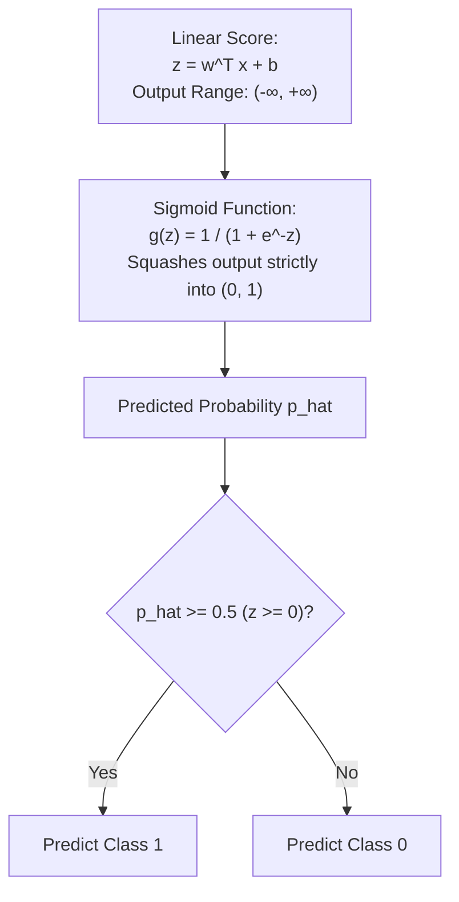

# Lecture 24.13: Logistic Regression — Intuition & The Sigmoid Function

## 📌 Topic Overview
In this lecture, Shraddha ma'am introduces **Logistic Regression**, explaining why standard Linear Regression fails for binary classification and how the **Sigmoid Function** squashes continuous outputs into legitimate probabilities.

---

## 🏛️ Why Linear Regression Fails for Classification
1. **Unbounded Outputs**: A straight line $\hat{y} = mx + c$ produces values $< 0$ and $> 1$, which violates the fundamental law of probability $P \in [0, 1]$.
2. **Sensitive to Outliers**: Adding a far-away data point rotates the linear decision boundary, causing massive classification errors on previously correct samples!



---

## 📐 The Sigmoid Formulation

$$
\sigma(z) = \frac{1}{1 + e^{-z}}
$$

- At $z = -\infty \implies \sigma(z) = 0.0$
- At $z = 0 \implies \sigma(z) = 0.5$ (The Decision Threshold!)
- At $z = +\infty \implies \sigma(z) = 1.0$

---

## 💻 Python Implementation

```python
import numpy as np

def compute_sigmoid_probability(z_values):
    """
    Computes predicted probability using the Sigmoid (Logistic) Function:
        g(z) = 1 / (1 + e^-z)
        
    Maps linear scores z in (-inf, inf) strictly into valid probabilities p in (0, 1).
    Decision Threshold:
        If p >= 0.5 (i.e., z >= 0) => Class 1
        If p < 0.5  (i.e., z < 0)  => Class 0
    """
    z = np.array(z_values, dtype=float)
    probabilities = 1.0 / (1.0 + np.exp(-z))
    predictions = (probabilities >= 0.5).astype(int)
    
    return {
        'linear_score_z': z.tolist(),
        'probability': probabilities.round(4).tolist(),
        'class_prediction': predictions.tolist()
    }

# --- Function Call & Testing ---
sample_z = [-10.0, -2.0, 0.0, 2.0, 10.0]
sig_data = compute_sigmoid_probability(sample_z)
print(f"{'Linear Score z':<15} | {'Sigmoid Prob p':<18} | {'Predicted Class (0/1)':<20}")
print("-" * 55)
for z_val, p_val, cls_val in zip(sig_data['linear_score_z'], sig_data['probability'], sig_data['class_prediction']):
    print(f"{z_val:<15.1f} | {p_val:<18.4f} | {cls_val:<20}")
```

---

## 🔑 Key Takeaways
1. Despite its name, Logistic Regression is a **classification** algorithm.
2. The Sigmoid function smoothly maps real-valued numbers to valid probabilities.
3. The default decision boundary is $z = 0 \implies \hat{p} = 0.5$.
