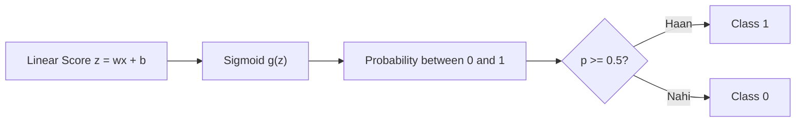

# Notes_24.13: Logistic Regression Ki Intuition Aur Sigmoid Function [Hinglish]

## 📌 Topic Overview
Is lecture mein Shraddha ma'am ne **Logistic Regression** ka foundational concept samjhaya hai: Linear Regression classification mein kyu fail ho jata hai aur **Sigmoid Function (S-Curve)** kaise probabilities generate karta hai.

---

### 📋 Is Topic Mein Hum Kya Seekhenge?
- Classification ke liye Linear Regression kyu galat hai?
- Sigmoid Function ka formula: $g(z) = \frac{1}{1 + e^{-z}}$.
- Probabilities ko 0 aur 1 ke beech squash karna.
- 0.5 Decision Boundary ka rule.

---

### 🔍 Har Ek Point Ka Simple & Detailed Explanation

#### 1. Linear Regression Classification Mein Kyu Fail Hua?
Agar aap Linear Regression se predict karoge ki "Patient ko cancer hai (1) ya nahi (0)":
- Ek straight line kabhi-kabhi $1.8$ ya $-0.5$ predict kar degi! Probability kabhi negative ya $1$ se badi nahi ho sakti.
- Outlier aate hi straight line ghoom jaati hai aur sahi predictions ko bhi galat kar deti hai.

#### 2. Sigmoid Function Ka Magic:
Humein ek aisi machine chahiye jo chahe kitna bhi bada number aaye ($-\infty$ se $+\infty$), usse kheench kar **$0$ aur $1$ ke beech** bandh de!
Is function ko **Sigmoid Function** kehte hain:

$$
g(z) = \frac{1}{1 + e^{-z}}
$$

- Agar $z = 0 \implies g(z) = 0.5$ (50-50 chance).
- Agar probability $\ge 0.5$ hai $\implies$ Class 1 (Approved / Cancer Yes).
- Agar probability $< 0.5$ hai $\implies$ Class 0 (Rejected / Cancer No).

---

### 📊 Visual Flowchart: Sigmoid S-Curve



---

### 💻 Python Code

```python
import numpy as np

def compute_sigmoid_probability(z_values):
    """
    Computes predicted probability using the Sigmoid (Logistic) Function:
        g(z) = 1 / (1 + e^-z)
        
    Maps linear scores z in (-inf, inf) strictly into valid probabilities p in (0, 1).
    Decision Threshold:
        If p >= 0.5 (i.e., z >= 0) => Class 1
        If p < 0.5  (i.e., z < 0)  => Class 0
    """
    z = np.array(z_values, dtype=float)
    probabilities = 1.0 / (1.0 + np.exp(-z))
    predictions = (probabilities >= 0.5).astype(int)
    
    return {
        'linear_score_z': z.tolist(),
        'probability': probabilities.round(4).tolist(),
        'class_prediction': predictions.tolist()
    }

# --- Function Call & Testing ---
sample_z = [-10.0, -2.0, 0.0, 2.0, 10.0]
sig_data = compute_sigmoid_probability(sample_z)
print(f"{'Linear Score z':<15} | {'Sigmoid Prob p':<18} | {'Predicted Class (0/1)':<20}")
print("-" * 55)
for z_val, p_val, cls_val in zip(sig_data['linear_score_z'], sig_data['probability'], sig_data['class_prediction']):
    print(f"{z_val:<15.1f} | {p_val:<18.4f} | {cls_val:<20}")
```

---

### 📌 Summary Points
- Naam mein 'Regression' hai par yeh **Classification** algorithm hai.
- Sigmoid real numbers ko probability ($0$ se $1$) mein badalta hai.
