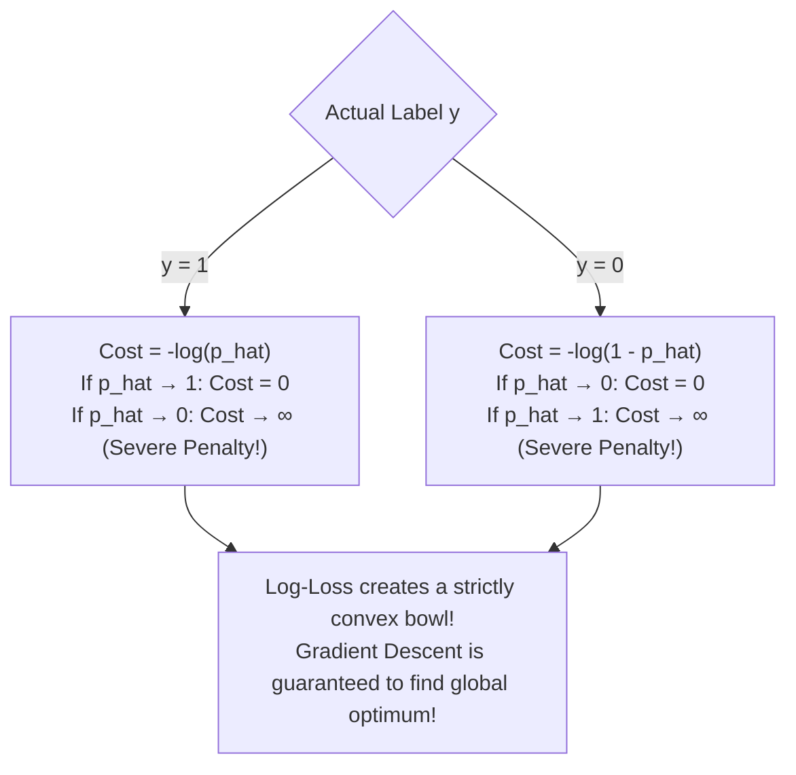

# Lecture 24.14: Logistic Regression — Cost Function (Log-Loss)

## 📌 Topic Overview
In this lecture, Shraddha ma'am explains why Mean Squared Error fails for Logistic Regression and derives the **Binary Cross-Entropy (Log-Loss)** cost function.

---

## 🏛️ Why MSE Fails for Logistic Regression
If you insert the non-linear Sigmoid function into MSE:

$$
J(\mathbf{w}) = \frac{1}{2m} \sum \left(\sigma(\mathbf{w}^T \mathbf{x}) - y\right)^2
$$

The resulting loss surface is **non-convex**, riddled with local minima and flat plateaus where Gradient Descent gets permanently stuck!

---

## 📐 Binary Cross-Entropy (Log-Loss)

To ensure strict convexity, we use **Log-Loss**:

$$
J(\mathbf{w}) = -\frac{1}{m} \sum_{i=1}^m \left[ y^{(i)} \log\left(\hat{p}^{(i)}\right) + \left(1 - y^{(i)}\right) \log\left(1 - \hat{p}^{(i)}\right) \right]
$$



---

## 💻 Python Implementation

```python
import numpy as np

def compute_binary_cross_entropy(y_true, y_pred_prob):
    """
    Computes Binary Cross-Entropy (Log-Loss) Cost Function:
        J(w) = - 1/m * sum [ y*log(p) + (1-y)*log(1-p) ]
        
    Guarantees strict convexity, eliminating local minima traps of MSE.
    """
    y = np.array(y_true, dtype=float)
    p = np.clip(np.array(y_pred_prob, dtype=float), 1e-15, 1 - 1e-15)
    m = len(y)
    
    # Pointwise log-loss
    sample_losses = -(y * np.log(p) + (1.0 - y) * np.log(1.0 - p))
    total_cost = (1.0 / m) * np.sum(sample_losses)
    
    return {
        'total_cost': float(total_cost),
        'sample_losses': sample_losses.round(4).tolist()
    }

# --- Function Call & Testing ---
actual_labels = [1, 1, 0, 0]
# Confident good predictions vs unconfident predictions
confident_preds = [0.95, 0.90, 0.05, 0.10]
poor_preds      = [0.20, 0.30, 0.80, 0.70]

loss_good = compute_binary_cross_entropy(actual_labels, confident_preds)['total_cost']
loss_bad  = compute_binary_cross_entropy(actual_labels, poor_preds)['total_cost']

print(f"Log Loss with Confident Accurate Predictions : {loss_good:.4f}")
print(f"Log Loss with Poor Misclassified Predictions: {loss_bad:.4f}")
```

---

## 🔑 Key Takeaways
1. Binary Cross-Entropy heavily penalizes confident wrong predictions with infinite loss.
2. Log-loss restores convexity to the optimization surface.
