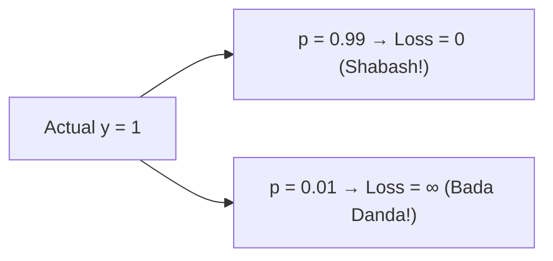

# Notes_24.14: Logistic Regression Ka Cost Function (Log-Loss) [Hinglish]

## 📌 Topic Overview
Is lecture mein Shraddha ma'am ne samjhaya hai ki Logistic Regression mein MSE (Mean Squared Error) kyu fail ho jata hai aur **Log-Loss (Binary Cross-Entropy)** kyu zaroori hota hai.

---

### 📋 Is Topic Mein Hum Kya Seekhenge?
- Sigmoid ke sath MSE non-convex (pahaad-gaddha) kyu ban jata hai?
- Binary Cross-Entropy (Log-Loss) ka formula.
- Confident galat prediction par infinite penalty ka logic.
- Convexity wapas kaise aati hai?

---

### 🔍 Har Ek Point Ka Simple & Detailed Explanation

#### 1. MSE Kyu Fail Hua?
Linear Regression mein MSE ka graph ek sundar katori (Convex) banta tha.
Lekin jab Sigmoid ke curve ko square kiya jata hai, toh graph mein **hazaron local minima (gaddhe)** ban jaate hain. Gradient Descent kisi galat gaddhe mein atak jata hai aur kabhi asli answer nahi dhoond pata!

#### 2. Log-Loss Ka Danda (Severe Penalty):
Is problem ko solve karne ke liye hum **Logarithm** ka use karte hain:

$$
J(\mathbf{w}) = -\frac{1}{m} \sum_{i=1}^m \left[ y^{(i)} \log(\hat{p}^{(i)}) + (1 - y^{(i)}) \log(1 - \hat{p}^{(i)}) \right]
$$

- Agar actual label $y = 1$ hai aur model ne $0.99$ bola $\implies$ Loss lagbhag $0$ hoga.
- Lekin agar actual label $y = 1$ hai aur model overconfidence mein bola $0.01$ (Galat bola) $\implies$ Loss **$\infty$ (Infinite) ho jayega**!
Is zabardast penalty ki wajah se curve wapas convex katori ban jata hai.

---

### 📊 Visual Flowchart: Log Loss Penalty



---

### 💻 Python Code

```python
import numpy as np

def compute_binary_cross_entropy(y_true, y_pred_prob):
    """
    Computes Binary Cross-Entropy (Log-Loss) Cost Function:
        J(w) = - 1/m * sum [ y*log(p) + (1-y)*log(1-p) ]
        
    Guarantees strict convexity, eliminating local minima traps of MSE.
    """
    y = np.array(y_true, dtype=float)
    p = np.clip(np.array(y_pred_prob, dtype=float), 1e-15, 1 - 1e-15)
    m = len(y)
    
    # Pointwise log-loss
    sample_losses = -(y * np.log(p) + (1.0 - y) * np.log(1.0 - p))
    total_cost = (1.0 / m) * np.sum(sample_losses)
    
    return {
        'total_cost': float(total_cost),
        'sample_losses': sample_losses.round(4).tolist()
    }

# --- Function Call & Testing ---
actual_labels = [1, 1, 0, 0]
# Confident good predictions vs unconfident predictions
confident_preds = [0.95, 0.90, 0.05, 0.10]
poor_preds      = [0.20, 0.30, 0.80, 0.70]

loss_good = compute_binary_cross_entropy(actual_labels, confident_preds)['total_cost']
loss_bad  = compute_binary_cross_entropy(actual_labels, poor_preds)['total_cost']

print(f"Log Loss with Confident Accurate Predictions : {loss_good:.4f}")
print(f"Log Loss with Poor Misclassified Predictions: {loss_bad:.4f}")
```

---

### 📌 Summary Points
- Classification ke liye MSE nahi, **Log-Loss** use hota hai.
- Confident galat prediction par model ko sabse badi penalty milti hai.
