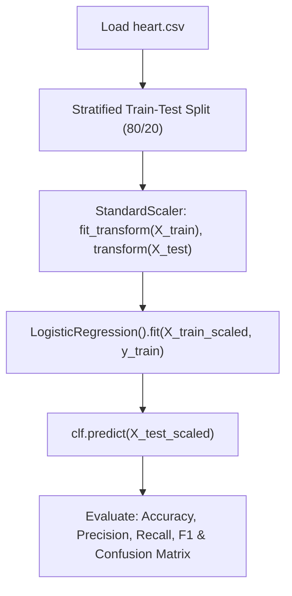

# Lecture 24.15: Logistic Regression Implementation & Evaluation

## 📌 Topic Overview
In this concluding lecture for Day 24, Shraddha ma'am builds an end-to-end **Heart Disease Diagnostic Classifier** in Python using Scikit-Learn on `heart.csv`, demonstrating proper scaling, fitting, and evaluation via the Confusion Matrix.

---

## 🛠️ Complete Pipeline Architecture



---

## 🔍 Why Feature Scaling is Essential for Logistic Regression
Because Logistic Regression computes the linear score $z = \mathbf{w}^T \mathbf{x} + b$ within the exponential function $e^{-z}$, features with large numeric scales (e.g., Cholesterol $300$) will dominate smaller features (e.g., Age $45$) during gradient descent updates. Standardizing features with `StandardScaler` ensures smooth, balanced convergence.

---

## 💻 Python Implementation

```python
import pandas as pd
import numpy as np
from sklearn.model_selection import train_test_split
from sklearn.preprocessing import StandardScaler
from sklearn.linear_model import LogisticRegression
from sklearn.metrics import accuracy_score, precision_score, recall_score, f1_score, confusion_matrix

def train_heart_disease_classifier(data_path=None):
    """
    Trains and evaluates a Logistic Regression classifier on Heart Disease dataset
    as demonstrated by Shraddha ma'am in video lecture 24.15.
    
    Includes StandardScaler preprocessing, train-test split, and classification metrics.
    """
    if data_path and os.path.exists(data_path):
        df = pd.read_csv(data_path)
    else:
        # Fallback synthetic heart dataset
        np.random.seed(42)
        n = 250
        df = pd.DataFrame({
            'age': np.random.randint(30, 75, size=n),
            'chol': np.random.uniform(150, 350, size=n),
            'trestbps': np.random.uniform(100, 180, size=n),
            'thalach': np.random.uniform(80, 200, size=n),
            'target': np.zeros(n, dtype=int)
        })
        # Probability depends on age and cholesterol
        z = 0.05 * df['age'] + 0.02 * df['chol'] - 0.03 * df['thalach'] - 1.5
        prob = 1.0 / (1.0 + np.exp(-z))
        df['target'] = (prob > 0.5).astype(int)

    X = df.drop(columns=['target'])
    y = df['target']

    # 1. Train-test split (80/20)
    X_train, X_test, y_train, y_test = train_test_split(
        X, y, test_size=0.20, random_state=42, stratify=y
    )

    # 2. Scale features
    scaler = StandardScaler()
    X_train_scaled = scaler.fit_transform(X_train)
    X_test_scaled = scaler.transform(X_test)

    # 3. Fit Logistic Regression
    clf = LogisticRegression(random_state=42)
    clf.fit(X_train_scaled, y_train)

    # 4. Predict & Evaluate
    y_pred = clf.predict(X_test_scaled)

    metrics = {
        'accuracy': float(accuracy_score(y_test, y_pred)),
        'precision': float(precision_score(y_test, y_pred, zero_division=0)),
        'recall': float(recall_score(y_test, y_pred, zero_division=0)),
        'f1_score': float(f1_score(y_test, y_pred, zero_division=0)),
        'confusion_matrix': confusion_matrix(y_test, y_pred).tolist()
    }
    return metrics

# --- Function Call & Testing ---
eval_res = train_heart_disease_classifier()
print(f"Heart Disease Classifier Results:")
print(f"  Accuracy : {eval_res['accuracy']*100:.2f}%")
print(f"  Precision: {eval_res['precision']*100:.2f}%")
print(f"  Recall   : {eval_res['recall']*100:.2f}%")
print(f"  F1-Score : {eval_res['f1_score']:.4f}")
print("Confusion Matrix:")
print(" ", eval_res['confusion_matrix'])
```

---

## 🔑 Key Takeaways
1. Always apply `StandardScaler` to features before training Logistic Regression.
2. Never rely solely on accuracy for medical datasets; evaluate Precision, Recall, and the Confusion Matrix.
