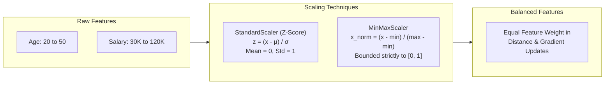

# Lecture 25.01: Standardization & Normalization

## 📌 Topic Overview
In this lecture, Shraddha ma'am introduces **Feature Scaling**, explaining why distance-based and gradient-based algorithms fail without scaling, and the core differences between **Z-score Standardization** and **Min-Max Normalization**.

---

## 💡 Real-World Intuition: Age vs Salary
Consider two applicants with features:
- **Age**: Ranges from 20 to 50 years.
- **Salary**: Ranges from ₹30,000 to ₹1,20,000.

When an algorithm calculates Euclidean distance:

$$
d = \sqrt{(Age_1 - Age_2)^2 + (Salary_1 - Salary_2)^2}
$$

A salary difference of ₹20,000 produces $(20000)^2 = 400,000,000$, while an age difference of 10 years produces only $(10)^2 = 100$. The algorithm completely ignores Age! Scaling puts all features on equal footing.

---

## 📊 Visual Diagram: Feature Scaling Architecture



---

## 📐 Mathematical Formulas

### 1. Standardization (Z-score Scaling)

$$
z = \frac{x - \mu}{\sigma}
$$

- $\mu$: Feature mean
- $\sigma$: Feature standard deviation
- Results in **Mean = 0** and **Standard Deviation = 1**. Robust to outliers.

### 2. Normalization (Min-Max Scaling)

$$
x_{\text{norm}} = \frac{x - x_{\min}}{x_{\max} - x_{\min}}
$$

- Squashes values into **$[0, 1]$**. Highly sensitive to extreme outliers.

---

## ⚖️ Comparison Table

| Property | Standardization (`StandardScaler`) | Normalization (`MinMaxScaler`) |
| :--- | :--- | :--- |
| **Output Range** | Unbounded (typically $[-3, +3]$) | Strictly bounded to $[0, 1]$ |
| **Mean & Std** | Mean = 0, Std = 1 | Arbitrary |
| **Outlier Robustness** | High | Low (squashes other data points) |
| **Best Used When** | Distance algorithms (kNN, SVM, Logistic) | Neural Networks, Image Pixels ($0-255$) |

---

## 💻 Python Implementation

```python
import numpy as np
from sklearn.preprocessing import StandardScaler, MinMaxScaler

def demonstrate_feature_scaling():
    """
    Compares Raw Data vs Z-Score Standardization vs Min-Max Normalization.
    Demonstrates how feature scaling prevents high-magnitude features
    (e.g., Salary) from dominating low-magnitude features (e.g., Age).
    """
    # Features: [Age (20-50), Salary (30,000 - 1,20,000)]
    data = np.array([
        [25, 50000],
        [35, 90000],
        [45, 120000],
        [20, 30000]
    ])

    # 1. Standardization (Mean = 0, Std = 1)
    std_scaler = StandardScaler()
    standardized_data = std_scaler.fit_transform(data)

    # 2. Min-Max Normalization (Squash to [0, 1])
    minmax_scaler = MinMaxScaler()
    normalized_data = minmax_scaler.fit_transform(data)

    return data, standardized_data, normalized_data

# --- Function Call & Testing ---
raw, std, norm = demonstrate_feature_scaling()
print("Original Data (Age, Salary):\n", raw)
print()
print("Standardized (Z-Score):\n", std.round(2))
print()
print("Normalized (Min-Max [0, 1]):\n", norm.round(2))
```

---

## 🔑 Key Takeaways
1. Always scale features for distance-based and gradient-descent based algorithms.
2. Tree-based models (Decision Trees, Random Forests) do not require scaling.
3. Default to `StandardScaler` for tabular datasets; reserve `MinMaxScaler` for bounded domains like image pixel values.
