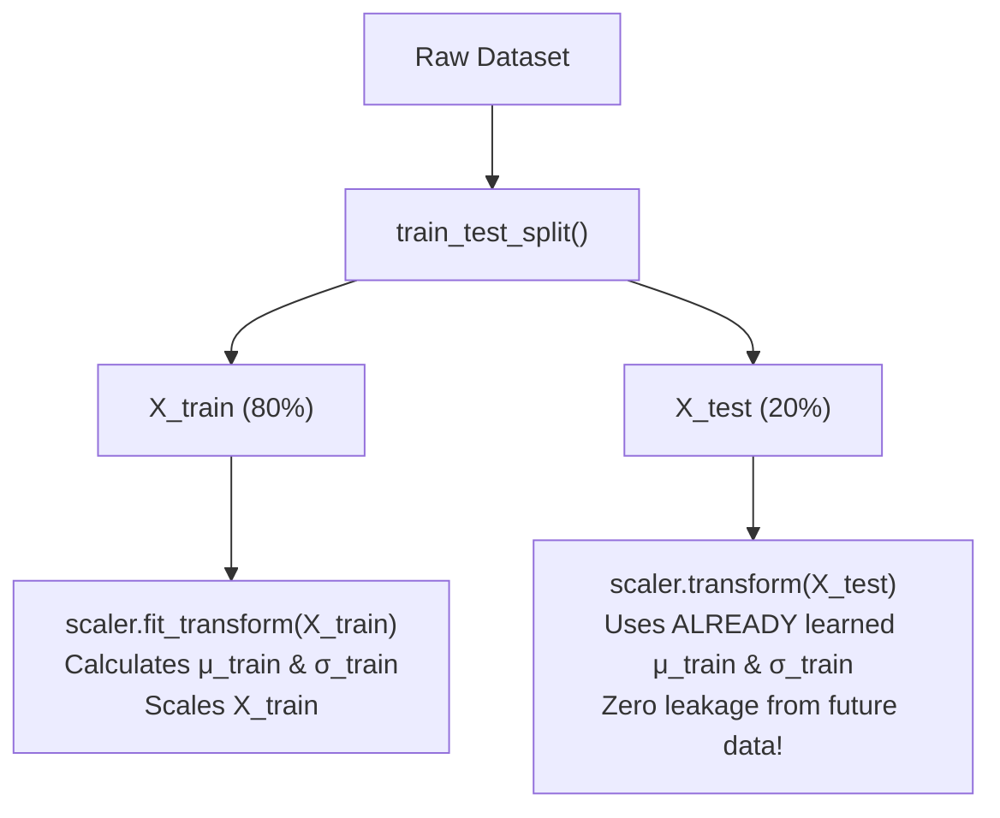

# Lecture 25.02: Using StandardScaler in Scikit-Learn

## 📌 Topic Overview
In this lecture, Shraddha ma'am demonstrates how to implement **StandardScaler** in Scikit-Learn, highlighting the critical rule of machine learning hygiene: **preventing data leakage** between training and testing splits.

---

## ⚠️ Data Leakage: fit_transform vs transform
A frequent mistake made by beginners is fitting the scaler on the entire dataset before splitting, or calling `fit_transform()` on the test dataset.



---

## 🔑 Crucial Rules
1. `fit()` computes the sample mean $\mu$ and standard deviation $\sigma$.
2. `transform()` subtracts $\mu$ and divides by $\sigma$.
3. `fit_transform()` does both in one step — **only use this on `X_train`**.
4. On `X_test`, **only call `transform()`**. The model must never peek at the distribution of the test data.

---

## 💻 Python Implementation

```python
import numpy as np
from sklearn.model_selection import train_test_split
from sklearn.preprocessing import StandardScaler

def scale_features_without_leakage(X, y):
    """
    Applies StandardScaler properly to avoid data leakage:
    - fit_transform() is called ONLY on X_train (learns mean and std).
    - transform() is called on X_test (uses training mean and std).
    """
    # 1. Split data first
    X_train, X_test, y_train, y_test = train_test_split(
        X, y, test_size=0.2, random_state=42
    )

    # 2. Fit and transform training set
    scaler = StandardScaler()
    X_train_scaled = scaler.fit_transform(X_train)

    # 3. Transform test set (NEVER call fit on test data!)
    X_test_scaled = scaler.transform(X_test)

    return X_train_scaled, X_test_scaled, scaler

# --- Function Call & Testing ---
np.random.seed(42)
X_dummy = np.random.randn(100, 3) * 50 + 100
y_dummy = np.random.randint(0, 2, 100)

X_tr_s, X_te_s, trained_scaler = scale_features_without_leakage(X_dummy, y_dummy)
print("Training Scaled Mean:", X_tr_s.mean(axis=0).round(2))
print("Training Scaled Std: ", X_tr_s.std(axis=0).round(2))
print("Learned Feature Means:", trained_scaler.mean_.round(2))
```

---

## 🔑 Key Takeaways
1. Always split your data **before** applying any feature scaling.
2. Apply `scaler.fit_transform()` exclusively to the training set.
3. Apply `scaler.transform()` to the test set and production inference data.
