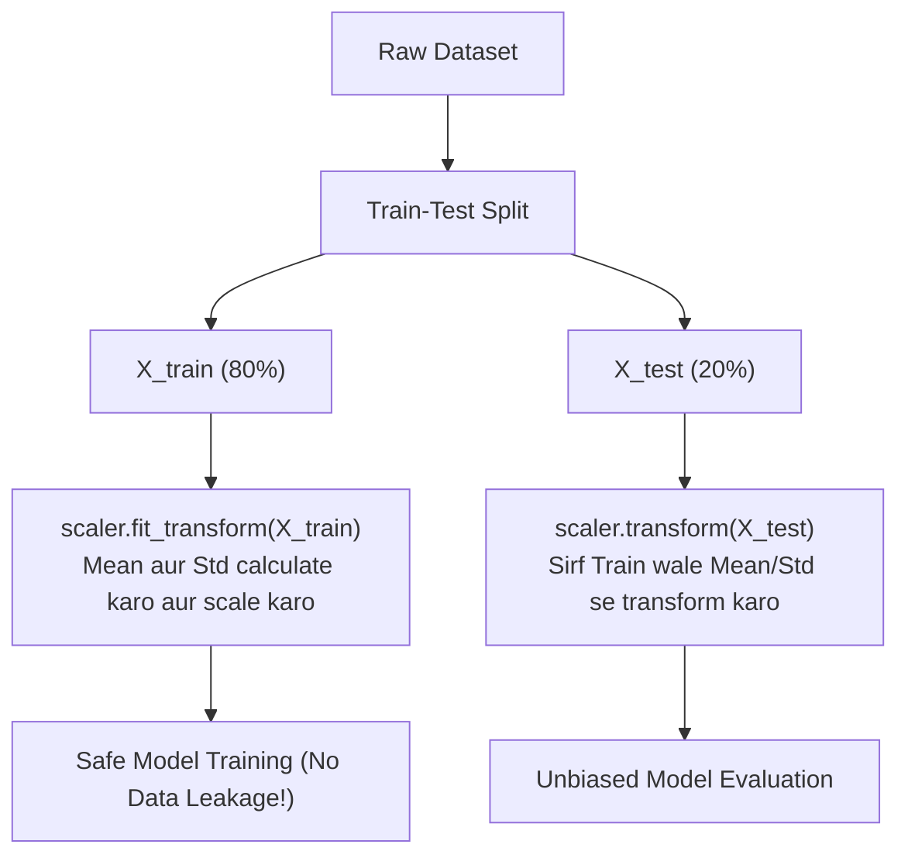

# Notes_25.02: Scikit-Learn Mein StandardScaler Ka Use [Hinglish]

## 📌 Topic Overview
Is lecture mein Shraddha ma'am ne Scikit-Learn ke **StandardScaler** ka practical use dikhaya hai, aur sabse zaroori rule samjhaya hai: **Data Leakage se kaise bachein**.

---

### 📋 Is Topic Mein Hum Kya Seekhenge?
- `StandardScaler` class ko Scikit-Learn se kaise import aur use karte hain.
- `fit()`, `transform()`, aur `fit_transform()` mein kya antar hota hai?
- **Data Leakage** kya hota hai aur test set par kabhi `fit()` kyu nahi lagana chahiye.
- Real-world clean code implementation bina kisi data leakage ke.

---

### 🔍 Har Ek Point Ka Simple & Detailed Explanation

#### 1. fit(), transform() aur fit_transform() Ka Matlab
- **`fit()`**: Yeh data ko scan karke features ka mean ($\mu$) aur standard deviation ($\sigma$) calculate karke yaad kar leta hai.
- **`transform()`**: Yeh pehle se yaad kiye gaye mean aur std ko use karke data ko scale ($z = \frac{x - \mu}{\sigma}$) karta hai.
- **`fit_transform()`**: Yeh dono kaam ek hi line mein kar deta hai (pehle calculate karta hai, fir scale karta hai).

#### 2. Golden Rule: Data Leakage Se Bachna
Hamesha data ko pehle `train_test_split` se baatein:
- `X_train` par lagao: **`scaler.fit_transform(X_train)`**
- `X_test` par lagao: **`scaler.transform(X_test)`** (Kabhi bhi `fit_transform` mat lagana!)

Agar aap test set par bhi `fit` laga doge ya split karne se pehle poore data par fit laga doge, toh test data ki information training mein leak ho jayegi (jise **Data Leakage** kehte hain).

---

### 📊 Visual Flowchart: Scaling Ka Sahi Tareeqa



---

### 💻 Python Code

```python
import numpy as np
from sklearn.model_selection import train_test_split
from sklearn.preprocessing import StandardScaler

def scale_features_without_leakage(X, y):
    """
    Applies StandardScaler properly to avoid data leakage:
    - fit_transform() is called ONLY on X_train (learns mean and std).
    - transform() is called on X_test (uses training mean and std).
    """
    # 1. Split data first
    X_train, X_test, y_train, y_test = train_test_split(
        X, y, test_size=0.2, random_state=42
    )

    # 2. Fit and transform training set
    scaler = StandardScaler()
    X_train_scaled = scaler.fit_transform(X_train)

    # 3. Transform test set (NEVER call fit on test data!)
    X_test_scaled = scaler.transform(X_test)

    return X_train_scaled, X_test_scaled, scaler

# --- Function Call & Testing ---
np.random.seed(42)
X_dummy = np.random.randn(100, 3) * 50 + 100
y_dummy = np.random.randint(0, 2, 100)

X_tr_s, X_te_s, trained_scaler = scale_features_without_leakage(X_dummy, y_dummy)
print("Training Scaled Mean:", X_tr_s.mean(axis=0).round(2))
print("Training Scaled Std: ", X_tr_s.std(axis=0).round(2))
print("Learned Feature Means:", trained_scaler.mean_.round(2))
```

---

### 📌 Summary Points
- Scaling hamesha train-test split ke **baad** ki jaati hai.
- `X_train` par `fit_transform()`, jabki `X_test` par sirf `transform()`.
- Isse model production mein bhi wahi scale use karega jo training ke dauran sikha tha.
