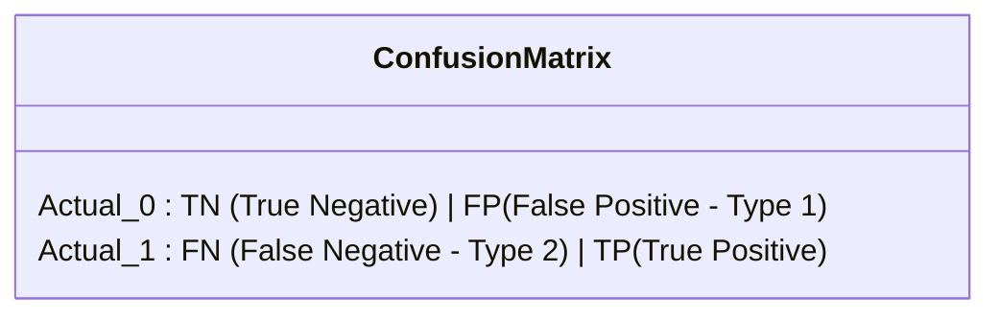

# Lecture 25.03: Understanding Confusion Matrix

## 📌 Topic Overview
In this lecture, Shraddha ma'am introduces the **Confusion Matrix** for binary classification, detailing how predictions are categorized against ground-truth labels into True Positives, True Negatives, False Positives, and False Negatives.

---

## 🏛️ The 2x2 Confusion Matrix Layout
On the classroom blackboard, ma'am drew the exact 2x2 grid representing binary classification:



| | **Predicted 0 (Negative)** | **Predicted 1 (Positive)** |
| :--- | :--- | :--- |
| **Actual 0 (Negative)** | **TN** (True Negative) - Correct | **FP** (False Positive - Type I Error) |
| **Actual 1 (Positive)** | **FN** (False Negative - Type II Error) | **TP** (True Positive) - Correct |

---

## 🔍 The Four Quadrants Explained

### 1. True Negative (TN)
- Actual value was **0 (Negative)**, and model correctly predicted **0 (Negative)**.
- *Example*: Healthy patient correctly diagnosed as healthy.

### 2. False Positive (FP) — Type I Error
- Actual value was **0 (Negative)**, but model wrongly predicted **1 (Positive)**.
- *Example*: Important legitimate email mistakenly sent to Spam folder.

### 3. False Negative (FN) — Type II Error
- Actual value was **1 (Positive)**, but model wrongly predicted **0 (Negative)**.
- *Example*: Sick cancer patient wrongly told they are healthy. (Extremely dangerous!)

### 4. True Positive (TP)
- Actual value was **1 (Positive)**, and model correctly predicted **1 (Positive)**.
- *Example*: Fraudulent transaction successfully caught and blocked.

---

## 💻 Python Implementation

```python
import numpy as np
from sklearn.metrics import confusion_matrix

def compute_binary_confusion_matrix(y_true, y_pred):
    """
    Computes and formats a 2x2 binary confusion matrix:
    Returns TN, FP, FN, TP values explicitly.
    """
    cm = confusion_matrix(y_true, y_pred)
    # Scikit-Learn convention:
    # cm[0, 0] = TN, cm[0, 1] = FP
    # cm[1, 0] = FN, cm[1, 1] = TP
    tn, fp, fn, tp = cm.ravel()

    summary = {
        'matrix': cm,
        'TN': int(tn),
        'FP': int(fp),
        'FN': int(fn),
        'TP': int(tp)
    }
    return summary

# --- Function Call & Testing ---
# 0 = Non-Spam / Healthy, 1 = Spam / Diseased
actuals    = [0, 0, 0, 0, 1, 1, 1, 1]
predicted  = [0, 0, 1, 0, 0, 1, 1, 1]

results = compute_binary_confusion_matrix(actuals, predicted)
print("Confusion Matrix:\n", results['matrix'])
print(f"TN: {results['TN']} (Actual 0, Predicted 0)")
print(f"FP: {results['FP']} (Actual 0, Predicted 1) -> Type I Error")
print(f"FN: {results['FN']} (Actual 1, Predicted 0) -> Type II Error")
print(f"TP: {results['TP']} (Actual 1, Predicted 1)")
```

---

## 🔑 Key Takeaways
1. The diagonal entries (TN and TP) represent correct predictions.
2. The off-diagonal entries (FP and FN) represent prediction errors.
3. Type I Error (FP) vs Type II Error (FN) have very different real-world consequences depending on the problem domain.
