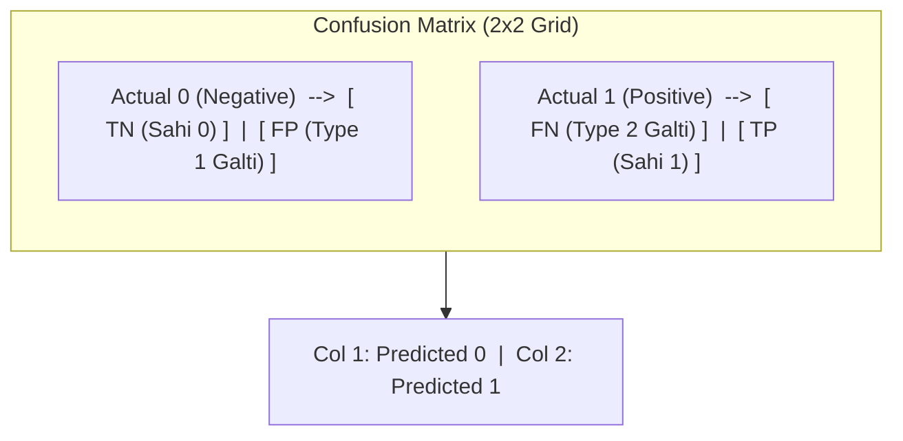

# Notes_25.03: Confusion Matrix Ki Poori Samajh [Hinglish]

## 📌 Topic Overview
Is lecture mein Shraddha ma'am ne classification models ko evaluate karne ke liye **Confusion Matrix** ka 2x2 grid samjhaya hai: True Positive, True Negative, False Positive aur False Negative ka detailed concept.

---

### 📋 Is Topic Mein Hum Kya Seekhenge?
- Confusion Matrix asal mein kya hota hai aur iski zaroorat kyu hai?
- 2x2 binary classification matrix ka layout (Actual vs Predicted).
- **TP, TN, FP, FN** ka simple aur practical matlab.
- **Type I Error** (False Positive) vs **Type II Error** (False Negative) ka farq.
- Real-life examples (Spam detection vs Cancer detection).

---

### 🔍 Har Ek Point Ka Simple & Detailed Explanation

#### 1. Confusion Matrix Kya Hai?
Yeh ek aisi summary table hai jo batati hai ki hamare model ne kitne predictions sahi kiye aur kitne galat kiye. 

#### 2. Chaar Mukhya Dabbey (Quadrants):
Video mein ma'am ne board par 2x2 table banakar samjhaya:

1. **True Negative (TN)**:
   - Asal mein bhi 0 tha, aur model ne bhi **0** bola (Sahi decision!).
   - *Example*: Swasth insaan ko doctor ne kaha "Aapko bimari nahi hai."
2. **False Positive (FP) — Type 1 Error**:
   - Asal mein 0 tha, lekin model ne galati se **1** predict kar diya.
   - *Example*: Important email ko model ne galti se **Spam** mein daal diya.
3. **False Negative (FN) — Type 2 Error**:
   - Asal mein 1 tha (bimari thi), lekin model ne **0** predict karke miss kar diya!
   - *Example*: Cancer wale mareez ko model ne "Normal" bol kar ghar bhej diya (Yeh bohot jaanleva error hai!).
4. **True Positive (TP)**:
   - Asal mein bhi 1 tha, aur model ne bhi **1** bola (Sahi pakda!).
   - *Example*: Spam email ko sahi identify karke block kiya.

---

### 📊 Visual Diagram: Confusion Matrix Layout



---

### 💻 Python Code

```python
import numpy as np
from sklearn.metrics import confusion_matrix

def compute_binary_confusion_matrix(y_true, y_pred):
    """
    Computes and formats a 2x2 binary confusion matrix:
    Returns TN, FP, FN, TP values explicitly.
    """
    cm = confusion_matrix(y_true, y_pred)
    # Scikit-Learn convention:
    # cm[0, 0] = TN, cm[0, 1] = FP
    # cm[1, 0] = FN, cm[1, 1] = TP
    tn, fp, fn, tp = cm.ravel()

    summary = {
        'matrix': cm,
        'TN': int(tn),
        'FP': int(fp),
        'FN': int(fn),
        'TP': int(tp)
    }
    return summary

# --- Function Call & Testing ---
# 0 = Non-Spam / Healthy, 1 = Spam / Diseased
actuals    = [0, 0, 0, 0, 1, 1, 1, 1]
predicted  = [0, 0, 1, 0, 0, 1, 1, 1]

results = compute_binary_confusion_matrix(actuals, predicted)
print("Confusion Matrix:\n", results['matrix'])
print(f"TN: {results['TN']} (Actual 0, Predicted 0)")
print(f"FP: {results['FP']} (Actual 0, Predicted 1) -> Type I Error")
print(f"FN: {results['FN']} (Actual 1, Predicted 0) -> Type II Error")
print(f"TP: {results['TP']} (Actual 1, Predicted 1)")
```

---

### 📌 Summary Points
- Confusion Matrix accuracy ke peeche ki sachai dikhata hai.
- Diagonal elements (TN + TP) sahi predictions hote hain.
- Off-diagonal elements (FP + FN) model ki galtiyan hoti hain.
