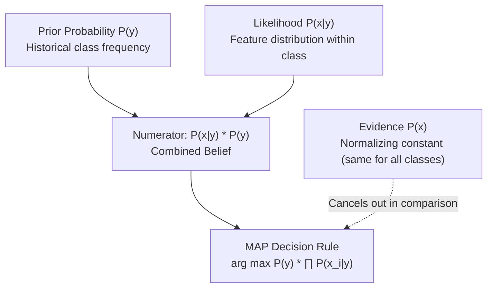

# Lecture 25.05: Naive Bayes (Intuition & Bayes' Theorem)

## 📌 Topic Overview
In this lecture, Shraddha ma'am introduces the probabilistic foundations of machine learning through **Bayes' Theorem** and explains the core assumption behind **Naive Bayes classification**.

---

## 🏛️ Bayes' Theorem Formulation

$$
P(y \mid \mathbf{x}) = \frac{P(\mathbf{x} \mid y) \cdot P(y)}{P(\mathbf{x})}
$$

Where:
- **$P(y \mid \mathbf{x})$ [Posterior Probability]**: Probability of class $y$ given features $\mathbf{x}$.
- **$P(\mathbf{x} \mid y)$ [Likelihood]**: Probability that features $\mathbf{x}$ appear given class $y$.
- **$P(y)$ [Prior Probability]**: Initial base rate probability of class $y$ before seeing features.
- **$P(\mathbf{x})$ [Evidence / Marginal Probability]**: Total probability of observing features $\mathbf{x}$.

---

## 💡 Why Is It Called "Naive"?
The algorithm makes a simple, powerful assumption:
> **All features are conditionally independent of each other given the class label.**

Mathematically:

$$
P(x_1, x_2, \dots, x_d \mid y) = P(x_1 \mid y) \cdot P(x_2 \mid y) \cdots P(x_d \mid y) = \prod_{j=1}^d P(x_j \mid y)
$$

In real life, words and features are rarely 100% independent. Yet, this simplification dramatically reduces computational complexity and works well in practice!

---

## 📊 Visual Diagram: Bayes' Theorem Architecture



---

## 💻 Python Implementation

```python
def calculate_bayes_posterior(prior_y, likelihood_x_given_y, marginal_x):
    """
    Computes Posterior Probability using Bayes' Theorem:
        P(Y|X) = [P(X|Y) * P(Y)] / P(X)
    
    Args:
        prior_y: Prior belief P(Y)
        likelihood_x_given_y: Likelihood P(X|Y)
        marginal_x: Total evidence P(X)
    
    Returns:
        float: Posterior probability P(Y|X)
    """
    posterior = (likelihood_x_given_y * prior_y) / marginal_x
    return posterior

# --- Function Call & Testing ---
# Example: Probability an email is Spam given it contains 'Free'
# P(Spam) = 0.3, P(Free|Spam) = 0.8, P(Free) = 0.35
p_spam = 0.3
p_free_given_spam = 0.8
p_free = 0.35

posterior_spam = calculate_bayes_posterior(p_spam, p_free_given_spam, p_free)
print(f"Prior Probability P(Spam): {p_spam*100:.1f}%")
print(f"Likelihood P('Free'|Spam): {p_free_given_spam*100:.1f}%")
print(f"Updated Posterior P(Spam|'Free'): {posterior_spam*100:.2f}%")
```

---

## 🔑 Key Takeaways
1. Bayes' Theorem updates our prior beliefs with new incoming evidence.
2. The "Naive" conditional independence assumption turns exponential probability estimation into linear product multiplication.
3. Because the denominator $P(\mathbf{x})$ is identical across all candidate classes, we only need to maximize the numerator: $P(y) \prod P(x_j \mid y)$.
