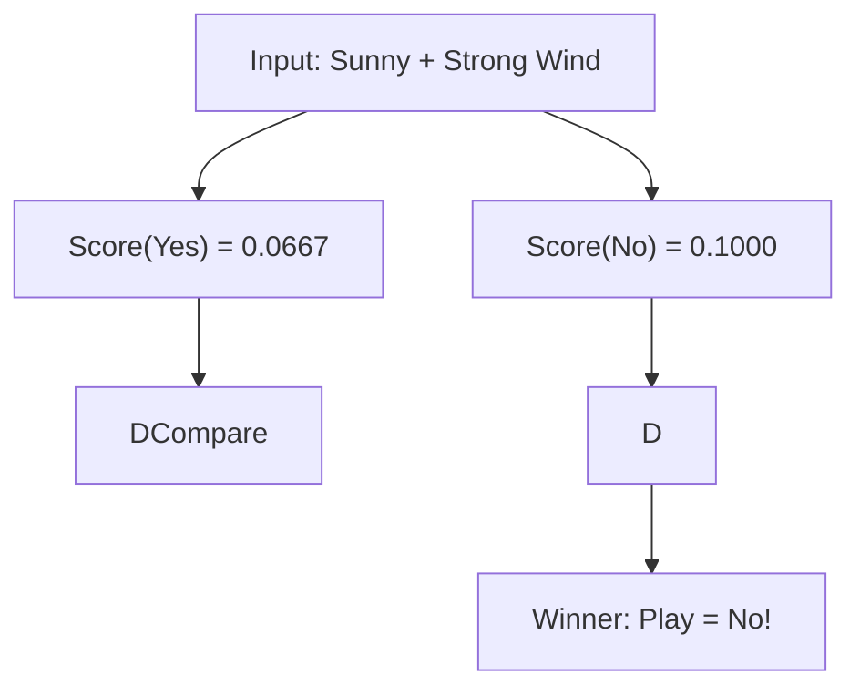

# Notes_25.06: Naive Bayes Step-by-Step Blackboard Example [Hinglish]

## 📌 Topic Overview
Is lecture mein Shraddha ma'am ne blackboard par **Weather aur Wind** ke 5 dino ke dataset par haath se step-by-step Naive Bayes calculate karke samjhaya hai.

---

### 📋 Is Topic Mein Hum Kya Seekhenge?
- Blackboard ke 5-row dataset se frequency tables banana.
- Class Prior $P(\text{Yes})$ aur $P(\text{No})$ calculate karna.
- Likelihoods ($P(\text{Sunny}|\text{Yes})$, $P(\text{Strong}|\text{No})$) nikalna.
- Naye test din ($Weather=Sunny, Wind=Strong$) par final prediction nikalna.

---

### 🔍 Har Ek Point Ka Simple & Detailed Explanation

#### 1. Blackboard Dataset:
- Total Din: 5
- Match Khela (Yes): 3 din
- Match Nahi Khela (No): 2 din

#### 2. Prior Probabilities:

$$
P(\text{Yes}) = \frac{3}{5} = 0.60, \quad P(\text{No}) = \frac{2}{5} = 0.40
$$

#### 3. Likelihoods (Condition ke hisab se chances):
- 3 baar Match Khela gaya tha, usme se Sunny sirf 1 baar tha: $P(\text{Sunny}|\text{Yes}) = \frac{1}{3}$
- 3 baar Match Khela gaya tha, usme Strong hawa 1 baar thi: $P(\text{Strong}|\text{Yes}) = \frac{1}{3}$
- 2 baar Match Nahi Khela gaya, usme Sunny 1 baar tha: $P(\text{Sunny}|\text{No}) = \frac{1}{2}$
- 2 baar Match Nahi Khela gaya, usme Strong hawa 1 baar thi: $P(\text{Strong}|\text{No}) = \frac{1}{2}$

#### 4. Scores Ka Comparison:

$$
\text{Score}(\text{Yes}) = \frac{3}{5} \times \frac{1}{3} \times \frac{1}{3} = 0.0667
$$

$$
\text{Score}(\text{No}) = \frac{2}{5} \times \frac{1}{2} \times \frac{1}{2} = 0.1000
$$

Kyunki **$0.1000 > 0.0667$**, isliye model ne predict kiya: **Play = No**!

---

### 📊 Visual Flowchart: Decision Tree



---

### 💻 Python Code

```python
def naive_bayes_weather_predict(weather_val, wind_val):
    """
    Demonstrates manual Naive Bayes step-by-step probability calculation
    using Shraddha ma'am's Weather/Wind -> Play Tennis blackboard dataset.
    
    Dataset Breakdown:
    - Total Days = 5
    - Play = Yes (3 days), Play = No (2 days)
    
    Calculates P(Yes|X) vs P(No|X) and returns predicted class with scores.
    """
    # 1. Class Priors
    p_yes = 3 / 5
    p_no  = 2 / 5

    # 2. Likelihood tables from blackboard
    # Weather given Class:
    likelihood_weather = {
        'Yes': {'Sunny': 1/3, 'Overcast': 1/3, 'Rainy': 1/3},
        'No':  {'Sunny': 1/2, 'Overcast': 0/2, 'Rainy': 1/2}
    }

    # Wind given Class:
    likelihood_wind = {
        'Yes': {'Strong': 1/3, 'Weak': 2/3},
        'No':  {'Strong': 1/2, 'Weak': 1/2}
    }

    # 3. Calculate Numerator (Posterior Score)
    score_yes = p_yes * likelihood_weather['Yes'][weather_val] * likelihood_wind['Yes'][wind_val]
    score_no  = p_no  * likelihood_weather['No'][weather_val]  * likelihood_wind['No'][wind_val]

    # 4. ArgMax Decision
    prediction = "Play = Yes" if score_yes > score_no else "Play = No"

    return {
        'Score_Yes': score_yes,
        'Score_No': score_no,
        'Prediction': prediction
    }

# --- Function Call & Testing ---
result = naive_bayes_weather_predict(weather_val='Sunny', wind_val='Strong')
print("Weather = Sunny, Wind = Strong:")
print(f"  Posterior Score (Yes): {result['Score_Yes']:.4f}")
print(f"  Posterior Score (No) : {result['Score_No']:.4f}")
print(f"  Final Decision       : {result['Prediction']}")
```

---

### 📌 Summary Points
- Probability score jiska sabse zyada hoga, model wahi class predict karega.
- Blackboard calculations se Naive Bayes ka internal math bilkul clear ho jata hai.
