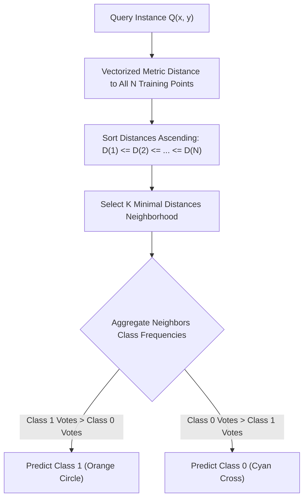
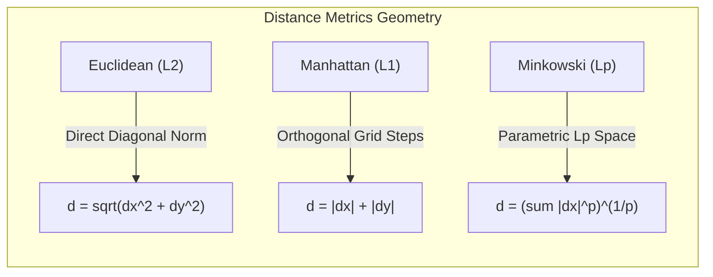

# 🧠 Lecture 25.09: kNN — K-Nearest Neighbours (Intuition)

[](#)
[](lecture_25_09.ipynb)
[](README_HINGLISH.md)
[](notes.pdf)
[](notes_hinglish.pdf)

---

## 📌 Topic Overview
In this foundational lecture, Shraddha ma'am introduces the **k-Nearest Neighbors (kNN)** algorithm — a non-parametric, instance-based lazy learning method used widely for both classification and regression tasks. Unlike parametric models that optimize an explicit cost function to determine fixed model weights during training, kNN defers all computation to inference time, classifying novel query instances based purely on geometric proximity and local majority voting.

This comprehensive guide dissects the mathematical mechanics of vector distance metrics (Euclidean, Manhattan, Minkowski), analyzes the computational trade-offs of eager vs. lazy learners, formalizes the bias-variance tradeoff governing the hyperparameter $K$, walks through a manual coordinate-space numerical example, and provides a production-grade first-principles Python implementation.

---

### 📋 Key Learning Objectives
- **Instance-Based Lazy Learning Paradigm**: Why kNN requires $\mathcal{O}(1)$ training time but incurs high $\mathcal{O}(N \cdot d)$ inference latency.
- **Three-Step Prediction Pipeline**: Vectorized distance computation, sorting/top-$K$ filtering, and plurality majority voting.
- **Metric Space Formulations**:
  - Euclidean Distance ($L_2$ norm)
  - Manhattan Distance ($L_1$ norm / Taxicab metric)
  - Minkowski Metric ($L_p$ norm generalization)
- **Selection of Hyperparameter $K$**:
  - Why odd integers ($K \in \{1, 3, 5, 7, \dots\}$) are mandatory for binary classification to prevent voting deadlocks.
  - Structural impact on the decision boundary: Overfitting (high variance) at low $K$ vs. Underfitting (high bias) at high $K$.
- **Coordinate Space Blackboard Demonstration**: Step-by-step manual distance ranking for query point $Q(5, 5)$ across Cyan Crosses ($y=0$) and Orange Circles ($y=1$).
- **Pure NumPy Implementation from Scratch**: Complete algorithmic formulation without high-level library dependencies.

---

### 🔍 Detailed Algorithmic Mechanics

#### 1. Foundational Principle: Geometric Proximity
The core inductive assumption of kNN is that **points that are close to each other in metric space share the same semantic class label**.
- If a query point $\mathbf{x}_{\text{query}}$ is situated in a region surrounded predominantly by positive class instances, the likelihood of it belonging to the positive class approaches 1.
- No global decision boundary is explicitly parameterized; instead, local decision boundaries are dynamically evaluated as Voronoi-like partitions in feature space.

---

#### 2. Eager Learners vs. Lazy Learners

| Dimension | Eager Learners (e.g. Logistic Regression, Decision Trees, SVM) | Lazy Learners (e.g. k-Nearest Neighbors) |
| :--- | :--- | :--- |
| **Model Nature** | Parametric / Structural (Fits weights $\mathbf{w}$ or tree splits). | Non-parametric / Instance-based (Stores entire training dataset). |
| **Training Time Complexity** | Heavy: $\mathcal{O}(\text{epochs} \cdot N \cdot d)$. | Trivial: $\mathcal{O}(1)$ or memory write $\mathcal{O}(N \cdot d)$. |
| **Inference Time Complexity** | Ultra-Fast: $\mathcal{O}(d)$ inner product evaluation. | Computationally Intensive: $\mathcal{O}(N \cdot d)$ distance evaluations. |
| **Memory Footprint** | Compact: Only stores model weights/parameters. | Large: Must retain entire training feature matrix $\mathbf{X}_{N \times d}$. |
| **Adaptability** | Requires full retraining or warm-start updates for new data. | Trivially incorporates new streaming data points into storage. |

---

#### 3. Formal Prediction Workflow
When evaluating a novel query instance $\mathbf{x}_{\text{new}} \in \mathbb{R}^d$:

1. **Distance Metric Evaluation**:
   Compute the distance metric $D(\mathbf{x}_{\text{new}}, \mathbf{x}_i)$ for all $i \in \{1, 2, \dots, N\}$ in the training set.

2. **Top-$K$ Nearest Neighborhood Identification**:
   Sort the distances in ascending order:

$$
D_{(1)} \le D_{(2)} \le \dots \le D_{(K)} \le \dots \le D_{(N)}
$$

   Select the set of indices $\mathcal{N}_K(\mathbf{x}_{\text{new}}) = \{ (1), (2), \dots, (K) \}$.

3. **Plurality Majority Voting**:
   The predicted class $\hat{y}$ is the mode of labels within the neighborhood:

$$
\hat{y} = \arg\max_{c \in \mathcal{C}} \sum_{i \in \mathcal{N}_K(\mathbf{x}_{\text{new}})} \mathbb{I}(y_i = c)
$$

   where $\mathbb{I}(\cdot)$ denotes the indicator function and $\mathcal{C}$ is the set of distinct class labels.

---

#### 4. Distance Metrics Mathematical Formulations

##### (A) Euclidean Distance ($L_2$ Norm)
Represents the shortest straight-line geometric distance between two vectors in Euclidean space:

$$
d_{\text{Euclidean}}(\mathbf{p}, \mathbf{q}) = \|\mathbf{p} - \mathbf{q}\|_2 = \sqrt{\sum_{j=1}^d (p_j - q_j)^2}
$$

##### (B) Manhattan Distance ($L_1$ Norm / Taxicab Metric)
Evaluates distance strictly along axis-aligned grid paths:

$$
d_{\text{Manhattan}}(\mathbf{p}, \mathbf{q}) = \|\mathbf{p} - \mathbf{q}\|_1 = \sum_{j=1}^d |p_j - q_j|
$$

##### (C) Minkowski Distance ($L_p$ Metric)
The generalized vector norm encompassing both $L_1$ and $L_2$ as special parametric cases:

$$
d_{\text{Minkowski}}(\mathbf{p}, \mathbf{q}) = \left( \sum_{j=1}^d |p_j - q_j|^p \right)^{\frac{1}{p}}
$$

- For $p = 1 \implies$ Manhattan Distance.
- For $p = 2 \implies$ Euclidean Distance.
- For $p \to \infty \implies$ Chebyshev (Supremum) Distance: $\max_j |p_j - q_j|$.

---

#### 5. Hyperparameter Tuning: The Critical Role of $K$

##### Why Odd $K$ is Mandatory in Binary Classification
In a two-class problem ($y \in \{0, 1\}$):
- If an even value such as $K = 4$ is chosen, a scenario can readily arise where exactly 2 neighbors belong to Class 0 and 2 neighbors belong to Class 1.
- This creates an unresolvable 50-50 voting deadlock (tie), requiring arbitrary tie-breaking heuristics.
- Selecting odd values ($K \in \{1, 3, 5, 7, 9\}$) mathematically guarantees a strict plurality majority.

##### Bias-Variance Tradeoff across Neighborhood Size $K$:
- **Extremely Small $K$ ($K=1$)**:
  - The model assigns the label of the single nearest neighbor.
  - Decision boundaries become highly irregular, fragmented, and sensitive to localized label noise.
  - **High Variance / Overfitting** (Zero training error, poor test generalization).
- **Extremely Large $K$ ($K \to N$)**:
  - The neighborhood expands to include nearly the entire dataset.
  - The decision rule degenerates to constantly predicting the global majority class, completely ignoring localized patterns.
  - **High Bias / Underfitting** (Oversmoothed boundary).
- **Practical Rule of Thumb**:
  - Initial heuristic: $K = \lfloor \sqrt{N} \rfloor$. If even, increment by 1.
  - Final calibration: Optimize $K$ via stratified cross-validation (`GridSearchCV`).

---

#### 6. Step-by-Step Numerical Walkthrough

Consider a 2D synthetic dataset matching Shraddha ma'am's blackboard example:
- **Class 0 (Cyan Crosses)**: $A(1, 2)$, $B(2, 3)$, $C(3, 3)$
- **Class 1 (Orange Circles)**: $D(6, 5)$, $E(7, 7)$, $F(8, 6)$

We evaluate the classification of query point **$Q(5, 5)$**:

##### Distance Calculation Table:

| Point | Class | Coordinates $(x, y)$ | Distance Computation: $\sqrt{(x - 5)^2 + (y - 5)^2}$ | Metric Value | Neighborhood Rank |
| :---: | :---: | :---: | :--- | :---: | :---: |
| **D** | **1 (Orange)** | $(6, 5)$ | $\sqrt{(6-5)^2 + (5-5)^2} = \sqrt{1 + 0} = 1.0$ | **1.00** | **Rank 1 (Closest)** |
| **E** | **1 (Orange)** | $(7, 7)$ | $\sqrt{(7-5)^2 + (7-5)^2} = \sqrt{4 + 4} = \sqrt{8} \approx 2.83$ | **2.83** | **Rank 2** |
| **C** | **0 (Cyan)**   | $(3, 3)$ | $\sqrt{(3-5)^2 + (3-5)^2} = \sqrt{4 + 4} = \sqrt{8} \approx 2.83$ | **2.83** | **Rank 3** |
| **F** | **1 (Orange)** | $(8, 6)$ | $\sqrt{(8-5)^2 + (6-5)^2} = \sqrt{9 + 1} = \sqrt{10} \approx 3.16$| **3.16** | **Rank 4** |
| **B** | **0 (Cyan)**   | $(2, 3)$ | $\sqrt{(2-5)^2 + (3-5)^2} = \sqrt{9 + 4} = \sqrt{13} \approx 3.61$| **3.61** | **Rank 5** |
| **A** | **0 (Cyan)**   | $(1, 2)$ | $\sqrt{(1-5)^2 + (2-5)^2} = \sqrt{16 + 9} = \sqrt{25} = 5.0$ | **5.00** | **Rank 6** |

##### Classification Decision:
- **At $K = 3$**:
  - Neighborhood: $\{D, E, C\}$.
  - Votes: Class 1 = 2 votes ($D, E$), Class 0 = 1 vote ($C$).
  - Predicted Label: **Class 1 (Orange Circle)**.
- **At $K = 5$**:
  - Neighborhood: $\{D, E, C, F, B\}$.
  - Votes: Class 1 = 3 votes ($D, E, F$), Class 0 = 2 votes ($C, B$).
  - Predicted Label: **Class 1 (Orange Circle)**.

---

### 📊 Algorithmic Architecture Diagrams

#### Diagram 1: kNN Classification Workflow


#### Diagram 2: Distance Metric Geometries


---

### 💻 Python Implementation: First-Principles kNN

```python
import numpy as np

def predict_knn_from_scratch(query_point, X_train, y_train, k=3, metric="euclidean"):
    """
    Manual first-principles implementation of k-Nearest Neighbors classification.
    
    Parameters:
    -----------
    query_point : array-like of shape (d,)
        Coordinates of the query instance to classify.
    X_train : array-like of shape (N, d)
        Training feature matrix containing N samples across d dimensions.
    y_train : array-like of shape (N,)
        Class labels corresponding to training instances.
    k : int, default=3
        Number of nearest neighbors to aggregate in voting.
    metric : str, default='euclidean'
        Distance metric: 'euclidean' (L2) or 'manhattan' (L1).
        
    Returns:
    --------
    predicted_class : int
        Winning class label selected by majority plurality voting.
    top_k_indices : ndarray
        Indices of the k nearest training samples.
    top_k_distances : ndarray
        Distances from query point to the k nearest neighbors.
    class_vote_counts : dict
        Detailed vote distribution across candidate classes.
    """
    query = np.asarray(query_point, dtype=float)
    X = np.asarray(X_train, dtype=float)
    y = np.asarray(y_train, dtype=int)
    
    # 1. Compute distances based on chosen metric
    if metric == "euclidean":
        distances = np.sqrt(np.sum((X - query) ** 2, axis=1))
    elif metric == "manhattan":
        distances = np.sum(np.abs(X - query), axis=1)
    else:
        raise ValueError(f"Unsupported metric: {metric}. Choose 'euclidean' or 'manhattan'.")
        
    # 2. Extract indices of k smallest distance entries
    sorted_indices = np.argsort(distances)
    top_k_indices = sorted_indices[:k]
    top_k_distances = distances[top_k_indices]
    top_k_labels = y[top_k_indices]
    
    # 3. Majority Plurality Voting
    unique_classes, counts = np.unique(top_k_labels, return_counts=True)
    vote_dict = dict(zip(unique_classes.tolist(), counts.tolist()))
    
    # Argmax for winner class
    predicted_class = int(unique_classes[np.argmax(counts)])
    
    return predicted_class, top_k_indices, top_k_distances, vote_dict

# ----------------- Driver Execution & Testing -----------------
if __name__ == "__main__":
    # Blackboard Dataset from Lecture 25.09
    # Class 0: Cyan Crosses | Class 1: Orange Circles
    X_train_demo = np.array([
        [1.0, 2.0],  # Point A (Class 0)
        [2.0, 3.0],  # Point B (Class 0)
        [3.0, 3.0],  # Point C (Class 0)
        [6.0, 5.0],  # Point D (Class 1)
        [7.0, 7.0],  # Point E (Class 1)
        [8.0, 6.0]   # Point F (Class 1)
    ])
    y_train_demo = np.array([0, 0, 0, 1, 1, 1])
    
    test_query = np.array([5.0, 5.0])
    
    print("=" * 60)
    print("--- FIRST-PRINCIPLES kNN CLASSIFICATION DEMO ---")
    print(f"Query Test Point: {test_query}")
    print("=" * 60)
    
    # Evaluation at K=3
    pred_3, idx_3, dist_3, votes_3 = predict_knn_from_scratch(
        test_query, X_train_demo, y_train_demo, k=3, metric="euclidean"
    )
    print(f"\n[Configuration: K=3, Metric=Euclidean]")
    print(f"  Nearest Sample Indices : {idx_3.tolist()}")
    print(f"  Nearest Distances      : {[round(d, 3) for d in dist_3]}")
    print(f"  Neighbor Labels        : {y_train_demo[idx_3].tolist()}")
    print(f"  Vote Distribution      : {votes_3}")
    print(f"  -> Predicted Winner    : Class {pred_3} ({'Orange Circle' if pred_3==1 else 'Cyan Cross'})")
    
    # Evaluation at K=5
    pred_5, idx_5, dist_5, votes_5 = predict_knn_from_scratch(
        test_query, X_train_demo, y_train_demo, k=5, metric="euclidean"
    )
    print(f"\n[Configuration: K=5, Metric=Euclidean]")
    print(f"  Nearest Sample Indices : {idx_5.tolist()}")
    print(f"  Nearest Distances      : {[round(d, 3) for d in dist_5]}")
    print(f"  Neighbor Labels        : {y_train_demo[idx_5].tolist()}")
    print(f"  Vote Distribution      : {votes_5}")
    print(f"  -> Predicted Winner    : Class {pred_5} ({'Orange Circle' if pred_5==1 else 'Cyan Cross'})")
    print("=" * 60)
```

---

### 🔑 Critical Architectural Takeaways
1. **Lazy Evaluation Overhead**: kNN does zero learning during `.fit()`, postponing all geometric computations to `.predict()`. On massive databases, real-time latency degrades to $\mathcal{O}(N \cdot d)$.
2. **Mandatory Feature Normalization**: Unscaled features with large absolute ranges completely overpower small-range features in Euclidean space. Applying `StandardScaler` is strictly mandatory before metric distance calculations.
3. **Odd Neighborhood Invariant**: For binary classification, setting $K$ to an odd integer completely eliminates the mathematical possibility of voting ties.
