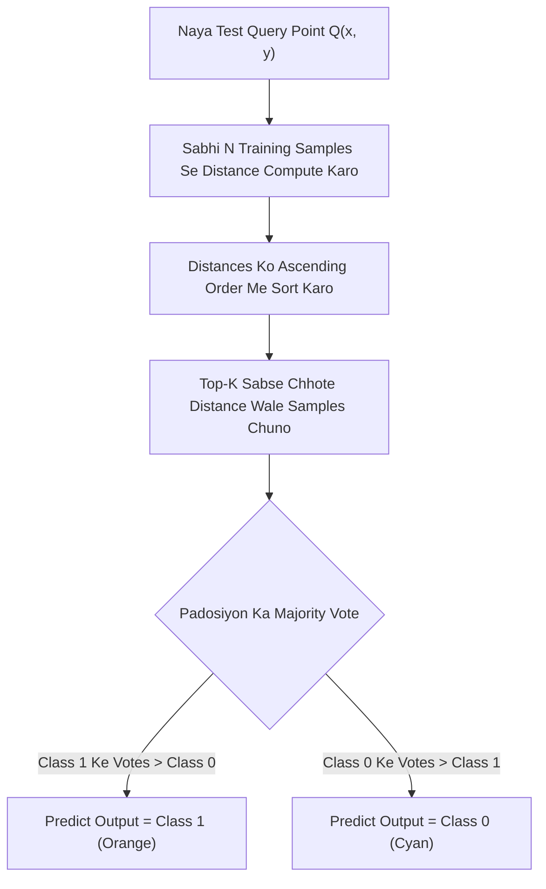
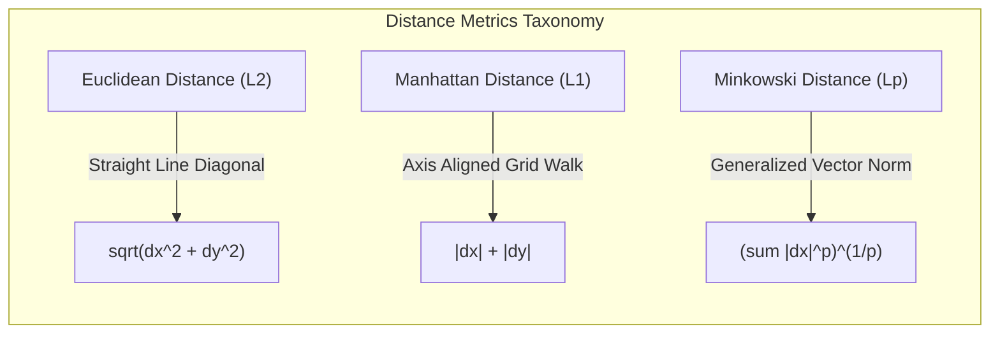

# 🧠 Notes_25.09: kNN — K-Nearest Neighbours (Intuition) [Hinglish]

[](#)
[](lecture_25_09.ipynb)
[](README.md)
[](notes.pdf)
[](notes_hinglish.pdf)

---

## 📌 Topic Overview
Is lecture mein Shraddha ma'am ne Supervised Machine Learning ke ek behad popular aur intuitive algorithm **k-Nearest Neighbors (kNN)** ka complete visual aur mathematical intuition samjhaya hai. kNN classification aur regression dono mein use hota hai, lekin iska basic foundation ek simple human principle par tika hai: **"Aap jaise logon ke sath baithte ho, aapki pehchan bhi waise hi hoti hai (Birds of a feather flock together)"**.

Hum detail mein dekhenge ki kNN kaise bina kisi complex mathematical training phase ke seedhe distances calculate karke naye points ka faisla karta hai, isse **Lazy Learner** kyu bolte hain, Euclidean aur Manhattan distances kaise nikali jaati hain, aur $K$ ki value hamesha **Odd (visham sankhya: 3, 5, 7)** kyu chunni chahiye!

---

### 📋 Is Topic Mein Hum Kya Seekhenge?
- **kNN Asal Mein Kya Hai?**: Non-parametric aur Instance-based learning ka core concept.
- **Lazy Learner vs Eager Learner**: kNN ko 'Aalsi' (Lazy) model kyu kehte hain aur training vs testing time complexity kya hoti hai.
- **Naye Query Point Ka Faisla (3 Core Steps)**: Distance calculation, Top-$K$ selection, aur Plurality Majority Voting.
- **Distance Metrics Ki Mathematics**:
  - Euclidean Distance ($L_2$ norm)
  - Manhattan Distance ($L_1$ norm / Taxicab metric)
  - Minkowski Distance ($L_p$ generalized metric)
- **$K$ Value Ka Role Aur Importance of Odd $K$**:
  - $K$ even rakhne par 50-50 tie ka khatra.
  - Small $K$ ($K=1$) par high variance (Overfitting).
  - Large $K$ ($K \to N$) par high bias (Underfitting).
- **Blackboard Numerical Example**: 2D plane par Cyan Crosses ($y=0$) aur Orange Circles ($y=1$) ke beech naye point $Q(5, 5)$ ka step-by-step classification.
- **Pure Python Scratch Implementation**: Bina Scikit-Learn ke NumPy se pura distance matrix aur majority voting calculate karna.

---

### 🔍 Har Ek Point Ka Simple & Detailed Explanation

#### 1. kNN Algorithm Ka Fundamental Principle (Padosi Rule)
kNN ek **Supervised Machine Learning** algorithm hai jiska use Classification aur Regression dono mein hota hai.
- Iska simple logic yeh hai: **"Similar data points 2D/3D feature space mein ek dusre ke kareeb hote hain."**
- Agar ek naye query point ke kareebi sabse zyada padosi (nearest neighbors) Class 1 ke hain, toh yeh naya point bhi Class 1 ka hi hoga!

---

#### 2. Lazy Learner vs Eager Learner (kNN Ko Aalsi Kyu Bolte Hain?)
Machine Learning algorithms do tarah ke hote hain:

| Property | Eager Learners (e.g. Logistic Regression, Decision Tree, SVM) | Lazy Learners (e.g. k-Nearest Neighbors) |
| :--- | :--- | :--- |
| **Training Phase** | Bohat mehnat karte hain; data se mathematical weights/hyperplanes learn karte hain. | **Zero Work!** Data ko sirf memory (RAM) mein store karke rakh leta hai. Koi weight calculate nahi karta. |
| **Training Time** | Slow / Heavy (Takes time to converge). | **Almost 0 Seconds** $\mathcal{O}(1)$ ya $\mathcal{O}(N)$. |
| **Prediction Phase** | Fast; formula mein seedhe $x$ pass karo aur $\hat{y}$ mil jata hai. | **Bohot Heavy & Slow!** Har ek test point ke liye training set ke saare $N$ points se doori nikalni padti hai. |
| **Prediction Complexity**| $\mathcal{O}(d)$ jahan $d$ features hain. | $\mathcal{O}(N \cdot d)$ jahan $N$ total samples hain. |

> [!NOTE]
> kNN ko **Instance-Based Learner** ya **Memory-Based Learner** bhi bolte hain kyunki prediction karte waqt yeh purane saare training instances ko yaad rakhta hai.

---

#### 3. Naye Data Point Ka Prediction Lene Ke 3 Steps
Jab bhi koi naya query point $\mathbf{x}_{\text{new}}$ aata hai:
1. **Distance Calculation**: Training data ke har ek point $\mathbf{x}_i$ se $\mathbf{x}_{\text{new}}$ ki doori nikaalo.
2. **Sorting & Selection**: Sabhi distances ko ascending order (chote se bada) mein sort karo aur sabse choti doori wale pehle **$K$ padosi** chun lo.
3. **Majority Voting (Plurality Rule)**:
   - Dekho un $K$ padosiyon mein se kitne Class 0 ke hain aur kitne Class 1 ke hain.
   - Jis class ke padosi zyada honge, naya point usi class ko assign ho jayega!

---

#### 4. Distance Metrics Ki Mathematics
Do points $P(x_1, y_1)$ aur $Q(x_2, y_2)$ ke beech doori napne ke 3 mukhya formulas hote hain:

##### (A) Euclidean Distance ($L_2$ Norm)
Yeh do points ke beech ki seedhi (straight-line) shortest distance hoti hai (Pythagoras Theorem par aadharit):

$$
d_{\text{Euclidean}}(P, Q) = \sqrt{\sum_{j=1}^d (p_j - q_j)^2} = \sqrt{(x_2 - x_1)^2 + (y_2 - y_1)^2}
$$

##### (B) Manhattan Distance ($L_1$ Norm / City-Block / Taxicab Metric)
Yeh grid-like city streets ki tarah horizontal aur vertical steps jod kar nikalti hai:

$$
d_{\text{Manhattan}}(P, Q) = \sum_{j=1}^d |p_j - q_j| = |x_2 - x_1| + |y_2 - y_1|
$$

##### (C) Minkowski Distance (Generalized Metric)
Euclidean aur Manhattan dono Minkowski distance ke special cases hain:

$$
d_{\text{Minkowski}}(P, Q) = \left( \sum_{j=1}^d |p_j - q_j|^p \right)^{\frac{1}{p}}
$$

- Agar $p = 1 \implies$ Manhattan Distance.
- Agar $p = 2 \implies$ Euclidean Distance.

---

#### 5. $K$ Value Ka Election & Importance of Odd $K$
$K$ ek hyperparameter hai jo user decide karta hai:

##### Kyu Hamesha Odd (Visham: 3, 5, 7, 9) $K$ Chunein?
Binary classification (jaise 0 vs 1, Yes vs No) mein:
- Agar aap $K = 4$ (Even number) chunoge, toh ho sakta hai **2 padosi Class 0** bole aur **2 padosi Class 1** bole!
- $2 = 2$ par **TIE** ho jayega aur algorithm faisla nahi kar payega ki naye point ko kis category mein daale.
- Isliye hamesha $K = 3, 5, 7, 9$ jaisi **Odd values** chuni jaati hain taaki majority vote mein clear winner nikal sake!

##### $K$ Ka Size Decision Boundary Par Kya Asar Dalta Hai?
- **Small $K$ (e.g. $K=1$)**:
  - Boundary bohot zigzag, complex aur sensitive ho jaati hai.
  - Data ke individual noise aur outliers ko ratna shuru kar deta hai $\implies$ **Overfitting (High Variance)**.
- **Large $K$ (e.g. $K \to N$)**:
  - Sabhi data points vote karne lagte hain.
  - Model sirf usi class ko predict karega jiske dataset mein sabse zyada samples hain $\implies$ **Underfitting (High Bias)**.
- **Optimal $K$**:
  - Rule of thumb: $K \approx \sqrt{N}$ (jahan $N$ total samples hain), aur cross-validation (`GridSearchCV`) se best $K$ tune kiya jata hai.

---

#### 6. Step-by-Step Blackboard Numerical Example
Maan lijiye Shraddha ma'am ke blackboard par 6 training points hain:
- **Class 0 (Cyan Crosses)**: $A(1, 2)$, $B(2, 3)$, $C(3, 3)$
- **Class 1 (Orange Circles)**: $D(6, 5)$, $E(7, 7)$, $F(8, 6)$

Naya test query point aaya: **$Q(5, 5)$**. Hum ise classify karna chahte hain using $K = 3$ aur $K = 5$.

##### Distance Calculation Table from $Q(5, 5)$:

| Point | Class | Coordinates $(x, y)$ | Distance Formula: $\sqrt{(x - 5)^2 + (y - 5)^2}$ | Calculated Distance | Rank (Closest) |
| :---: | :---: | :---: | :--- | :---: | :---: |
| **D** | **1 (Orange)** | $(6, 5)$ | $\sqrt{(6-5)^2 + (5-5)^2} = \sqrt{1 + 0} = 1.0$ | **1.00** | **1st** |
| **E** | **1 (Orange)** | $(7, 7)$ | $\sqrt{(7-5)^2 + (7-5)^2} = \sqrt{4 + 4} = \sqrt{8} \approx 2.83$ | **2.83** | **2nd** |
| **C** | **0 (Cyan)**   | $(3, 3)$ | $\sqrt{(3-5)^2 + (3-5)^2} = \sqrt{4 + 4} = \sqrt{8} \approx 2.83$ | **2.83** | **3rd** |
| **F** | **1 (Orange)** | $(8, 6)$ | $\sqrt{(8-5)^2 + (6-5)^2} = \sqrt{9 + 1} = \sqrt{10} \approx 3.16$| **3.16** | **4th** |
| **B** | **0 (Cyan)**   | $(2, 3)$ | $\sqrt{(2-5)^2 + (3-5)^2} = \sqrt{9 + 4} = \sqrt{13} \approx 3.61$| **3.61** | **5th** |
| **A** | **0 (Cyan)**   | $(1, 2)$ | $\sqrt{(1-5)^2 + (2-5)^2} = \sqrt{16 + 9} = \sqrt{25} = 5.0$ | **5.00** | **6th** |

##### Voting Decisions:
- **Case 1: $K = 3$**
  - Top 3 closest neighbors: **Point D (1.00, Class 1)**, **Point E (2.83, Class 1)**, **Point C (2.83, Class 0)**.
  - Votes: Class 1 = 2 votes, Class 0 = 1 vote.
  - Winner: **Class 1 (Orange Circle)**!
- **Case 2: $K = 5$**
  - Top 5 closest neighbors: **D (Class 1)**, **E (Class 1)**, **C (Class 0)**, **F (Class 1)**, **B (Class 0)**.
  - Votes: Class 1 = 3 votes, Class 0 = 2 votes.
  - Winner: **Class 1 (Orange Circle)**!

---

### 📊 Visual Flowcharts

#### Flowchart 1: kNN Inference Pipeline


#### Flowchart 2: Distance Metric Comparison


---

### 💻 Python Code: Complete kNN From Scratch

Yeh code bina Scikit-Learn ke pure NumPy use karke distance matrix compute karta hai aur plurality vote execute karta hai:

```python
import numpy as np

def predict_knn_from_scratch(query_point, X_train, y_train, k=3, metric="euclidean"):
    """
    Manual first-principles implementation of k-Nearest Neighbors classification.
    
    Parameters:
    -----------
    query_point : array-like of shape (d,)
        Coordinates of the query instance to classify.
    X_train : array-like of shape (N, d)
        Training feature matrix containing N samples across d dimensions.
    y_train : array-like of shape (N,)
        Class labels corresponding to training instances.
    k : int, default=3
        Number of nearest neighbors to aggregate in voting.
    metric : str, default='euclidean'
        Distance metric: 'euclidean' (L2) or 'manhattan' (L1).
        
    Returns:
    --------
    predicted_class : int
        Winning class label selected by majority plurality voting.
    top_k_indices : ndarray
        Indices of the k nearest training samples.
    top_k_distances : ndarray
        Distances from query point to the k nearest neighbors.
    class_vote_counts : dict
        Detailed vote distribution across candidate classes.
    """
    query = np.asarray(query_point, dtype=float)
    X = np.asarray(X_train, dtype=float)
    y = np.asarray(y_train, dtype=int)
    
    # 1. Compute distances based on chosen metric
    if metric == "euclidean":
        distances = np.sqrt(np.sum((X - query) ** 2, axis=1))
    elif metric == "manhattan":
        distances = np.sum(np.abs(X - query), axis=1)
    else:
        raise ValueError(f"Unsupported metric: {metric}. Choose 'euclidean' or 'manhattan'.")
        
    # 2. Extract indices of k smallest distance entries
    sorted_indices = np.argsort(distances)
    top_k_indices = sorted_indices[:k]
    top_k_distances = distances[top_k_indices]
    top_k_labels = y[top_k_indices]
    
    # 3. Majority Plurality Voting
    unique_classes, counts = np.unique(top_k_labels, return_counts=True)
    vote_dict = dict(zip(unique_classes.tolist(), counts.tolist()))
    
    # Argmax for winner class
    predicted_class = int(unique_classes[np.argmax(counts)])
    
    return predicted_class, top_k_indices, top_k_distances, vote_dict

# ----------------- Driver Execution & Testing -----------------
if __name__ == "__main__":
    # Blackboard Dataset from Lecture 25.09
    # Class 0: Cyan Crosses | Class 1: Orange Circles
    X_train_demo = np.array([
        [1.0, 2.0],  # Point A (Class 0)
        [2.0, 3.0],  # Point B (Class 0)
        [3.0, 3.0],  # Point C (Class 0)
        [6.0, 5.0],  # Point D (Class 1)
        [7.0, 7.0],  # Point E (Class 1)
        [8.0, 6.0]   # Point F (Class 1)
    ])
    y_train_demo = np.array([0, 0, 0, 1, 1, 1])
    
    test_query = np.array([5.0, 5.0])
    
    print("=" * 60)
    print("--- FIRST-PRINCIPLES kNN CLASSIFICATION DEMO ---")
    print(f"Query Test Point: {test_query}")
    print("=" * 60)
    
    # Evaluation at K=3
    pred_3, idx_3, dist_3, votes_3 = predict_knn_from_scratch(
        test_query, X_train_demo, y_train_demo, k=3, metric="euclidean"
    )
    print(f"\n[Configuration: K=3, Metric=Euclidean]")
    print(f"  Nearest Sample Indices : {idx_3.tolist()}")
    print(f"  Nearest Distances      : {[round(d, 3) for d in dist_3]}")
    print(f"  Neighbor Labels        : {y_train_demo[idx_3].tolist()}")
    print(f"  Vote Distribution      : {votes_3}")
    print(f"  -> Predicted Winner    : Class {pred_3} ({'Orange Circle' if pred_3==1 else 'Cyan Cross'})")
    
    # Evaluation at K=5
    pred_5, idx_5, dist_5, votes_5 = predict_knn_from_scratch(
        test_query, X_train_demo, y_train_demo, k=5, metric="euclidean"
    )
    print(f"\n[Configuration: K=5, Metric=Euclidean]")
    print(f"  Nearest Sample Indices : {idx_5.tolist()}")
    print(f"  Nearest Distances      : {[round(d, 3) for d in dist_5]}")
    print(f"  Neighbor Labels        : {y_train_demo[idx_5].tolist()}")
    print(f"  Vote Distribution      : {votes_5}")
    print(f"  -> Predicted Winner    : Class {pred_5} ({'Orange Circle' if pred_5==1 else 'Cyan Cross'})")
    print("=" * 60)
```

---

### 📌 Summary Points & Interview Takeaways
1. **Zero Explicit Training**: kNN ka koi training step nahi hota; yeh ek **Lazy Learner** hai jo runtime inference ke waqt saare distances calculate karta hai.
2. **Feature Scaling Mandate**: Agar ek feature $0-1$ range mein hai aur dusra $10,000-50,000$ salary mein, toh Euclidean distance sirf salary se dominate ho jayegi! Isliye kNN mein **StandardScaler lagana 100% compulsory hai**.
3. **Odd $K$ Advantage**: Binary classification mein tie se bachne ke liye hamesha odd $K$ ($3, 5, 7$) select kiya jata hai.
4. **Computational Bottleneck**: Bade datasets par ($N > 1,000,000$) kNN inference bohot slow ho jata hai kyunki time complexity $\mathcal{O}(N \cdot d)$ hoti hai.
