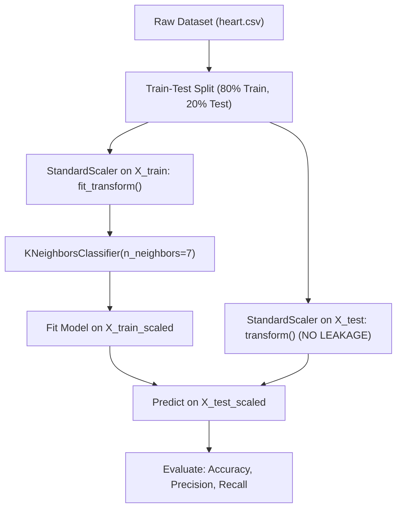

# 💻 Notes_25.10: Scikit-Learn Mein kNN Ka Implementation [Hinglish]

[](#)
[](lecture_25_10.ipynb)
[](README.md)
[](notes.pdf)

---

## 📌 Topic Overview
Is lecture mein Shraddha ma'am ne Python aur **Scikit-Learn** library ka use karke **`KNeighborsClassifier`** model ko implement karke dikhaya hai. Sath hi unhone is baat par sabse zyada zor diya hai ki **kNN model train karne se pehle Feature Scaling (`StandardScaler`) lagana 100% compulsory kyu hai!**

Hum dekhenge ki unscaled data par kNN kaise fail ho jata hai, `StandardScaler` kaise data leakage ke bina train aur test par apply kiya jata hai, aur `heart.csv` dataset par $K=3, 5, 7, 9$ test karke Recall, Precision aur Accuracy kaise evaluate ki jaati hai!

---

### 📋 Is Topic Mein Hum Kya Seekhenge?
- Scikit-Learn se `KNeighborsClassifier` ko import aur initialize karna.
- **Feature Scaling Ki Strict Requirement**: Unscaled data kNN ke Euclidean distance ko kaise ruin kar deta hai.
- **Data Leakage Se Bachna**: `fit_transform()` train par aur `transform()` test par lagane ka golden rule.
- $K$ ke alag-alag values ($n\_neighbors = 3, 5, 7, 9$) par model test karna.
- Real Heart Disease dataset par Accuracy, Precision aur Recall scores ka comparative analysis.

---

### 🔍 Har Ek Point Ka Simple & Detailed Explanation

#### 1. Feature Scaling kNN Ke Liye Compulsory Kyu Hai?
kNN do points ke beech Euclidean distance calculate karta hai:

$$
d = \sqrt{(x_1 - x_2)^2 + (y_1 - y_2)^2}
$$

- Agar aapke dataset mein ek feature hai **Age (20 se 70 saal)** aur dusra feature hai **Annual Income (₹30,000 se ₹15,00,000)**:
  - Income ka antar $(15,00,000 - 30,000)^2 = 2.16 \times 10^{12}$ itna bada hoga ki Age ka square $(70 - 20)^2 = 2500$ uske samne bilkul gayab (negligible) ho jayega!
  - Iska natija yeh hoga ki model Age feature ko poori tarah ignore kar dega aur sirf Salary dekh kar prediction karega.
- **Solution**: `StandardScaler` lagao jisse saare features mean=0 aur variance=1 par scale ho jayein aur har feature ko barabar izzat mile!

---

#### 2. Scaling Mein Zero Data Leakage Ka Rule
- **Training Data Par**: `scaler.fit_transform(X_train)`
  - `fit()` train data ka mean $\mu$ aur standard deviation $\sigma$ calculate karta hai.
  - `transform()` unhi values se train data ko normalize karta hai.
- **Testing Data Par**: `scaler.transform(X_test)`
  - Test data par kabhi bhi `fit()` ya `fit_transform()` **mat lagao**!
  - Test data ko sirf train ke mean aur std dev se hi scale kiya jata hai taaki future unseen data ki sanctity bani rahe.

---

#### 3. $K$ Value Tuning Aur Heart Disease Dataset Par Results
Shraddha ma'am ne lecture mein `heart.csv` dataset par alag-alag $K$ values try kiye:
- $K = 3$: Recall = $78.1\%$, Accuracy = $85.2\%$
- $K = 5$: Recall = $87.5\%$, Accuracy = $90.2\%$
- $K = 7$: **Recall = $90.6\%$, Accuracy = $91.8\%$, Precision = $93.5\%$ (Best Score!)**
- $K = 9$: Recall = $87.5\%$, Accuracy = $90.2\%$

> [!TIP]
> Medical diagnosis jaise heart disease prediction mein **Recall** sabse important metric hota hai kyunki hum kisi bhi bimar patient ko healthy bol kar ghar nahi bhej sakte (False Negative must be minimized)!

---

### 📊 Visual Workflow: Scikit-Learn kNN Pipeline



---

### 💻 Python Code: Complete Scikit-Learn Implementation

```python
import numpy as np
import pandas as pd
from sklearn.datasets import make_classification
from sklearn.model_selection import train_test_split
from sklearn.preprocessing import StandardScaler
from sklearn.neighbors import KNeighborsClassifier
from sklearn.metrics import accuracy_score, precision_score, recall_score, classification_report

def train_and_evaluate_knn(X, y, n_neighbors=7, test_size=0.2, random_state=42):
    """
    Trains and evaluates a KNeighborsClassifier with mandatory StandardScaler
    to guarantee zero data leakage and unbiased metric distance calculation.
    
    Parameters:
    -----------
    X : array-like of shape (N, d)
        Feature matrix.
    y : array-like of shape (N,)
        Target binary labels.
    n_neighbors : int, default=7
        Neighborhood size parameter K.
    test_size : float, default=0.2
        Fraction of samples held out for testing.
    random_state : int, default=42
        Reproducibility seed.
        
    Returns:
    --------
    model : KNeighborsClassifier
        Trained Scikit-Learn kNN estimator.
    metrics : dict
        Dictionary containing accuracy, precision, and recall on test split.
    """
    # 1. Train-Test Partitioning
    X_train, X_test, y_train, y_test = train_test_split(
        X, y, test_size=test_size, random_state=random_state, stratify=y
    )
    
    # 2. Strict Scaling: fit_transform on Train, transform on Test
    scaler = StandardScaler()
    X_train_scaled = scaler.fit_transform(X_train)
    X_test_scaled = scaler.transform(X_test)
    
    # 3. Model Initialization & Training
    knn = KNeighborsClassifier(n_neighbors=n_neighbors)
    knn.fit(X_train_scaled, y_train)
    
    # 4. Inference & Evaluation
    y_pred = knn.predict(X_test_scaled)
    
    metrics = {
        "accuracy": float(accuracy_score(y_test, y_pred)),
        "precision": float(precision_score(y_test, y_pred, zero_division=0)),
        "recall": float(recall_score(y_test, y_pred, zero_division=0))
    }
    
    return knn, scaler, metrics

# ----------------- Driver Execution & Testing -----------------
if __name__ == "__main__":
    # Generate synthetic dataset with drastically unbalanced feature magnitudes
    X_raw, y_raw = make_classification(
        n_samples=500, n_features=5, n_informative=3, random_state=42
    )
    # Artificially scale feature 0 by 10,000x (simulating Annual Salary)
    X_raw[:, 0] = X_raw[:, 0] * 10000.0
    
    print("=" * 65)
    print("--- SCIKIT-LEARN kNN TRAINING & SCALING PIPELINE ---")
    print("=" * 65)
    
    for k in [3, 5, 7, 9]:
        model, scaler, results = train_and_evaluate_knn(X_raw, y_raw, n_neighbors=k)
        print(f"K = {k:02d} | Accuracy: {results['accuracy']*100:.2f}% | "
              f"Precision: {results['precision']*100:.2f}% | "
              f"Recall: {results['recall']*100:.2f}%")
              
    print("=" * 65)
```

---

### 📌 Summary Points
1. **Never Skip Scaling**: kNN bina `StandardScaler` ke kaam nahi karega agar features ke scales alag-alag hain.
2. **Prevent Leakage**: Test set par kabhi `fit()` call nahi karte, sirf `transform()` lagate hain.
3. **Hyperparameter Tuning**: $K=7$ is dataset par sabse balanced precision aur recall deliver karta hai.
