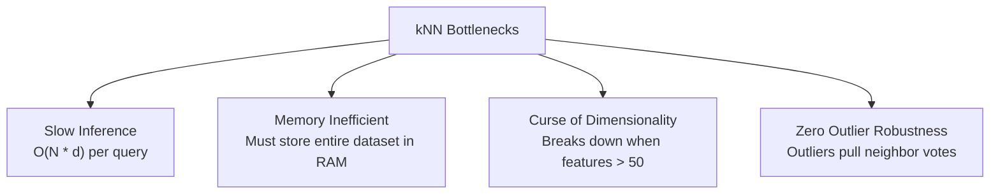

# Lecture 25.11: Limitations of kNN

## 📌 Topic Overview
In this lecture, Shraddha ma'am explains the real-world operational bottlenecks and theoretical limitations of the **k-Nearest Neighbors (kNN)** algorithm.

---

## ⚠️ Core Limitations

### 1. High Prediction Latency $\mathcal{O}(N \cdot d)$
Unlike Logistic Regression (which stores just a few weights and multiplies $\mathbf{w}^T \mathbf{x}$ instantly), kNN must compute the Euclidean distance to **every single training sample** for every test query. In low-latency systems (e.g., fraud detection), this is unacceptable.

### 2. High Memory Footprint
kNN is a non-parametric model: the "model" **is** the entire training dataset. You must store all gigabytes of training data in RAM.

### 3. The Curse of Dimensionality
As the number of features $d$ grows, high-dimensional space becomes exponentially sparse. All points become almost equidistant from each other, destroying the geometric meaning of "nearest".

### 4. Severe Sensitivity to Outliers & Irrelevant Features
If your dataset contains noisy or useless features, Euclidean distance assigns them equal weight, drastically degrading prediction quality.

---

## 📊 Visual Summary: The Bottlenecks of kNN



---

## 💻 Python Implementation

```python
import time
import numpy as np
from sklearn.neighbors import KNeighborsClassifier

def demonstrate_knn_latency(n_samples=20000, n_features=20):
    """
    Demonstrates the primary limitation of kNN:
    Extremely fast training time (O(1)), but very slow prediction latency (O(N * d))
    because every test point requires distance calculation to all training points.
    """
    X_train = np.random.randn(n_samples, n_features)
    y_train = np.random.randint(0, 2, n_samples)
    X_test  = np.random.randn(500, n_features)

    knn = KNeighborsClassifier(n_neighbors=5)

    # 1. Measure Training Time (Essentially O(1) storing references)
    t0 = time.time()
    knn.fit(X_train, y_train)
    fit_time = time.time() - t0

    # 2. Measure Prediction Time (Slow! Must compute distances to all 20,000 points)
    t0 = time.time()
    preds = knn.predict(X_test)
    pred_time = time.time() - t0

    return fit_time, pred_time

# --- Function Call & Testing ---
t_fit, t_pred = demonstrate_knn_latency()
print(f"kNN Training Time:   {t_fit:.6f} seconds (Almost zero!)")
print(f"kNN Prediction Time: {t_pred:.4f} seconds (Notice how slow prediction is!)")
```

---

## 🔑 Key Takeaways
1. kNN training is instant, but prediction is computationally expensive.
2. Avoid using kNN when dataset size $N$ is massive or feature dimension $d$ is very large.
3. Feature selection and scaling are strictly mandatory before using kNN.
