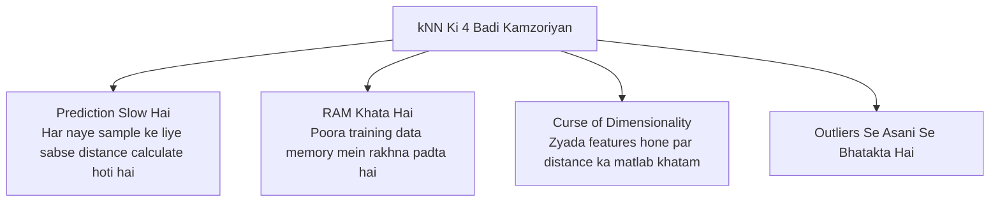

# Notes_25.11: kNN Algorithm Ki Kamzoriyan (Limitations) [Hinglish]

## 📌 Topic Overview
Is lecture mein Shraddha ma'am ne samjhaya hai ki real-world production mein **kNN algorithm kyu kam use hota hai** aur iski sabse badi kamzoriyan (limitations) kya hain.

---

### 📋 Is Topic Mein Hum Kya Seekhenge?
- Prediction ke time kNN itna slow kyu ho jata hai?
- **Memory issue**: Saare training data ko RAM mein store karne ki majboori.
- **Curse of Dimensionality**: Bohot zyada features hone par kNN kyu fail ho jata hai.
- Outliers aur useless features ka asar.

---

### 🔍 Har Ek Point Ka Simple & Detailed Explanation

#### 1. Prediction Mein Bohot Slow (High Latency)
- Logistic Regression ya Neural Networks mein model training ke baad sirf weights store karta hai aur prediction microseconds mein deta hai.
- Lekin kNN ko jab bhi koi naya prediction karna hota hai, wo **dataset ke ek-ek point se distance nikaalta hai**. Agar aapke paas 10 lakh rows hain, toh har prediction ke liye 10 lakh calculations karni padengi!

#### 2. Memory Ka Bojh (Heavy RAM Footprint)
- kNN koi chhota formula nahi banata; iska "model" poora ka poora dataset hi hota hai.
- Production server ki RAM mein poora data load karke rakhna padta hai.

#### 3. Curse of Dimensionality (Zyada Features Ka Shraap)
- Jaise-jaise features badhte hain (jaise 100 features), multidimensional space itna bada ho jata hai ki saare points ek doosre se lagbhag barabar doori par dikhne lagte hain. Isse "kareebi padosi" ka concept fail ho jata hai.

#### 4. Outliers Se Jaldi Prabhavit Hona
- Agar data mein 1-2 galat outliers hain, toh chhota $K$ hone par wo decision ko poori tarah palat dete hain.

---

### 📊 Visual Flowchart: kNN Ke 4 Badi Kamzoriyan



---

### 💻 Python Code

```python
import time
import numpy as np
from sklearn.neighbors import KNeighborsClassifier

def demonstrate_knn_latency(n_samples=20000, n_features=20):
    """
    Demonstrates the primary limitation of kNN:
    Extremely fast training time (O(1)), but very slow prediction latency (O(N * d))
    because every test point requires distance calculation to all training points.
    """
    X_train = np.random.randn(n_samples, n_features)
    y_train = np.random.randint(0, 2, n_samples)
    X_test  = np.random.randn(500, n_features)

    knn = KNeighborsClassifier(n_neighbors=5)

    # 1. Measure Training Time (Essentially O(1) storing references)
    t0 = time.time()
    knn.fit(X_train, y_train)
    fit_time = time.time() - t0

    # 2. Measure Prediction Time (Slow! Must compute distances to all 20,000 points)
    t0 = time.time()
    preds = knn.predict(X_test)
    pred_time = time.time() - t0

    return fit_time, pred_time

# --- Function Call & Testing ---
t_fit, t_pred = demonstrate_knn_latency()
print(f"kNN Training Time:   {t_fit:.6f} seconds (Almost zero!)")
print(f"kNN Prediction Time: {t_pred:.4f} seconds (Notice how slow prediction is!)")
```

---

### 📌 Summary Points
- kNN chote datasets ke liye theek hai, bade data ke liye production mein avoid kiya jata hai.
- Prediction time fast chahiye toh Logistic Regression ya Decision Trees better hain.
