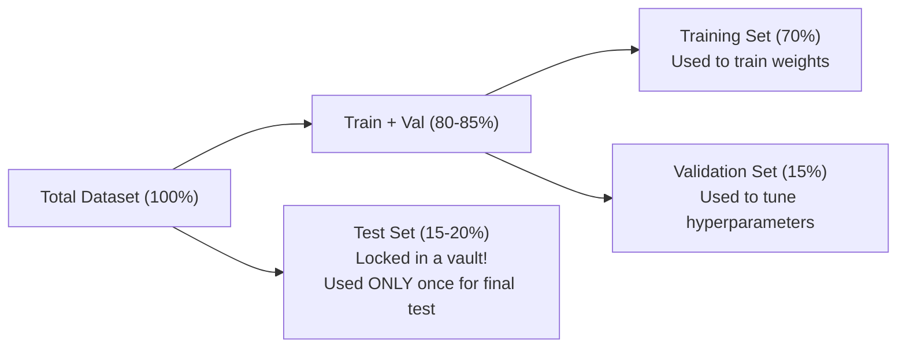

# Lecture 25.12: What is Validation Data?

## 📌 Topic Overview
In this lecture, Shraddha ma'am explains why machine learning practitioners divide datasets into three partitions: **Training Data**, **Validation Data**, and **Testing Data**, rather than a simple 2-way split.

---

## 🎯 The Three-Way Partition Strategy



---

## 🤔 Why Can't We Tune Hyperparameters on the Test Set?
If you evaluate different values of $K$ (e.g. $K=1, 3, 5, 7, 9$) directly on your Test Set and pick the $K$ with the best score:
- Your model has indirectly **overfitted to the test set**.
- The test score becomes optimistically biased and no longer represents real-world generalization.
- The **Validation Set** acts as a proxy test set during experimentation, keeping the real Test Set completely untouched.

---

## 💻 Python Implementation

```python
from sklearn.model_selection import train_test_split
from sklearn.datasets import make_classification

def split_train_validation_test(X, y, train_size=0.7, val_size=0.15, test_size=0.15):
    """
    Partitions data into three mutually exclusive subsets:
    1. Training Set:   Used to fit model parameters (e.g. 70%)
    2. Validation Set: Used to tune hyperparameters (e.g. 15%)
    3. Test Set:       Used exclusively for final performance evaluation (e.g. 15%)
    """
    # Step 1: Split off the Test Set first
    X_train_val, X_test, y_train_val, y_test = train_test_split(
        X, y, test_size=test_size, random_state=42
    )

    # Step 2: Split remaining data into Train and Validation
    val_ratio = val_size / (train_size + val_size)
    X_train, X_val, y_train, y_val = train_test_split(
        X_train_val, y_train_val, test_size=val_ratio, random_state=42
    )

    return X_train, X_val, X_test, y_train, y_val, y_test

# --- Function Call & Testing ---
X_dummy, y_dummy = make_classification(n_samples=1000, random_state=42)
X_tr, X_v, X_te, y_tr, y_v, y_te = split_train_validation_test(X_dummy, y_dummy)

print(f"Total Dataset:     {len(X_dummy)} samples")
print(f"Training Set:      {len(X_tr)} samples (70%)")
print(f"Validation Set:    {len(X_v)} samples (15%) -> Used to tune k / hyperparameters")
print(f"Final Test Set:    {len(X_te)} samples (15%) -> Touched ONLY once at the end!")
```

---

## 🔑 Key Takeaways
1. Training data fits model parameters (weights, coefficients).
2. Validation data selects optimal hyperparameters ($K$ in kNN, max depth in trees).
3. Test data delivers the unbiased final report of model capability.
