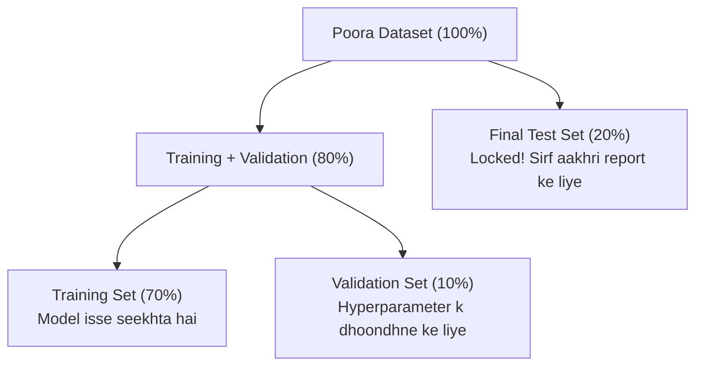

# Notes_25.12: Validation Data Kya Hota Hai? [Hinglish]

## 📌 Topic Overview
Is lecture mein Shraddha ma'am ne samjhaya hai ki data ko sirf Train aur Test mein baantna kafi kyu nahi hota, aur **Validation Data** kyu zaroori hota hai.

---

### 📋 Is Topic Mein Hum Kya Seekhenge?
- Training, Validation, aur Testing data ka 3-way split.
- Hyperparameters ko Test set par tune karna galat kyu hai?
- Test set ko lock karke rakhne ka concept.
- Python mein Train, Validation aur Test sets banane ka code.

---

### 🔍 Har Ek Point Ka Simple & Detailed Explanation

#### 1. Real-World Exam Analogy
- **Training Data**: Text-book ke questions jinse student padhai karta hai.
- **Validation Data**: Mock tests / Pre-board exams jahan student check karta hai ki konsi padhai ki technique (hyperparameter) sabse achhi hai.
- **Test Data**: Asal Board Exam! Iske questions student ko pehle se kabhi nahi dikhaye jaate.

#### 2. Test Set Par Tuning Karna Kyu Galat Hai?
Agar aap $K=1, 3, 5, 7$ sabko Test set par chala kar dekhoge aur bologe ki $K=5$ best hai:
Toh aapne test data ke answers dekh liye! Isse model real-world mein fail ho jayega kyunki test data ab naya aur anjaan nahi raha.

---

### 📊 Visual Flowchart: 3-Way Data Split



---

### 💻 Python Code

```python
from sklearn.model_selection import train_test_split
from sklearn.datasets import make_classification

def split_train_validation_test(X, y, train_size=0.7, val_size=0.15, test_size=0.15):
    """
    Partitions data into three mutually exclusive subsets:
    1. Training Set:   Used to fit model parameters (e.g. 70%)
    2. Validation Set: Used to tune hyperparameters (e.g. 15%)
    3. Test Set:       Used exclusively for final performance evaluation (e.g. 15%)
    """
    # Step 1: Split off the Test Set first
    X_train_val, X_test, y_train_val, y_test = train_test_split(
        X, y, test_size=test_size, random_state=42
    )

    # Step 2: Split remaining data into Train and Validation
    val_ratio = val_size / (train_size + val_size)
    X_train, X_val, y_train, y_val = train_test_split(
        X_train_val, y_train_val, test_size=val_ratio, random_state=42
    )

    return X_train, X_val, X_test, y_train, y_val, y_test

# --- Function Call & Testing ---
X_dummy, y_dummy = make_classification(n_samples=1000, random_state=42)
X_tr, X_v, X_te, y_tr, y_v, y_te = split_train_validation_test(X_dummy, y_dummy)

print(f"Total Dataset:     {len(X_dummy)} samples")
print(f"Training Set:      {len(X_tr)} samples (70%)")
print(f"Validation Set:    {len(X_v)} samples (15%) -> Used to tune k / hyperparameters")
print(f"Final Test Set:    {len(X_te)} samples (15%) -> Touched ONLY once at the end!")
```

---

### 📌 Summary Points
- Train data model fit karta hai.
- Validation data hyperparameters tune karta hai.
- Test data aakhri unbiased test hota hai.
