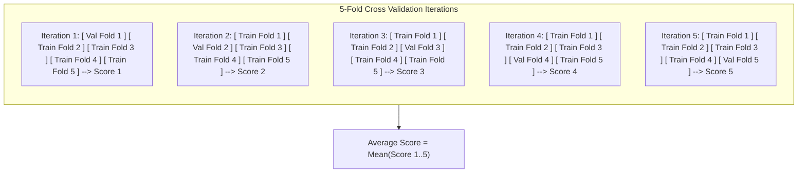

# Lecture 25.13: What is Cross Validation?

## 📌 Topic Overview
In this lecture, Shraddha ma'am introduces **K-Fold Cross Validation**, explaining how rotating the validation set across multiple folds provides a robust, low-variance evaluation of model skill.

---

## 🏛️ How K-Fold Cross Validation Works ($K=5$)
Instead of relying on a single static validation split:
1. Divide the training data into $K$ equal subsets (folds).
2. Run $K$ iterations. In each iteration $i$:
   - Use fold $i$ as the validation data.
   - Use the remaining $K-1$ folds combined as training data.
3. Compute the average accuracy across all $K$ iterations.



---

## 💻 Python Implementation

```python
from sklearn.model_selection import cross_val_score, KFold
from sklearn.neighbors import KNeighborsClassifier
from sklearn.datasets import make_classification

def run_kfold_cross_validation(n_splits=5):
    """
    Executes K-Fold Cross Validation:
    Splits training data into K equal folds, rotating the validation
    fold across K iterations, and computes mean performance.
    """
    X, y = make_classification(n_samples=500, random_state=42)
    knn = KNeighborsClassifier(n_neighbors=5)

    # 1. Initialize KFold
    kf = KFold(n_splits=n_splits, shuffle=True, random_state=42)

    # 2. Compute cross-validated scores
    cv_scores = cross_val_score(knn, X, y, cv=kf, scoring='accuracy')

    summary = {
        'fold_scores': cv_scores,
        'mean_score':  float(cv_scores.mean()),
        'std_score':   float(cv_scores.std())
    }
    return summary

# --- Function Call & Testing ---
res = run_kfold_cross_validation(n_splits=5)
print("5-Fold Individual Accuracies:", res['fold_scores'].round(4))
print(f"Mean CV Accuracy:            {res['mean_score']*100:.2f}% (Std: +/- {res['std_score']*100:.2f}%)")
```

---

## 🔑 Key Takeaways
1. Every single data point gets to be in the validation set exactly once.
2. The average cross-validation score eliminates the luck or bad variance of a single train/validation split.
3. Standard choice is $K = 5$ or $K = 10$.
