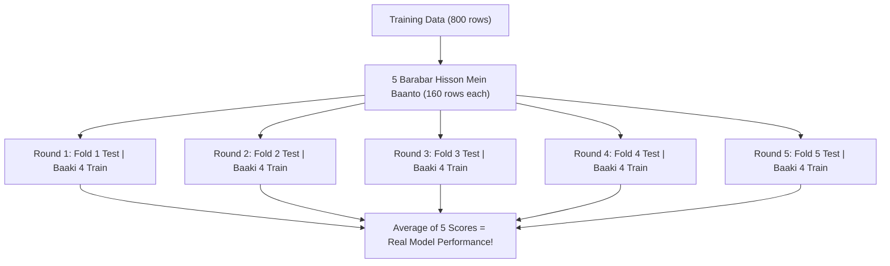

# Notes_25.13: Cross Validation Kya Hota Hai? [Hinglish]

## 📌 Topic Overview
Is lecture mein Shraddha ma'am ne **K-Fold Cross Validation** ka concept blackboard par diagrams banakar samjhaya hai: yeh kaise data ke har hisse ko bari-bari se validate karke sabse reliable score deta hai.

---

### 📋 Is Topic Mein Hum Kya Seekhenge?
- Cross Validation (CV) kya hota hai aur single train-test split se behtar kyu hai?
- **K-Fold CV ($K=5$)** kaise kaam karta hai?
- Rotating validation fold ka visual concept.
- Mean CV score aur standard deviation ka matlab.

---

### 🔍 Har Ek Point Ka Simple & Detailed Explanation

#### 1. Single Validation Split Ka Nuksaan
Agar hum sirf ek baar data split karte hain, toh ho sakta hai kismat se saare aasaan samples test mein chale jayein aur score 95% aa jaye, ya saare tough samples chale jayein aur score 60% aa jaye. Is kismat ke bharose se bachne ke liye **Cross Validation** use hota hai.

#### 2. K-Fold CV Ka Kaam Karne Ka Tareeqa (K=5):
1. Training data ko 5 barabar tukdon (Folds) mein baant lo.
2. **Iteration 1**: Fold 1 validation banega, baaki 4 training. Score 1 mila.
3. **Iteration 2**: Fold 2 validation banega, baaki 4 training. Score 2 mila.
4. Isi tarah 5 round chalenge.
5. Aakhri mein sabhi 5 scores ka **Average (Mean)** nikaal liya jata hai!

---

### 📊 Visual Flowchart: 5-Fold Cross Validation



---

### 💻 Python Code

```python
from sklearn.model_selection import cross_val_score, KFold
from sklearn.neighbors import KNeighborsClassifier
from sklearn.datasets import make_classification

def run_kfold_cross_validation(n_splits=5):
    """
    Executes K-Fold Cross Validation:
    Splits training data into K equal folds, rotating the validation
    fold across K iterations, and computes mean performance.
    """
    X, y = make_classification(n_samples=500, random_state=42)
    knn = KNeighborsClassifier(n_neighbors=5)

    # 1. Initialize KFold
    kf = KFold(n_splits=n_splits, shuffle=True, random_state=42)

    # 2. Compute cross-validated scores
    cv_scores = cross_val_score(knn, X, y, cv=kf, scoring='accuracy')

    summary = {
        'fold_scores': cv_scores,
        'mean_score':  float(cv_scores.mean()),
        'std_score':   float(cv_scores.std())
    }
    return summary

# --- Function Call & Testing ---
res = run_kfold_cross_validation(n_splits=5)
print("5-Fold Individual Accuracies:", res['fold_scores'].round(4))
print(f"Mean CV Accuracy:            {res['mean_score']*100:.2f}% (Std: +/- {res['std_score']*100:.2f}%)")
```

---

### 📌 Summary Points
- Cross validation model ko sabhi hisson par test karta hai.
- $K=5$ standard industry practice hai.
