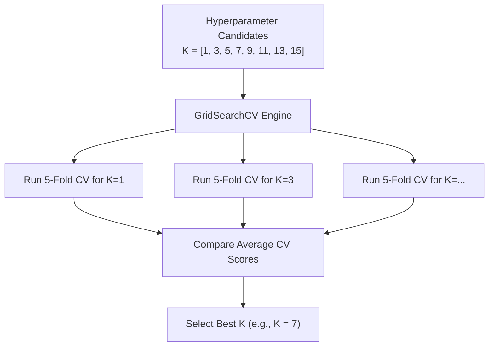

# Lecture 25.14: Hyperparameter Tuning with Cross Validation

## 📌 Topic Overview
In this lecture, Shraddha ma'am demonstrates how to combine Cross Validation with **GridSearchCV** to automatically search for the optimal $K$ neighbors parameter in kNN.

---

## 🛠️ The GridSearchCV Architecture



---

## 💻 Python Implementation

```python
from sklearn.model_selection import GridSearchCV
from sklearn.neighbors import KNeighborsClassifier
from sklearn.datasets import make_classification
from sklearn.preprocessing import StandardScaler

def tune_knn_k_parameter():
    """
    Uses 5-Fold GridSearchCV to find the optimal 'n_neighbors' (K)
    for KNeighborsClassifier across candidate values [1, 3, 5, 7, 9, 11, 13, 15].
    """
    X, y = make_classification(n_samples=500, random_state=42)
    X_scaled = StandardScaler().fit_transform(X)

    # 1. Define hyperparameter grid
    param_grid = {'n_neighbors': [1, 3, 5, 7, 9, 11, 13, 15]}

    # 2. Initialize GridSearchCV
    grid_search = GridSearchCV(
        KNeighborsClassifier(),
        param_grid=param_grid,
        cv=5,
        scoring='accuracy'
    )

    # 3. Fit grid search
    grid_search.fit(X_scaled, y)

    return grid_search.best_params_, grid_search.best_score_

# --- Function Call & Testing ---
best_params, best_acc = tune_knn_k_parameter()
print(f"Optimal K found:  {best_params['n_neighbors']}")
print(f"Best CV Accuracy: {best_acc*100:.2f}%")
```

---

## 🔑 Key Takeaways
1. `GridSearchCV` runs an exhaustive combinatorial search across your parameter dictionary.
2. It automatically evaluates each candidate using internal $K$-fold cross-validation.
3. Access optimal parameters via `grid.best_params_` and `grid.best_score_`.
