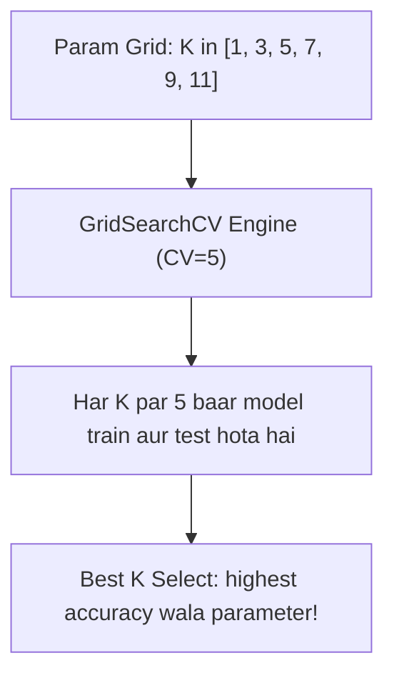

# Notes_25.14: Cross Validation Se Hyperparameter Tuning [Hinglish]

## 📌 Topic Overview
Is lecture mein Shraddha ma'am ne **GridSearchCV** ka use karke kNN ke liye sabse best $K$ neighbor dhoondhna sikhaya hai.

---

### 📋 Is Topic Mein Hum Kya Seekhenge?
- Hyperparameter Tuning kya hoti hai?
- `GridSearchCV` class ko Scikit-Learn se kaise use karte hain.
- Parameter dictionary (`param_grid = {'n_neighbors': [1, 3, 5, ...]}`) banana.
- Best parameter aur best score automatically nikalna.

---

### 🔍 Har Ek Point Ka Simple & Detailed Explanation

#### 1. Hyperparameter Tuning Kya Hai?
kNN mein humein pehle se nahi pata hota ki $K=3$ achha chalega ya $K=7$ ya $K=11$. 
Haath se baar-baar code likhne ke bajaye hum **GridSearchCV** ko candidate values ki list de dete hain: `[1, 3, 5, 7, 9, 11, 13, 15]`.

#### 2. GridSearchCV Kaise Kaam Karta Hai?
- Yeh har candidate value ke liye **5-Fold Cross Validation** chalata hai.
- Jiska average score sabse zyada aata hai, use `best_params_` mein store kar deta hai.

---

### 📊 Visual Flowchart: GridSearchCV Workflow



---

### 💻 Python Code

```python
from sklearn.model_selection import GridSearchCV
from sklearn.neighbors import KNeighborsClassifier
from sklearn.datasets import make_classification
from sklearn.preprocessing import StandardScaler

def tune_knn_k_parameter():
    """
    Uses 5-Fold GridSearchCV to find the optimal 'n_neighbors' (K)
    for KNeighborsClassifier across candidate values [1, 3, 5, 7, 9, 11, 13, 15].
    """
    X, y = make_classification(n_samples=500, random_state=42)
    X_scaled = StandardScaler().fit_transform(X)

    # 1. Define hyperparameter grid
    param_grid = {'n_neighbors': [1, 3, 5, 7, 9, 11, 13, 15]}

    # 2. Initialize GridSearchCV
    grid_search = GridSearchCV(
        KNeighborsClassifier(),
        param_grid=param_grid,
        cv=5,
        scoring='accuracy'
    )

    # 3. Fit grid search
    grid_search.fit(X_scaled, y)

    return grid_search.best_params_, grid_search.best_score_

# --- Function Call & Testing ---
best_params, best_acc = tune_knn_k_parameter()
print(f"Optimal K found:  {best_params['n_neighbors']}")
print(f"Best CV Accuracy: {best_acc*100:.2f}%")
```

---

### 📌 Summary Points
- `GridSearchCV` manual trial-and-error ko khatam karta hai.
- `best_params_` se optimal value milti hai.
