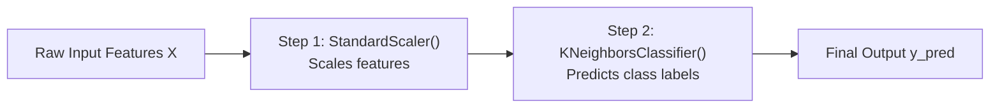

# Lecture 25.15: Pipeline in Scikit-Learn

## 📌 Topic Overview
In this lecture, Shraddha ma'am wraps up Lecture 25 by demonstrating Scikit-Learn's **Pipeline** class, showing how to cleanly chain transformers and estimators into a single production object while eliminating data leakage during cross-validation.

---

## 🏛️ Pipeline Architecture



---

## 💡 Why Pipelines Are Mandatory in Production
1. **Zero Data Leakage during CV**: When running `cross_val_score(pipe, X, y)`, the scaler is fit **only on each training fold** and transformed onto the validation fold automatically!
2. **Clean Code**: You only need to call `pipeline.fit(X_train, y_train)` and `pipeline.predict(X_test)`.
3. **Production Deployment**: A single pickle file contains both the scaler and the trained classifier.

---

## 💻 Python Implementation

```python
from sklearn.pipeline import Pipeline
from sklearn.preprocessing import StandardScaler
from sklearn.neighbors import KNeighborsClassifier
from sklearn.model_selection import train_test_split, cross_val_score
from sklearn.datasets import make_classification

def build_knn_production_pipeline():
    """
    Constructs a clean, leak-free Scikit-Learn Pipeline:
    Step 1: StandardScaler
    Step 2: KNeighborsClassifier
    
    Demonstrates how Pipeline automatically prevents data leakage
    during cross-validation and simplifies production deployment.
    """
    # 1. Dataset
    X, y = make_classification(n_samples=500, n_features=10, random_state=42)
    X_train, X_test, y_train, y_test = train_test_split(
        X, y, test_size=0.2, random_state=42
    )

    # 2. Build Pipeline
    pipe = Pipeline([
        ('scaler', StandardScaler()),
        ('classifier', KNeighborsClassifier(n_neighbors=5))
    ])

    # 3. Train entire chain in one line
    pipe.fit(X_train, y_train)

    # 4. Predict & Evaluate
    test_score = pipe.score(X_test, y_test)

    # 5. Leak-Free Cross-Validation
    cv_scores = cross_val_score(pipe, X_train, y_train, cv=5)

    return pipe, test_score, cv_scores.mean()

# --- Function Call & Testing ---
pipeline_model, score, mean_cv = build_knn_production_pipeline()
print(f"Pipeline Test Accuracy:     {score*100:.2f}%")
print(f"Pipeline 5-Fold CV Accuracy: {mean_cv*100:.2f}%")
```

---

## 🔑 Key Takeaways
1. A Pipeline chains preprocessing steps and ends with a final model estimator.
2. In cross-validation, Pipelines completely eliminate data leakage.
3. Call `pipe.fit()` once, and all scaling and model fitting happen sequentially.
