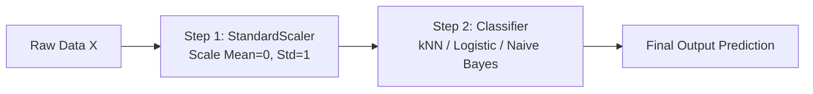

# Notes_25.15: Scikit-Learn Mein Pipeline Ka Use [Hinglish]

## 📌 Topic Overview
Is lecture mein Shraddha ma'am ne **Scikit-Learn Pipeline** ka concept sikhaya hai: preprocessing (scaling) aur model training ko ek hi single pipeline mein chain kaise karte hain taaki data leakage ka koi risk na rahe.

---

### 📋 Is Topic Mein Hum Kya Seekhenge?
- Pipeline class kya hoti hai aur iski zaroorat kyu hai?
- `StandardScaler` aur `KNeighborsClassifier` ko ek pipe mein kaise jodte hain.
- Cross-validation ke dauran data leakage se 100% bachna.
- Production mein ek single object se predict karna.

---

### 🔍 Har Ek Point Ka Simple & Detailed Explanation

#### 1. Pipeline Kya Hai?
Pipeline ek aisi assembly line hai jisme data ek taraf se raw enter karta hai:
1. Pehle step par `StandardScaler` data ko scale karta hai.
2. Doosre step par `KNeighborsClassifier` scaled data par prediction karta hai.
Aapko alag-alag `fit_transform` aur `predict` likhne ki zaroorat nahi padti!

#### 2. Cross-Validation Mein Data Leakage Se Bachav
Jab hum cross-validation chalate hain, toh agar humne bahar scaler fit kar diya toh leakage ho sakti hai. Lekin agar hum `Pipeline` ko `cross_val_score` mein pass karte hain, toh Scikit-Learn **har fold ke andar hi scaler ko fit karta hai**, jisse zero data leakage guaranteed hoti hai!

---

### 📊 Visual Flowchart: Pipeline Execution



---

### 💻 Python Code

```python
from sklearn.pipeline import Pipeline
from sklearn.preprocessing import StandardScaler
from sklearn.neighbors import KNeighborsClassifier
from sklearn.model_selection import train_test_split, cross_val_score
from sklearn.datasets import make_classification

def build_knn_production_pipeline():
    """
    Constructs a clean, leak-free Scikit-Learn Pipeline:
    Step 1: StandardScaler
    Step 2: KNeighborsClassifier
    
    Demonstrates how Pipeline automatically prevents data leakage
    during cross-validation and simplifies production deployment.
    """
    # 1. Dataset
    X, y = make_classification(n_samples=500, n_features=10, random_state=42)
    X_train, X_test, y_train, y_test = train_test_split(
        X, y, test_size=0.2, random_state=42
    )

    # 2. Build Pipeline
    pipe = Pipeline([
        ('scaler', StandardScaler()),
        ('classifier', KNeighborsClassifier(n_neighbors=5))
    ])

    # 3. Train entire chain in one line
    pipe.fit(X_train, y_train)

    # 4. Predict & Evaluate
    test_score = pipe.score(X_test, y_test)

    # 5. Leak-Free Cross-Validation
    cv_scores = cross_val_score(pipe, X_train, y_train, cv=5)

    return pipe, test_score, cv_scores.mean()

# --- Function Call & Testing ---
pipeline_model, score, mean_cv = build_knn_production_pipeline()
print(f"Pipeline Test Accuracy:     {score*100:.2f}%")
print(f"Pipeline 5-Fold CV Accuracy: {mean_cv*100:.2f}%")
```

---

### 📌 Summary Points
- Pipeline code ko clean aur organized banata hai.
- Preprocessing aur model ek hi bundle mein pack ho jaate hain.
- Production deployment ke liye Pipeline standard industry best practice hai.
