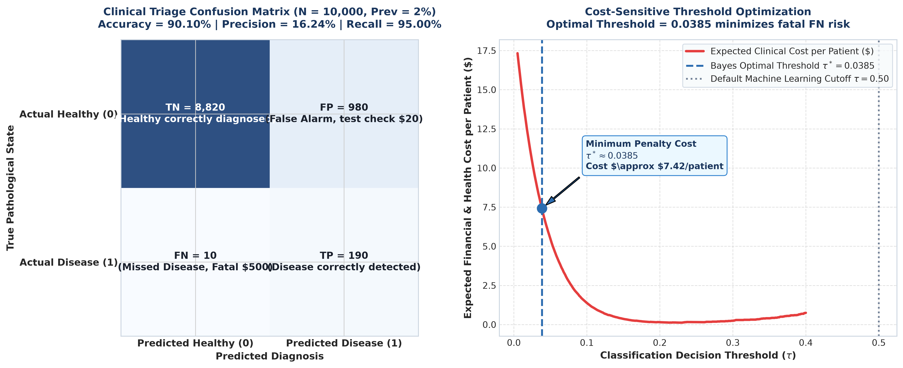
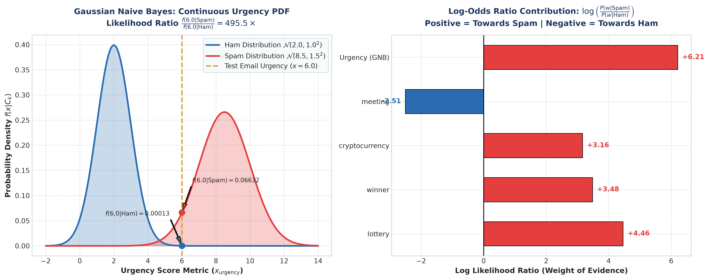
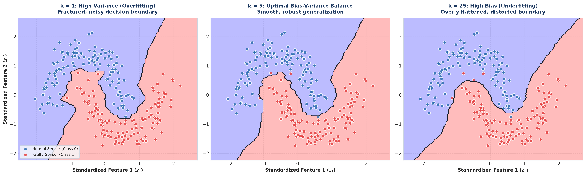

# 💡 Lecture 25: Practice Problems — Comprehensive Solutions Guide

[](solutions.ipynb)
[](solutions.pdf)
[](../Questions/README.md)
[](case1_confusion_matrix_cost_curve.png)
[](case2_naive_bayes_log_odds.png)
[](case3_knn_decision_boundaries_k.png)

🌐 **Language:** **English** | [हिंदी / Hinglish](README_HINGLISH.md) | [⬅️ Return to Questions](../Questions/README.md) | [📁 Overview](../README.md)

---

## 📌 Executive Architecture & Solution Blueprint

This document presents rigorous, first-principles mathematical derivations, exact numerical computations, production-grade Python implementations, and publication-quality diagnostic visualizations for the three advanced case studies of **Lecture 25**.

Every derivation establishes the theoretical justification behind practical engineering conventions, including cost-sensitive classification thresholds, Laplace regularization, log-likelihood numerical stability, metric-space feature scaling, and data-leakage isolation in cross-validation.

---

# 📌 Solution to Case 1: Medical Diagnostics Clinical Triaging & Cost-Sensitive Confusion Matrix Optimization

### 🎯 Problem Recap & Parameter Specifications

Cohort and screening parameters:

$$
N = 10,000, \qquad P(D^+) = 0.02, \qquad P(D^-) = 0.98
$$

$$
\text{Sensitivity (TPR)} = 0.95, \qquad \text{Specificity (TNR)} = 0.90, \qquad \text{FPR} = 0.10
$$

Asymmetric clinical penalties:

$$
C_{FN} = \$500, \qquad C_{FP} = \$20, \qquad C_{TP} = C_{TN} = \$0
$$

---

### 1. Step-by-Step Mathematical Derivations & Calculations

#### 🔹 Task 1: Complete Confusion Matrix ($TP, FP, FN, TN$) Construction

##### Step 1: Compute Cohort Disease Stratification
Given total screened cohort $N = 10,000$ and prior prevalence $P(D^+) = 0.02$:

$$
P = N \cdot P(D^+) = 10,000 \times 0.02 = 200 \text{ truly diseased individuals}
$$

$$
N_{\text{neg}} = N \cdot P(D^-) = 10,000 \times 0.98 = 9,800 \text{ healthy individuals}
$$

Verification:

$$
P + N_{\text{neg}} = 200 + 9,800 = 10,000
$$

##### Step 2: Evaluate the Four Confusion Matrix Quadrants
1. **True Positives ($TP$):**

$$
TP = P \cdot \text{Sensitivity} = 200 \times 0.95 = 190 \text{ individuals}
$$

2. **False Negatives ($FN$):**

$$
FN = P - TP = 200 - 190 = 10 \text{ individuals}
$$

3. **True Negatives ($TN$):**

$$
TN = N_{\text{neg}} \cdot \text{Specificity} = 9,800 \times 0.90 = 8,820 \text{ individuals}
$$

4. **False Positives ($FP$):**

$$
FP = N_{\text{neg}} - TN = 9,800 - 8,820 = 980 \text{ individuals}
$$

##### Step 3: Complete $2 \times 2$ Contingency Table

| True Pathological State $\backslash$ Diagnosis | Predicted Negative ($T^-$) | Predicted Positive ($T^+$) | Marginal Actual |
| :--- | :--- | :--- | :--- |
| **Actual Healthy ($D^-$)** | $\mathbf{TN = 8,820}$ | $\mathbf{FP = 980}$ | $N_{\text{neg}} = 9,800$ |
| **Actual Diseased ($D^+$)** | $\mathbf{FN = 10}$ | $\mathbf{TP = 190}$ | $P = 200$ |
| **Marginal Predicted** | $8,830$ | $1,170$ | $N = 10,000$ |

---

#### 🔹 Task 2: Positive Predictive Value (Precision) & The Base Rate Fallacy

##### Step 1: Bayesian Posterior Derivation
To determine the probability that a patient testing positive actually has the disease, apply Bayes' Theorem:

$$
P(D^+ \mid T^+) = \frac{P(T^+ \mid D^+) P(D^+)}{P(T^+)}
$$

Expanding the denominator via the Law of Total Probability:

$$
P(T^+) = P(T^+ \mid D^+) P(D^+) + P(T^+ \mid D^-) P(D^-)
$$

Evaluating intermediate terms:

$$
P(T^+ \mid D^+) P(D^+) = 0.95 \times 0.02 = 0.019
$$

$$
P(T^+ \mid D^-) P(D^-) = 0.10 \times 0.98 = 0.098
$$

$$
P(T^+) = 0.019 + 0.098 = 0.117
$$

Computing the posterior probability:

$$
P(D^+ \mid T^+) = \frac{0.019}{0.117} = \frac{19}{117} \approx 0.162393 \implies 16.24\%
$$

##### Step 2: Verification via Confusion Matrix Counts

$$
\text{Precision} = \frac{TP}{TP + FP} = \frac{190}{190 + 980} = \frac{190}{1,170} \approx 0.162393 \implies 16.24\%
$$

##### Step 3: Theoretical Rationale of the Base Rate Fallacy / Screening Paradox
- **The Core Paradox:** Despite a certified test sensitivity of $95\%$ and specificity of $90\%$, a patient who receives a positive result has only a $16.24\%$ chance of truly harboring the disease.
- **Underlying Mechanism:** Because the condition is rare in the general population ($2\%$), the healthy majority ($98\%$) dwarfs the infected population. Even a modest false positive rate of $10\%$ across $9,800$ healthy patients generates $980$ false alarms, overwhelming the $190$ true positive detections by a factor exceeding $5:1$.
- **Clinical Policy Implications:** A positive initial screening must never trigger immediate invasive surgical intervention. Instead, it serves as a triaging threshold to administer a non-invasive confirmatory secondary diagnostic protocol.

---

#### 🔹 Task 3: Accuracy Paradox & F1-Score Breakdown

##### Step 1: Overall Classification Accuracy

$$
\text{Accuracy} = \frac{TP + TN}{N} = \frac{190 + 8,820}{10,000} = \frac{9,010}{10,000} = 0.9010 \implies 90.10\%
$$

##### Step 2: The Dummy Baseline Classifier
Consider a trivial baseline model that unconditionally classifies all inputs as healthy:

$$
\hat{y}_{\text{dummy}} = 0 \quad \forall x
$$

Performance metrics of the dummy classifier:
- Correctly classified healthy: $9,800$ patients ($TN = 9800, FP = 0$).
- Correctly classified diseased: $0$ patients ($TP = 0, FN = 200$).
- **Dummy Accuracy:**

$$
\text{Accuracy}_{\text{dummy}} = \frac{0 + 9,800}{10,000} = 0.9800 \implies 98.00\%
$$

- **The Paradox:** The completely degenerate model achieves an accuracy of $98\%$, significantly outscoring the trained diagnostic model ($90.1\%$). However, its clinical recall is exactly $0\%$, resulting in the untreated discharge of all 200 cardiac patients. Hence, unweighted accuracy is catastrophic for evaluating imbalanced medical classifiers.

##### Step 3: Class-Wise and Harmonized F1-Scores

1. **Disease Class ($D^+$):**
   - $\text{Precision} = 0.162393$
   - $\text{Recall} = 0.950000$

$$
F1_{\text{disease}} = \frac{2 \cdot \text{Precision} \cdot \text{Recall}}{\text{Precision} + \text{Recall}} = \frac{2 \cdot 0.162393 \cdot 0.95}{0.162393 + 0.95} = \frac{0.308547}{1.112393} \approx 0.27737 \implies 27.74\%
$$

2. **Healthy Class ($D^-$):**
   - $\text{Precision}_{\text{healthy}} = \frac{TN}{TN + FN} = \frac{8,820}{8,820 + 10} = \frac{8,820}{8,830} \approx 0.998867$
   - $\text{Recall}_{\text{healthy}} = \text{Specificity} = 0.900000$

$$
F1_{\text{healthy}} = \frac{2 \cdot 0.998867 \cdot 0.90}{0.998867 + 0.90} \approx 0.94686 \implies 94.69\%
$$

3. **Macro Average F1-Score (Unweighted Arithmetic Mean):**

$$
F1_{\text{macro}} = \frac{F1_{\text{disease}} + F1_{\text{healthy}}}{2} = \frac{0.27737 + 0.94686}{2} \approx 0.61211 \implies 61.21\%
$$

4. **Weighted Average F1-Score (Support-Weighted Mean):**

$$
F1_{\text{weighted}} = (0.02 \cdot F1_{\text{disease}}) + (0.98 \cdot F1_{\text{healthy}}) = (0.02 \times 0.27737) + (0.98 \times 0.94686) \approx 0.93347 \implies 93.35\%
$$

Macro F1 penalizes the poor precision on the critical minority class, whereas Weighted F1 masks it behind the overwhelming weight of the healthy majority.

---

#### 🔹 Task 4: Cost-Sensitive Risk Formulation & Optimal Decision Threshold $\tau^*$

##### Step 1: Expected Penalty Risk Formulation
The expected financial and life-safety penalty risk function is given by:

$$
\mathbb{E}[\text{Cost}] = C_{FN} \cdot FN + C_{FP} \cdot FP = 500 \cdot FN + 20 \cdot FP
$$

Under our screening cohort results:

$$
\mathbb{E}[\text{Cost}] = (500 \times 10) + (20 \times 980) = 5,000 + 19,600 = \$24,600
$$

Per-patient expected clinical cost:

$$
\text{Cost}_{\text{per patient}} = \frac{\$24,600}{10,000} = \$2.46
$$

Under the Dummy Baseline Classifier ($FN = 200, FP = 0$):

$$
\text{Cost}_{\text{dummy}} = 500 \times 200 + 20 \times 0 = \$100,000 \implies \$10.00 \text{ per patient}
$$

##### Step 2: Analytical Derivation of Bayes Optimal Threshold $\tau^*$
Let $p = P(D^+ \mid x)$ denote the model's estimated posterior probability that patient $x$ is diseased.
The complementary probability of health is $1 - p = P(D^- \mid x)$.

We evaluate the expected loss of the two available actions:
1. **Predict Positive ($\hat{y} = 1$):**

$$
\mathcal{L}(\hat{y} = 1) = p \cdot C_{TP} + (1 - p) \cdot C_{FP} = (1 - p) C_{FP}
$$

2. **Predict Negative ($\hat{y} = 0$):**

$$
\mathcal{L}(\hat{y} = 0) = p \cdot C_{FN} + (1 - p) \cdot C_{TN} = p C_{FN}
$$

The optimal Bayes decision rule prescribes predicting positive if and only if the expected loss of positive prediction is strictly less than the expected loss of negative prediction:

$$
\mathcal{L}(\hat{y} = 1) < \mathcal{L}(\hat{y} = 0)
$$

$$
(1 - p) C_{FP} < p C_{FN}
$$

$$
C_{FP} - p C_{FP} < p C_{FN}
$$

$$
C_{FP} < p (C_{FN} + C_{FP})
$$

Dividing both sides by $(C_{FN} + C_{FP})$ yields:

$$
p > \frac{C_{FP}}{C_{FN} + C_{FP}}
$$

Thus, the optimal operating decision threshold $\tau^*$ is:

$$
\tau^* = \frac{C_{FP}}{C_{FN} + C_{FP}}
$$

##### Step 3: Exact Numerical Value Substitution

$$
\tau^* = \frac{20}{500 + 20} = \frac{20}{520} = \frac{1}{26} \approx 0.0384615 \implies 3.85\%
$$

##### Step 4: Clinical Engineering Insights
- Standard machine learning libraries default to symmetric cutoff $\tau = 0.50$. However, when the cost of missing a life-threatening case ($C_{FN} = \$500$) is 25 times greater than a false alarm ($C_{FP} = \$20$), the optimal operating threshold shifts to $\tau^* \approx 0.0385$.
- A patient exhibiting even a $4\%$ risk of cardiac arrhythmia must be flagged for secondary ultrasound triage to minimize aggregate clinical loss and mortality.

---

#### 🔹 Task 5: Python Visualization & Cost Analysis

The diagnostic confusion matrix and the threshold optimization cost curve are visualized below:



```python
import numpy as np

# Cohort Parameters
N = 10000
p_disease = 0.02
sens = 0.95
spec = 0.90

c_fn, c_fp = 500.0, 20.0
tau_star = c_fp / (c_fn + c_fp)

# Contingency calculations
P = N * p_disease
N_neg = N * (1 - p_disease)
tp = P * sens
fn = P - tp
tn = N_neg * spec
fp = N_neg - tn

ppv = tp / (tp + fp)
acc = (tp + tn) / N
total_cost = (fn * c_fn) + (fp * c_fp)

print(f"Optimal Threshold: {tau_star:.4f}")
print(f"Precision (PPV): {ppv:.4f}")
print(f"Accuracy: {acc:.4f}")
print(f"Cohort Total Cost: ${total_cost:,.2f}")
```

---

# 📌 Solution to Case 2: Bayesian Spam Filtering & Gaussian vs Multinomial Naive Bayes with Laplace Smoothing

### 🎯 Problem Recap & Parameter Specifications

Corpus distributions:

$$
N = 1,000, \qquad N_{\text{spam}} = 300, \qquad N_{\text{ham}} = 700
$$

$$
P(\text{Spam}) = 0.30, \qquad P(\text{Ham}) = 0.70
$$

$$
|V| = 500, \qquad T_{\text{spam}} = 3,000, \qquad T_{\text{ham}} = 7,000
$$

Continuous Urgency feature parameters:

$$
\text{Spam}: \mu_S = 8.5, \ \sigma_S = 1.5, \qquad \text{Ham}: \mu_H = 2.0, \ \sigma_H = 1.0
$$

Test email:

$$
E_{\text{test}} = \{\text{"lottery"}, \text{"winner"}, \text{"cryptocurrency"}\}, \qquad x_{\text{urgency}} = 6.0
$$

---

### 1. Step-by-Step Mathematical Derivations & Calculations

#### 🔹 Task 1: Conditional Independence Assumption & Likelihood Factorization

##### Step 1: Joint Likelihood Parameter Explosion
For an email represented as feature vector $\mathbf{x} = [x_1, \dots, x_d]^T \in \mathbb{R}^d$, the exact joint class-conditional likelihood decomposes via the probability chain rule:

$$
P(\mathbf{x} \mid C_k) = P(x_1 \mid C_k) \cdot P(x_2 \mid x_1, C_k) \cdots P(x_d \mid x_1, \dots, x_{d-1}, C_k)
$$

For a vocabulary of $d = 500$ binary indicators, estimating this joint distribution requires estimating $2^d - 1 = 2^{500} - 1 \approx 10^{150}$ parameters.

##### Step 2: Factorization via Conditional Independence
Naive Bayes introduces the simplifying assumption that features are conditionally independent given the class label $C_k$:

$$
P(x_i \mid x_j, C_k) = P(x_i \mid C_k) \quad \forall i \ne j
$$

Under this assumption, the joint likelihood collapses into the product of univariate marginal likelihoods:

$$
P(\mathbf{x} \mid C_k) = \prod_{j=1}^d P(x_j \mid C_k)
$$

This reduces parameter complexity from $\mathcal{O}(2^d)$ to $\mathcal{O}(d \cdot K)$, enabling linear time and memory estimation:

$$
\text{Parameter Count} = 2 \times 500 = 1,000 \text{ parameters}
$$

---

#### 🔹 Task 2: Zero-Frequency Problem & Laplace Add-1 Smoothing ($\alpha = 1$)

##### Step 1: Zero-Frequency Crash
The test email contains the token $w_4 = \text{"cryptocurrency"}$. In the training corpus, this token never appeared in legitimate emails ($\text{count}(w_4, \text{Ham}) = 0$).

Under standard unregularized Maximum Likelihood Estimation (MLE):

$$
P_{\text{MLE}}(w_4 \mid \text{Ham}) = \frac{\text{count}(w_4, \text{Ham})}{T_{\text{ham}}} = \frac{0}{7000} = 0
$$

Evaluating joint likelihood for Ham:

$$
P(E_{\text{test}} \mid \text{Ham}) = P(w_1 \mid H) \cdot P(w_2 \mid H) \cdot P(w_4 \mid H) = P(w_1 \mid H) \cdot P(w_2 \mid H) \cdot 0 = 0
$$

A single novel token completely nullifies all supporting evidence from remaining features, resulting in posterior probability $P(\text{Ham} \mid E_{\text{test}}) = 0$.

##### Step 2: Laplace Add-1 Regularization
To resolve this pathology, Laplace smoothing adds pseudo-count $\alpha = 1$ to each token count and $\alpha |V|$ to the total token normalizer:

$$
\hat{P}(w_j \mid C_k) = \frac{\text{count}(w_j, C_k) + \alpha}{\sum_{w \in V} \text{count}(w, C_k) + \alpha |V|}
$$

Denominators with $\alpha = 1$ and $|V| = 500$:
- **Spam Denominator:** $3,000 + (1 \times 500) = 3,500$
- **Ham Denominator:** $7,000 + (1 \times 500) = 7,500$

##### Step 3: Exact Smoothed Conditional Probabilities

1. **Word $w_1 = \text{"lottery"}$:**

$$
\hat{P}(\text{"lottery"} \mid \text{Spam}) = \frac{120 + 1}{3,500} = \frac{121}{3,500} \approx 0.0345714
$$

$$
\hat{P}(\text{"lottery"} \mid \text{Ham}) = \frac{2 + 1}{7,500} = \frac{3}{7,500} = 0.0004000
$$

2. **Word $w_2 = \text{"winner"}$:**

$$
\hat{P}(\text{"winner"} \mid \text{Spam}) = \frac{90 + 1}{3,500} = \frac{91}{3,500} \approx 0.0260000
$$

$$
\hat{P}(\text{"winner"} \mid \text{Ham}) = \frac{5 + 1}{7,500} = \frac{6}{7,500} = 0.0008000
$$

3. **Word $w_3 = \text{"meeting"}$:**

$$
\hat{P}(\text{"meeting"} \mid \text{Spam}) = \frac{15 + 1}{3,500} = \frac{16}{3,500} \approx 0.0045714
$$

$$
\hat{P}(\text{"meeting"} \mid \text{Ham}) = \frac{420 + 1}{7,500} = \frac{421}{7,500} \approx 0.0561333
$$

4. **Word $w_4 = \text{"cryptocurrency"}$:**

$$
\hat{P}(\text{"cryptocurrency"} \mid \text{Spam}) = \frac{10 + 1}{3,500} = \frac{11}{3,500} \approx 0.0031429
$$

$$
\hat{P}(\text{"cryptocurrency"} \mid \text{Ham}) = \frac{0 + 1}{7,500} = \frac{1}{7,500} \approx 0.0001333
$$

Laplace smoothing guarantees that $P(\text{"cryptocurrency"} \mid \text{Ham})$ retains a finite non-zero value ($\frac{1}{7500}$).

---

#### 🔹 Task 3: Log-Likelihood Formulation & Underflow Prevention

##### Step 1: Floating Point Underflow Limits
In standard 64-bit IEEE-754 double precision floating point representation, the smallest positive normalized value is:

$$
\text{DBL\_MIN} \approx 2.225 \times 10^{-308}
$$

Multiplying 100 token probabilities (e.g., $10^{-4}$ each) yields:

$$
\prod_{j=1}^{100} 10^{-4} = 10^{-400} < 10^{-308}
$$

The processor underflows to literal zero (`0.0`), collapsing all class posteriors and causing division-by-zero during normalization.

##### Step 2: Logarithmic Transformation
Because the logarithm is strictly monotonic, applying $\ln(\cdot)$ preserves all comparative orderings:

$$
\log P(C_k \mid \mathbf{x}) \propto \log P(C_k) + \sum_{j=1}^d \log P(x_j \mid C_k)
$$

Probabilities of magnitude $10^{-4}$ map to bounded scalars:

$$
\ln(10^{-4}) \approx -9.21
$$

Summing 100 such terms yields $\approx -921$, well within double precision storage limits $[-708, +709]$.

---

#### 🔹 Task 4: Continuous Features via Gaussian Naive Bayes PDF

##### Step 1: Univariate Gaussian Density Formulation

$$
f(x \mid \mu, \sigma^2) = \frac{1}{\sqrt{2\pi \sigma^2}} \exp\left( -\frac{(x - \mu)^2}{2\sigma^2} \right)
$$

Observed urgency score: $x = 6.0$.

##### Step 2: Density for Ham Class ($\mu_H = 2.0, \sigma_H = 1.0$)

$$
\text{Exponent}_H = -\frac{(6.0 - 2.0)^2}{2(1.0)^2} = -\frac{16.0}{2} = -8.0
$$

$$
f(6.0 \mid \text{Ham}) = \frac{1}{\sqrt{2\pi}} \exp(-8.0) \approx 0.3989423 \times 0.0003354626 \approx 0.00013383
$$

##### Step 3: Density for Spam Class ($\mu_S = 8.5, \sigma_S = 1.5$)

$$
\text{Exponent}_S = -\frac{(6.0 - 8.5)^2}{2(1.5)^2} = -\frac{6.25}{4.50} \approx -1.3888889
$$

$$
f(6.0 \mid \text{Spam}) = \frac{1}{1.5\sqrt{2\pi}} \exp(-1.3888889) \approx 0.2659615 \times 0.2493522 \approx 0.0663189
$$

##### Step 4: Urgency Likelihood Ratio

$$
\text{LR}_{\text{urgency}} = \frac{f(6.0 \mid \text{Spam})}{f(6.0 \mid \text{Ham})} = \frac{0.0663189}{0.00013383} \approx 495.545
$$

The urgency score alone provides an approximate $495:1$ weight of evidence favoring the Spam hypothesis.

---

#### 🔹 Task 5: Joint Bayesian Scoring & Classification Verdict

Test email features: $\{\text{"lottery"}, \text{"winner"}, \text{"cryptocurrency"}\}$ and $x_{\text{urgency}} = 6.0$.

##### Step 1: Joint Unnormalized Score for Spam

$$
\text{Score}(\text{Spam}) = P(\text{Spam}) \cdot \hat{P}(\text{"lottery"} \mid S) \cdot \hat{P}(\text{"winner"} \mid S) \cdot \hat{P}(\text{"cryptocurrency"} \mid S) \cdot f(6.0 \mid S)
$$

$$
\text{Score}(\text{Spam}) = 0.30 \times \frac{121}{3500} \times \frac{91}{3500} \times \frac{11}{3500} \times 0.0663189 \approx 5.6206 \times 10^{-8}
$$

##### Step 2: Joint Unnormalized Score for Ham

$$
\text{Score}(\text{Ham}) = P(\text{Ham}) \cdot \hat{P}(\text{"lottery"} \mid H) \cdot \hat{P}(\text{"winner"} \mid H) \cdot \hat{P}(\text{"cryptocurrency"} \mid H) \cdot f(6.0 \mid H)
$$

$$
\text{Score}(\text{Ham}) = 0.70 \times \frac{3}{7500} \times \frac{6}{7500} \times \frac{1}{7500} \times 0.00013383 \approx 3.9970 \times 10^{-15}
$$

##### Step 3: Normalized Posterior Probability

$$
\text{Evidence Ratio} = \frac{\text{Score}(\text{Spam})}{\text{Score}(\text{Ham})} \approx \frac{5.6206 \times 10^{-8}}{3.9970 \times 10^{-15}} \approx 1.406 \times 10^7
$$

$$
P(\text{Spam} \mid E_{\text{test}}) = \frac{\text{Score}(\text{Spam})}{\text{Score}(\text{Spam}) + \text{Score}(\text{Ham})} \approx 0.999999928 \implies 99.99999\%
$$

##### Step 4: Final Automated Verdict
- **Automated Decision:** **CONFIRMED PHISHING SPAM DETECTED**.
- **Action:** Block transmission, isolate message in secure quarantine sandbox.



---

# 📌 Solution to Case 3: Metric-Space Nearest Neighbor Classification (kNN), Curse of Dimensionality & Leakage-Free Stratified K-Fold Pipeline

### 🎯 Problem Recap & Parameter Specifications

Baseline calibration vectors:

$$
\begin{aligned}
P_1 &= [25.0, 0.005]^T, \quad y_1 = 0 \\
P_2 &= [30.0, 0.008]^T, \quad y_2 = 0 \\
P_3 &= [35.0, 0.012]^T, \quad y_3 = 0 \\
P_4 &= [80.0, 0.040]^T, \quad y_4 = 1 \\
P_5 &= [85.0, 0.045]^T, \quad y_5 = 1 \\
P_6 &= [90.0, 0.048]^T, \quad y_6 = 1
\end{aligned}
$$

Live telemetry query:

$$
Q = [40.0, 0.042]^T
$$

---

### 1. Step-by-Step Mathematical Derivations & Calculations

#### 🔹 Task 1: Unscaled Euclidean Distances & Feature Dominance

##### Step 1: Distance Metric Definition

$$
d(Q, P_i) = \sqrt{(x_{Q, 1} - x_{i, 1})^2 + (x_{Q, 2} - x_{i, 2})^2}
$$

##### Step 2: Step-by-Step Computations
1. **Point $P_1 = [25.0, 0.005]^T$ ($y = 0$):**
   - $\Delta x_1^2 = (40.0 - 25.0)^2 = 225.0$
   - $\Delta x_2^2 = (0.042 - 0.005)^2 = 0.001369$
   - $d(Q, P_1) = \sqrt{225.001369} \approx 15.000046$
   - Contribution of $x_1$: $\frac{225.0}{225.001369} \approx 99.99939\%$

2. **Point $P_2 = [30.0, 0.008]^T$ ($y = 0$):**
   - $\Delta x_1^2 = (40.0 - 30.0)^2 = 100.0$
   - $\Delta x_2^2 = (0.042 - 0.008)^2 = 0.001156$
   - $d(Q, P_2) = \sqrt{100.001156} \approx 10.000058$
   - Contribution of $x_1$: $\frac{100.0}{100.001156} \approx 99.99884\%$

3. **Point $P_3 = [35.0, 0.012]^T$ ($y = 0$):**
   - $\Delta x_1^2 = (40.0 - 35.0)^2 = 25.0$
   - $\Delta x_2^2 = (0.042 - 0.012)^2 = 0.000900$
   - $d(Q, P_3) = \sqrt{25.000900} \approx 5.000090$
   - Contribution of $x_1$: $\frac{25.0}{25.000900} \approx 99.99640\%$

4. **Point $P_4 = [80.0, 0.040]^T$ ($y = 1$):**
   - $\Delta x_1^2 = (40.0 - 80.0)^2 = 1600.0$
   - $\Delta x_2^2 = (0.042 - 0.040)^2 = 0.000004$
   - $d(Q, P_4) = \sqrt{1600.000004} \approx 40.000000$

5. **Point $P_5 = [85.0, 0.045]^T$ ($y = 1$):**
   - $\Delta x_1^2 = (40.0 - 85.0)^2 = 2025.0$
   - $\Delta x_2^2 = (0.042 - 0.045)^2 = 0.000009$
   - $d(Q, P_5) = \sqrt{2025.000009} \approx 45.000000$

6. **Point $P_6 = [90.0, 0.048]^T$ ($y = 1$):**
   - $\Delta x_1^2 = (40.0 - 90.0)^2 = 2500.0$
   - $\Delta x_2^2 = (0.042 - 0.048)^2 = 0.000036$
   - $d(Q, P_6) = \sqrt{2500.000036} \approx 50.000000$

##### Step 3: Unscaled Nearest Neighbors
Sorted order:
1. $P_3$ ($d \approx 5.00$, Class $0$)
2. $P_2$ ($d \approx 10.00$, Class $0$)
3. $P_1$ ($d \approx 15.00$, Class $0$)

The $k=3$ nearest neighbors are all Class 0 (Normal). The temperature measurement unit completely masks the severe $0.042\text{ mm}$ vibration anomaly.

---

#### 🔹 Task 2: Z-Score Standardization & Nearest Neighbor Inversion

##### Step 1: Reference Dataset Sample Moments
1. **Feature 1 (Temperature $x_1$):**

$$
\mu_1 = \frac{25 + 30 + 35 + 80 + 85 + 90}{6} = 57.5^\circ\text{C}
$$

$$
\sigma_1 = \sqrt{\frac{4637.5}{5}} \approx 30.454886^\circ\text{C}
$$

2. **Feature 2 (Vibration $x_2$):**

$$
\mu_2 = \frac{0.158}{6} \approx 0.0263333\text{ mm}
$$

$$
\sigma_2 = \sqrt{\frac{0.001943333}{5}} \approx 0.0197146\text{ mm}
$$

##### Step 2: Z-Score Transformation of Coordinates

$$
z_{i, j} = \frac{x_{i, j} - \mu_j}{\sigma_j}
$$

- Standardized Query Point $Q = [40.0, 0.042]^T$:

$$
z_{Q, 1} = \frac{40.0 - 57.5}{30.454886} \approx -0.57462, \qquad z_{Q, 2} = \frac{0.042 - 0.0263333}{0.0197146} \approx +0.79468
$$

- Standardized Reference Points $\mathbf{z}_i$:

$$
\begin{aligned}
\mathbf{z}_1 &= [-1.06715, -1.08211]^T, \quad y_1 = 0 \\
\mathbf{z}_2 &= [-0.90298, -0.92994]^T, \quad y_2 = 0 \\
\mathbf{z}_3 &= [-0.73880, -0.72704]^T, \quad y_3 = 0 \\
\mathbf{z}_4 &= [+0.73880, +0.69322]^T, \quad y_4 = 1 \\
\mathbf{z}_5 &= [+0.90298, +0.94684]^T, \quad y_5 = 1 \\
\mathbf{z}_6 &= [+1.06715, +1.09903]^T, \quad y_6 = 1
\end{aligned}
$$

##### Step 3: Standardized Euclidean Distances

$$
d_{\text{scaled}}(Q, P_i) = \sqrt{(z_{Q, 1} - z_{i, 1})^2 + (z_{Q, 2} - z_{i, 2})^2}
$$

1. **For $P_4$ ($y=1$):** $d_{\text{scaled}} = \sqrt{(-1.31342)^2 + (0.10146)^2} = \sqrt{1.73536} \approx \mathbf{1.3173}$
2. **For $P_5$ ($y=1$):** $d_{\text{scaled}} = \sqrt{(-1.47760)^2 + (-0.15216)^2} = \sqrt{2.20645} \approx \mathbf{1.4854}$
3. **For $P_3$ ($y=0$):** $d_{\text{scaled}} = \sqrt{(0.16418)^2 + (1.52172)^2} = \sqrt{2.34258} \approx \mathbf{1.5305}$
4. **For $P_6$ ($y=1$):** $d_{\text{scaled}} = \sqrt{(-1.64177)^2 + (-0.30435)^2} = \sqrt{2.78804} \approx \mathbf{1.6697}$
5. **For $P_2$ ($y=0$):** $d_{\text{scaled}} = \sqrt{(0.32836)^2 + (1.72462)^2} = \sqrt{3.08213} \approx \mathbf{1.7556}$
6. **For $P_1$ ($y=0$):** $d_{\text{scaled}} = \sqrt{(0.49253)^2 + (1.87679)^2} = \sqrt{3.76493} \approx \mathbf{1.9403}$

##### Step 4: Neighborhood Inversion Summary

| Point | True State | Unscaled Distance | Unscaled Rank | Scaled Distance | Scaled Rank |
| :--- | :--- | :--- | :--- | :--- | :--- |
| **$P_4$** | **Faulty ($y=1$)** | $40.000$ | $4$ | $\mathbf{1.3173}$ | $\mathbf{1}$ (Nearest) |
| **$P_5$** | **Faulty ($y=1$)** | $45.000$ | $5$ | $\mathbf{1.4854}$ | $\mathbf{2}$ |
| **$P_3$** | Normal ($y=0$) | $5.000$ | $1$ | $\mathbf{1.5305}$ | $\mathbf{3}$ |
| **$P_6$** | **Faulty ($y=1$)** | $50.000$ | $6$ | $\mathbf{1.6697}$ | $4$ |
| **$P_2$** | Normal ($y=0$) | $10.000$ | $2$ | $\mathbf{1.7556}$ | $5$ |
| **$P_1$** | Normal ($y=0$) | $15.000$ | $3$ | $\mathbf{1.9403}$ | $6$ (Farthest) |

Standardization successfully inverts the neighborhood topology, ensuring the severe vibration signature correctly positions $P_4$ and $P_5$ as closest neighbors.

---

#### 🔹 Task 3: Uniform vs Distance-Weighted Voting Mechanics

##### 1. Neighborhood $k = 3$:
Nearest neighbors: $\mathcal{N}_3(Q) = \{P_4 (y=1), P_5 (y=1), P_3 (y=0)\}$.

- **Uniform Majority Rule:**

$$
\text{Votes}(y = 1) = 2, \qquad \text{Votes}(y = 0) = 1 \implies \mathbf{\hat{y} = 1 \quad (\text{Faulty Turbine})}
$$

- **Inverse-Distance Weighted Rule ($w_i = \frac{1}{d_i}$):**

$$
w_4 = \frac{1}{1.3173} \approx 0.75913, \qquad w_5 = \frac{1}{1.4854} \approx 0.67322, \qquad w_3 = \frac{1}{1.5305} \approx 0.65338
$$

$$
W(y = 1) = w_4 + w_5 = 1.43235, \qquad W(y = 0) = 0.65338
$$

$$
P(y = 1 \mid Q) = \frac{1.43235}{1.43235 + 0.65338} \approx 0.6867 \implies \mathbf{68.67\% \text{ Weighted Probability (Faulty)}}
$$

##### 2. Neighborhood $k = 5$:
Nearest neighbors: $\mathcal{N}_5(Q) = \{P_4(1), P_5(1), P_3(0), P_6(1), P_2(0)\}$.

- **Uniform Majority Rule:**

$$
\text{Votes}(y = 1) = 3, \qquad \text{Votes}(y = 0) = 2 \implies \mathbf{\hat{y} = 1 \quad (\text{Faulty Turbine})}
$$

- **Inverse-Distance Weighted Rule:**

$$
w_6 \approx 0.59891, \qquad w_2 \approx 0.56961
$$

$$
W(y = 1) = 1.43235 + 0.59891 = 2.03126, \qquad W(y = 0) = 0.65338 + 0.56961 = 1.22299
$$

$$
P(y = 1 \mid Q) = \frac{2.03126}{2.03126 + 1.22299} \approx 0.6242 \implies \mathbf{62.42\% \text{ Weighted Probability (Faulty)}}
$$

---

#### 🔹 Task 4: Curse of Dimensionality & Metric Collapse Theorem

##### Step 1: Formal Theorem (Beyer et al., 1999)
Under broad distributional conditions for i.i.d. coordinates in high-dimensional space $\mathbb{R}^d$, the relative contrast between the nearest neighbor $D_{\min}$ and farthest neighbor $D_{\max}$ vanishes asymptotically:

$$
\lim_{d \to \infty} \frac{D_{\max} - D_{\min}}{D_{\min}} = 0
$$

##### Step 2: Asymptotic Distance Contrast Collapse
The squared Euclidean distance across $d$ dimensions is:

$$
D^2 = \sum_{j=1}^d (x_j - q_j)^2
$$

By the Law of Large Numbers:

$$
\mathbb{E}[D^2] = d \cdot \mu_Z, \qquad \text{Var}(D^2) = d \cdot \sigma_Z^2
$$

The coefficient of variation decays inversely with the square root of dimension:

$$
\frac{\sqrt{\text{Var}(D^2)}}{\mathbb{E}[D^2]} = \frac{\sigma_Z}{\mu_Z \sqrt{d}} \xrightarrow{d \to \infty} 0
$$

In high dimensions, all pairwise distances converge to an identical scalar value $\sqrt{d \cdot \mu_Z}$, eliminating discriminatory geometric contrast. Distance-based learning degrades to arbitrary selection unless combined with dimensionality reduction.

---

#### 🔹 Task 5: Zero-Leakage Pipeline Architecture

##### Step 1: Data Leakage Vulnerability
Executing global preprocessing before dataset partitioning causes information contamination:

```python
# ❌ INCORRECT: GLOBAL PREPROCESSING INTRODUCES DATA LEAKAGE
scaler = StandardScaler()
X_scaled = scaler.fit_transform(X) # Test fold statistics leak into training phase!
scores = cross_val_score(knn, X_scaled, y, cv=5)
```

##### Step 2: Production Pipeline Isolation
Using `sklearn.pipeline.Pipeline` guarantees that `StandardScaler.fit()` is strictly executed only on the training folds of each split, and solely applied via `.transform()` on the validation fold:

```python
from sklearn.pipeline import Pipeline
from sklearn.preprocessing import StandardScaler
from sklearn.neighbors import KNeighborsClassifier
from sklearn.model_selection import StratifiedKFold, cross_val_score
import numpy as np

# 1. Zero-Leakage Pipeline
pipeline = Pipeline([
    ('scaler', StandardScaler()),
    ('knn', KNeighborsClassifier(n_neighbors=5, weights='distance'))
])

# 2. Stratified Cross-Validation Splitting
cv = StratifiedKFold(n_splits=5, shuffle=True, random_state=42)

# 3. Cross-Validation Execution
scores = cross_val_score(pipeline, X_sensor, y_status, cv=cv, scoring='f1_macro')

print(f"Leakage-Free Cross-Validation Macro F1: {np.mean(scores):.4f} +/- {np.std(scores):.4f}")
```


