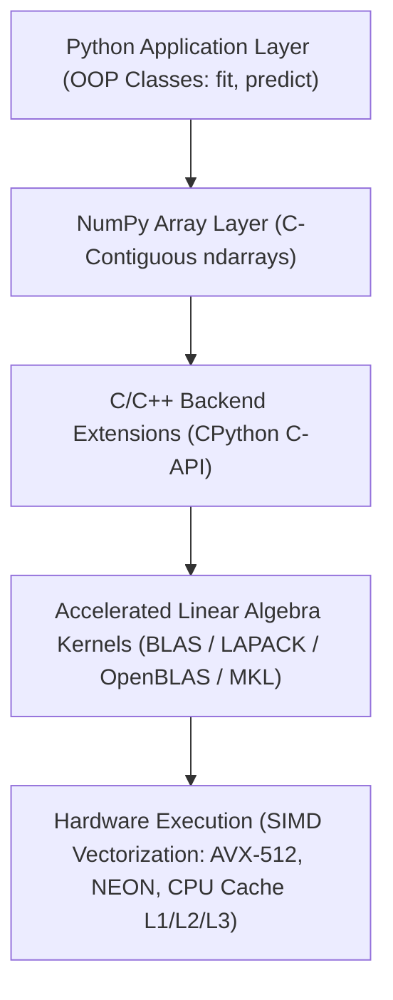

# Lecture 26.01: Section Introduction & The First-Principles Engineering Philosophy

## 📌 Executive Summary
Deep dive into the architectural rationale of implementing machine learning algorithms from scratch using pure Python and NumPy, transcending black-box abstractions to understand memory, numerical stability, and optimization dynamics.

---

## 🔬 Mathematical Formulation & Theory
### 1. The Black-Box Abstraction Trap
In modern applied machine learning, developers routinely invoke high-level API abstractions:

```python
from sklearn.linear_model import LinearRegression, LogisticRegression
from sklearn.neighbors import KNeighborsClassifier

model = LinearRegression().fit(X_train, y_train)
```

While high-level frameworks facilitate rapid prototyping, treating machine learning algorithms as opaque black boxes introduces severe engineering vulnerabilities in production systems:
1. **Loss of Numerical Intuition**: Inability to diagnose exploding gradients, vanishing probabilities, or ill-conditioned covariance matrices when optimizations fail to converge.
2. **Computational Profiling Blindspots**: Inability to predict asymptotic time complexity $\mathcal{O}(d^3)$ vs $\mathcal{O}(k \cdot m \cdot d)$ when scaling to high-dimensional datasets ($d > 10,000$).
3. **Memory Allocation Pitfalls**: Inability to understand how internal matrices are represented in C-contiguous memory versus fragmented Python pointer objects.

### 2. The Python Numerical Computing Runtime Hierarchy
To engineer high-performance systems from first principles, an engineer must master the multi-tiered architecture of the Python numerical stack:



### 3. Core Algorithms Implemented from Scratch
In this master module, we implement three foundational machine learning algorithms using only pure Python and vectorized NumPy operations:

| Algorithm Class | Mathematical Paradigm | Optimization Protocol | Core Equations |
| :--- | :--- | :--- | :--- |
| **Linear Regression (GD)** | Parametric Linear Mapping | Iterative First-Order Gradient Descent | $\hat{y} = Xw + b$, $J = \frac{1}{2m}\|Xw+b-y\|^2$, $\nabla_w J = \frac{1}{m}X^T(\hat{y}-y)$ |
| **Linear Regression (OLS)** | Parametric Analytical Geometry | Closed-Form Normal Equation | $\theta = (X_b^T X_b)^{-1} X_b^T y$ |
| **Logistic Regression** | Probabilistic Generalized Linear Model | Vectorized Gradient Descent on Log-Loss | $\sigma(z) = \frac{1}{1+e^{-z}}$, $J = -\frac{1}{m}\sum [y \log \hat{y} + (1-y)\log(1-\hat{y})]$ |
| **K-Nearest Neighbors** | Non-Parametric Metric Space | Lazy Learning & Plurality Voting | $d(x, x') = \sqrt{\sum (x_j - x_j')^2}$, $\hat{y} = \text{mode}(\mathcal{N}_k(x))$ |


---

## 💻 Python & NumPy Implementation
```python
import numpy as np
import time

# Benchmark: Pure Python Loops vs Vectorized NumPy Matrix Operations
n = 1_000_000
a = np.random.randn(n)
b = np.random.randn(n)

# Pure Python Loop Dot Product
t0 = time.perf_counter()
dot_loop = sum(x * y for x, y in zip(a, b))
t_loop = time.perf_counter() - t0

# NumPy Vectorized Dot Product
t0 = time.perf_counter()
dot_np = np.dot(a, b)
t_np = time.perf_counter() - t0

print(f"Pure Python Loop Time: {t_loop:.6f} seconds")
print(f"NumPy Vectorized Time:  {t_np:.6f} seconds")
print(f"Speedup Factor:         {t_loop / t_np:.2f}x faster with vectorization!")

```

---

## 🎯 Key Takeaways & Best Practices
1. **First-Principles Transparency**: Building from scratch demystifies optimizer mechanics, memory layouts, and algorithmic failure modes.
2. **Vectorization vs Loops**: Always eliminate Python `for` loops across sample dimensions by relying on BLAS-accelerated NumPy array operations.
3. **Shape Integrity**: Maintain explicit assertions on input array ranks and shapes (`X.shape == (m, d)`, `y.shape == (m,)`) to prevent silent broadcasting bugs.
