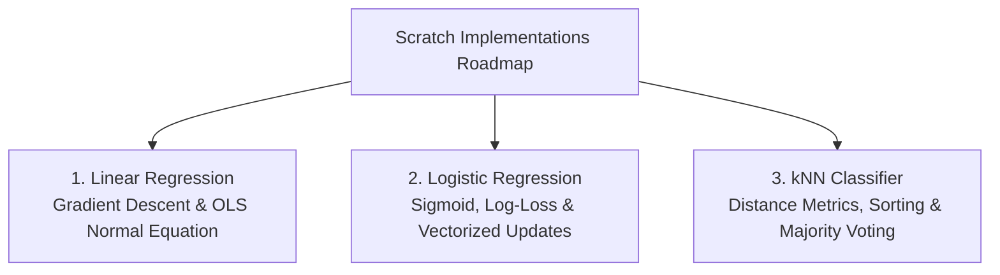

# Lecture 26.01: Scratch ML Section Introduction & Philosophy

## 📌 Topic Overview
In this lecture, Shraddha ma'am introduces the **Scratch Implementation Add-on Section**, explaining why every serious machine learning engineer must build foundational algorithms (**Linear Regression, Logistic Regression, kNN**) from first principles using pure Python and NumPy.

---

## 🏛️ The White-Box Engineering Philosophy
Modern machine learning often relies on high-level libraries:
```python
from sklearn.linear_model import LinearRegression
model = LinearRegression().fit(X, y)
```
While convenient, treating algorithms as black boxes creates dangerous engineering blindspots:
1. **Debugging Gradient Instability**: When loss explodes to `NaN` or diverges, only knowledge of calculus and update equations allows you to fix learning rates.
2. **Computational Complexity Mastery**: Knowing when closed-form matrix inversion $\mathcal{O}(d^3)$ crashes your machine versus when iterative Gradient Descent $\mathcal{O}(kmd)$ is required.
3. **Custom Optimizers**: Real-world production often demands custom constraints or objective functions unsupported by off-the-shelf libraries.

---

## 📊 Scratch Roadmap Overview



---

## 💻 Python Implementation

```python
import numpy as np
import time

def compare_python_loop_vs_numpy_vectorization(n_samples=1_000_000):
    """
    Demonstrates the fundamental computational reason why we build
    scratch ML algorithms using vectorized NumPy instead of pure Python loops:
    NumPy runs on optimized C/Fortran SIMD instructions.
    """
    a = np.random.randn(n_samples)
    b = np.random.randn(n_samples)

    # 1. Pure Python Loop
    t0 = time.perf_counter()
    dot_loop = sum(x * y for x, y in zip(a, b))
    t_loop = time.perf_counter() - t0

    # 2. Vectorized NumPy
    t0 = time.perf_counter()
    dot_np = np.dot(a, b)
    t_np = time.perf_counter() - t0

    speedup = t_loop / t_np
    return t_loop, t_np, speedup

# --- Function Call & Testing ---
t_py, t_vec, ratio = compare_python_loop_vs_numpy_vectorization()
print(f"Pure Python Loop Time: {t_py:.4f}s")
print(f"NumPy Vectorized Time:  {t_vec:.6f}s")
print(f"Speedup: NumPy is {ratio:.1f}x faster!")
```

---

## 🔑 Key Takeaways
1. Scratch coding demystifies "black box" machine learning.
2. Vectorized NumPy replaces slow Python loops with optimized C-speed array operations.
3. Linear Regression, Logistic Regression, and kNN form the bedrock of supervised learning math.
