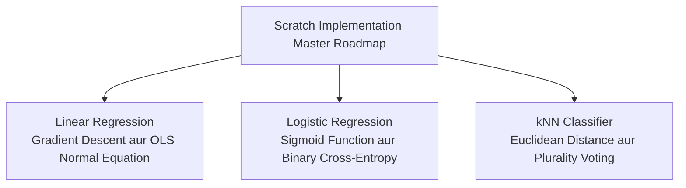

# Notes_26.01: Scratch Machine Learning Ki Shuruat Aur Philosophy [Hinglish]

## 📌 Topic Overview
Is lecture mein Shraddha ma'am ne **Scratch Implementations Section** ka introduction diya hai: bina kisi high-level library (jaise Scikit-Learn) ke, sirf pure Python aur NumPy se algorithms ko zero se kyu likhna chahiye.

---

### 📋 Is Topic Mein Hum Kya Seekhenge?
- Machine Learning algorithms ko scratch se banane ka kya fayda hota hai?
- "Black-Box" model use karne ki limitations aur khatre.
- Pure Python loops vs Vectorized NumPy speed comparison.
- Linear Regression, Logistic Regression aur kNN ka roadmap.

---

### 🔍 Har Ek Point Ka Simple & Detailed Explanation

#### 1. Scratch Se Code Kyu Likhein?
Scikit-Learn mein do line ka code likhna aasan hai:
`model = LinearRegression().fit(X, y)`
Lekin agar kal ko model overfit ho jaye, ya gradients explode ho kar `NaN` ban jayein, toh jab tak aapko underlying calculus aur update formulas nahi aate honge, aap use debug nahi kar paoge. Scratch implementation se aap ek "coder" se "true AI engineer" bante hain.

#### 2. Vectorization Ka Asar
Pure Python ke `for` loop bohot slow hote hain. Is poore section mein hum **NumPy arrays** ka use karenge jo C/C++ speed par parallel mathematical operations execute karta hai (100x se zyada fast!).

---

### 📊 Visual Flowchart: Scratch Section Ka Roadmap



---

### 💻 Python Code

```python
import numpy as np
import time

def compare_python_loop_vs_numpy_vectorization(n_samples=1_000_000):
    """
    Demonstrates the fundamental computational reason why we build
    scratch ML algorithms using vectorized NumPy instead of pure Python loops:
    NumPy runs on optimized C/Fortran SIMD instructions.
    """
    a = np.random.randn(n_samples)
    b = np.random.randn(n_samples)

    # 1. Pure Python Loop
    t0 = time.perf_counter()
    dot_loop = sum(x * y for x, y in zip(a, b))
    t_loop = time.perf_counter() - t0

    # 2. Vectorized NumPy
    t0 = time.perf_counter()
    dot_np = np.dot(a, b)
    t_np = time.perf_counter() - t0

    speedup = t_loop / t_np
    return t_loop, t_np, speedup

# --- Function Call & Testing ---
t_py, t_vec, ratio = compare_python_loop_vs_numpy_vectorization()
print(f"Pure Python Loop Time: {t_py:.4f}s")
print(f"NumPy Vectorized Time:  {t_vec:.6f}s")
print(f"Speedup: NumPy is {ratio:.1f}x faster!")
```

---

### 📌 Summary Points
- Scratch coding se mathematical clarity aati hai.
- NumPy vectorization standard loops se 100x fast hota hai.
