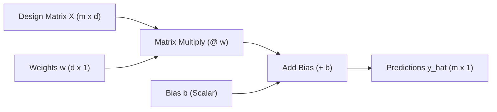

# Lecture 26.02: Linear Regression from Scratch — Mathematical Formulation & Hypothesis

## 📌 Executive Summary
Detailed mathematical formulation of the linear regression hypothesis, mapping input feature spaces to continuous targets via hyperplanes, with geometric and algebraic derivations.

---

## 🔬 Mathematical Formulation & Theory
### 1. The Supervised Regression Problem Formulation
In a supervised continuous regression task, we are provided with a training dataset $\mathcal{D}$ consisting of $m$ independent observations:

$$
\mathcal{D} = \left\{ (\mathbf{x}^{(1)}, y^{(1)}), (\mathbf{x}^{(2)}, y^{(2)}), \dots, (\mathbf{x}^{(m)}, y^{(m)}) \right\}
$$

Where each input feature vector $\mathbf{x}^{(i)} \in \mathbb{R}^d$ resides in a $d$-dimensional Euclidean space, and each target label $y^{(i)} \in \mathbb{R}$ represents a continuous scalar response.

### 2. The Linear Hypothesis Representation
The core inductive bias of linear regression asserts that the relationship between the features and the target is linear (an affine transformation):

$$
h_\theta(\mathbf{x}) = \theta_0 + \theta_1 x_1 + \theta_2 x_2 + \dots + \theta_d x_d
$$

Where:
- $\theta_0 \in \mathbb{R}$ represents the **intercept (bias parameter)**, determining the value of $\hat{y}$ when all input features are zero.
- $\theta_j \in \mathbb{R}$ ($j=1, \dots, d$) represents the **weights (slopes / regression coefficients)**, quantifying the partial marginal rate of change in $\hat{y}$ per unit change in feature $x_j$.

### 3. Compact Vector & Matrix Formulation
To enable vectorized execution on modern hardware, we define the augmented feature vector and parameter vector:

$$
\mathbf{x} = \begin{bmatrix} 1 \\ x_1 \\ x_2 \\ \vdots \\ x_d \end{bmatrix} \in \mathbb{R}^{d+1}, \quad \boldsymbol{\theta} = \begin{bmatrix} \theta_0 \\ \theta_1 \\ \theta_2 \\ \vdots \\ \theta_d \end{bmatrix} \in \mathbb{R}^{d+1}
$$

The scalar hypothesis simplifies to an inner product:

$$
\hat{y} = h_\theta(\mathbf{x}) = \boldsymbol{\theta}^T \mathbf{x} = \mathbf{x}^T \boldsymbol{\theta}
$$

Across the entire dataset of $m$ samples, we construct the design matrix $X \in \mathbb{R}^{m \times d}$ and bias scalar $b$:

$$
\hat{\mathbf{y}} = X \mathbf{w} + b \mathbf{1}_m
$$




---

## 💻 Python & NumPy Implementation
```python
import numpy as np
import matplotlib.pyplot as plt

# Generate synthetic linear regression dataset
np.random.seed(42)
m = 50
X = 2 * np.random.rand(m, 1)
true_w = 3.5
true_b = 4.2
y = true_w * X + true_b + np.random.randn(m, 1) * 0.8

# Hypothesis prediction function
def predict_linear(X, w, b):
    return X @ w + b

# Evaluate with sample weights
w_init = np.array([[2.0]])
b_init = 2.0
y_pred = predict_linear(X, w_init, b_init)

print(f"Sample X shape: {X.shape}, y shape: {y.shape}")
print(f"Predictions first 5: \n{y_pred[:5].flatten()}")

```

---

## 🎯 Key Takeaways & Best Practices
1. **First-Principles Transparency**: Building from scratch demystifies optimizer mechanics, memory layouts, and algorithmic failure modes.
2. **Vectorization vs Loops**: Always eliminate Python `for` loops across sample dimensions by relying on BLAS-accelerated NumPy array operations.
3. **Shape Integrity**: Maintain explicit assertions on input array ranks and shapes (`X.shape == (m, d)`, `y.shape == (m,)`) to prevent silent broadcasting bugs.
