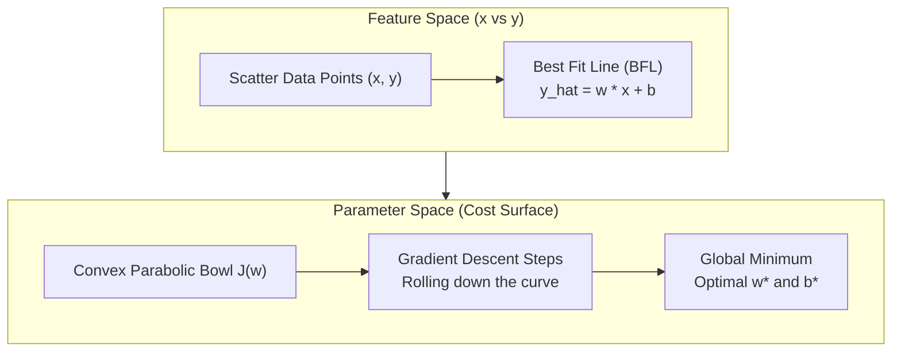

# Lecture 26.02: Linear Regression with Gradient Descent

## 📌 Topic Overview
In this lecture, Shraddha ma'am begins the mathematical formulation of **Linear Regression**, defining the continuous linear hypothesis function, the Best Fit Line, and the parabolic loss surface.

---

## 🏛️ The Linear Hypothesis
Linear regression predicts continuous target $y$ as a linear combination of input features $x$:

$$\hat{y} = h_w(x) = X w + b$$

Where:
- $X$ = Input matrix of $m$ training samples and $d$ features.
- $w$ = Weight coefficients representing feature slopes.
- $b$ = Intercept (bias).

---

## 📊 Visual Diagram: Best Fit Line & Parabolic Cost Bowl



---

## 💻 Python Implementation

```python
import numpy as np

def compute_linear_hypothesis(X, w, b):
    """
    Computes the Linear Regression hypothesis: y_hat = X * w + b
    
    Parameters:
        X: Feature matrix of shape (m, d)
        w: Weights vector of shape (d,)
        b: Bias scalar
        
    Returns:
        y_hat: Continuous predictions vector of shape (m,)
    """
    y_hat = np.dot(X, w) + b
    return y_hat

# --- Function Call & Testing ---
# 3 samples, 2 features
X_sample = np.array([[1.0, 2.0], [2.0, 3.0], [3.0, 1.0]])
weights  = np.array([0.5, -0.2])
bias     = 1.0

preds = compute_linear_hypothesis(X_sample, weights, bias)
print("Input Features:\n", X_sample)
print("Hypothesis Predictions (y_hat):", preds)
```

---

## 🔑 Key Takeaways
1. The goal of Linear Regression is finding the line that minimizes the total distance between itself and the data points.
2. The cost function is a convex parabola guaranteed to have a single global minimum.
