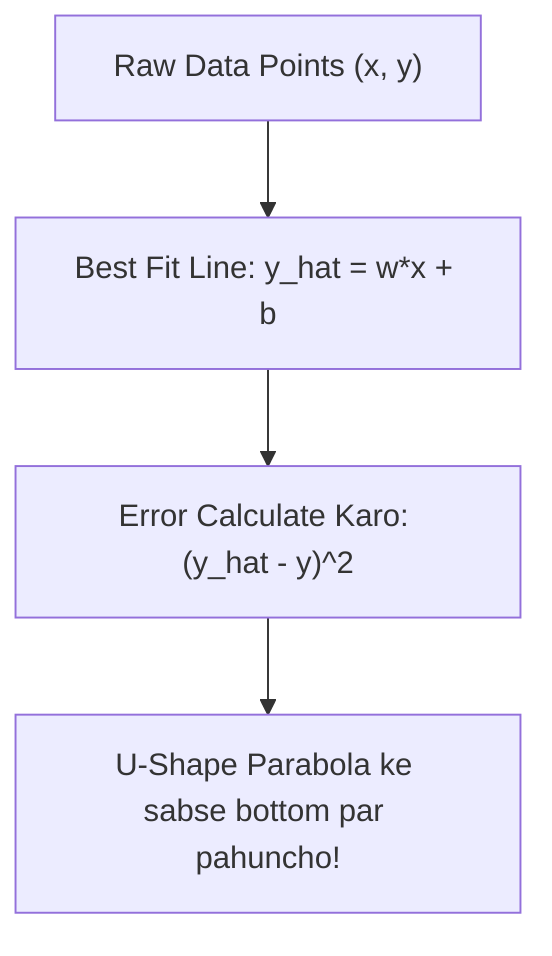

# Notes_26.02: Gradient Descent Ke Sath Linear Regression [Hinglish]

## 📌 Topic Overview
Is lecture mein Shraddha ma'am ne **Linear Regression** ka mathematical foundation samjhaya hai: hypothesis function $\hat{y} = Xw + b$, Best Fit Line (BFL), aur cost function ka bowl shape.

---

### 📋 Is Topic Mein Hum Kya Seekhenge?
- Linear Regression ka core equation: $\hat{y} = w \cdot x + b$.
- Best Fit Line (BFL) ka concept.
- Cost function $J(w)$ ka katora (parabolic bowl) shape.
- Gradient descent kaise minimum error dhoondhta hai.

---

### 🔍 Har Ek Point Ka Simple & Detailed Explanation

#### 1. Hypothesis Line Equation:
Blackboard par ma'am ne Best Fit Line draw karke dikhaya:

$$\hat{y} = w \cdot x + b$$

- $w$ = Slope (line ka jhukav).
- $b$ = Bias / Intercept (line y-axis ko kahan kaat ti hai).
- $\hat{y}$ = Model dwara predict ki gayi value.

#### 2. Parabolic Cost Function:
Jab hum alag-alag $w$ ke liye error (loss) plot karte hain, toh ek **katora (U-shape / bowl)** banta hai. Is katore ke sabse neeche waale point (global minimum) par error sabse kam hota hai.

---

### 📊 Visual Flowchart: Best Fit Line Aur Minimum Loss



---

### 💻 Python Code

```python
import numpy as np

def compute_linear_hypothesis(X, w, b):
    """
    Computes the Linear Regression hypothesis: y_hat = X * w + b
    
    Parameters:
        X: Feature matrix of shape (m, d)
        w: Weights vector of shape (d,)
        b: Bias scalar
        
    Returns:
        y_hat: Continuous predictions vector of shape (m,)
    """
    y_hat = np.dot(X, w) + b
    return y_hat

# --- Function Call & Testing ---
# 3 samples, 2 features
X_sample = np.array([[1.0, 2.0], [2.0, 3.0], [3.0, 1.0]])
weights  = np.array([0.5, -0.2])
bias     = 1.0

preds = compute_linear_hypothesis(X_sample, weights, bias)
print("Input Features:\n", X_sample)
print("Hypothesis Predictions (y_hat):", preds)
```

---

### 📌 Summary Points
- Linear regression continuous values predict karta hai.
- Loss function bowl-shaped hota hai jiska ek hi global minimum hota hai.
