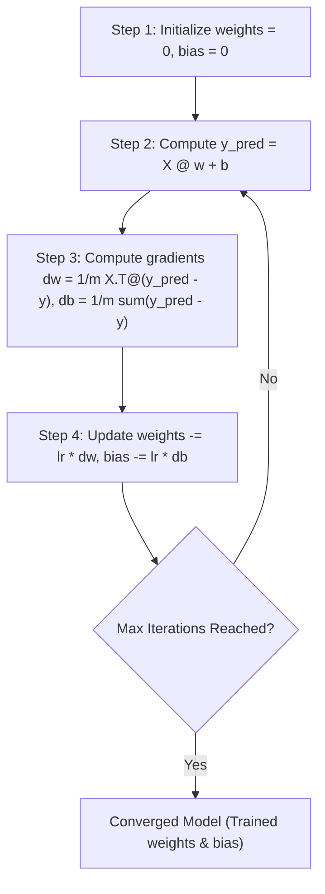

# Lecture 26.06: Linear Regression with Gradient Descent — Step 4: Parameter Updates & Scratch Implementation

## 📌 Executive Summary
Complete implementation of the convergence update rule, learning rate scaling, full LinearRegression class from scratch, and training verification.

---

## 🔬 Mathematical Formulation & Theory
### 1. The Parameter Update Theorem
To reach the minimum of the cost surface $J(\mathbf{w}, b)$, parameters must take a step in the direction opposite to the gradient (gradient descent):

$$
\mathbf{w} := \mathbf{w} - \alpha \frac{\partial J}{\partial \mathbf{w}} = \mathbf{w} - \alpha \cdot dw
$$

$$
b := b - \alpha \frac{\partial J}{\partial b} = b - \alpha \cdot db
$$

Where $\alpha > 0$ is the learning rate.



### 2. Complete Vectorized Class Implementation
Combining Steps 1 through 4 into a production-grade OOP class:

```python
class LinearRegression:
    def __init__(self, lr=0.01, n_iter=1000):
        self.lr = lr
        self.n_iter = n_iter
        self.weights = None
        self.bias = None

    def fit(self, X, y):
        m, n = X.shape
        self.weights = np.zeros(n)
        self.bias = 0.0

        for i in range(self.n_iter):
            # STEP 2: Calculate y_pred
            y_pred = self.bias + np.dot(X, self.weights)

            # STEP 3: Calculate gradients
            db = (1 / m) * np.sum(y_pred - y)
            dw = (1 / m) * np.dot(X.T, (y_pred - y))

            # STEP 4: Convergence parameter update
            self.bias -= self.lr * db
            self.weights -= self.lr * dw

    def predict(self, X):
        return self.bias + np.dot(X, self.weights)
```


---

## 💻 Python & NumPy Implementation
```python
import numpy as np

class LinearRegression:
    """Production-grade Linear Regression with Vectorized Batch Gradient Descent."""
    def __init__(self, lr=0.01, n_iter=1000):
        self.lr = lr
        self.n_iter = n_iter
        self.weights = None
        self.bias = None

    def fit(self, X, y):
        m, n = X.shape
        self.weights = np.zeros(n)
        self.bias = 0.0

        for i in range(self.n_iter):
            # STEP 2 - calc y_pred
            y_pred = self.bias + np.dot(X, self.weights)
            
            # STEP 3 - calc gradient
            db = (1.0 / m) * np.sum(y_pred - y)
            dw = (1.0 / m) * np.dot(X.T, (y_pred - y))
            
            # STEP 4 - convergence theorem - params update
            self.bias -= self.lr * db
            self.weights -= self.lr * dw

    def predict(self, X):
        return self.bias + np.dot(X, self.weights)

# Test with Lecture Example
X = np.array([[1], [2], [3], [4], [5]])
y = np.array([2, 4, 6, 8, 10])

model = LinearRegression(lr=0.01, n_iter=1000)
model.fit(X, y)

y_pred = model.predict(X)
print("Fitted Weights:", model.weights)
print("Fitted Bias:   ", model.bias)
print("Predictions:   ", y_pred)

```

---

## 🎯 Key Takeaways & Best Practices
1. **First-Principles Transparency**: Building from scratch demystifies optimizer mechanics, memory layouts, and algorithmic failure modes.
2. **Vectorization vs Loops**: Always eliminate Python `for` loops across sample dimensions by relying on BLAS-accelerated NumPy array operations.
3. **Shape Integrity**: Maintain explicit assertions on input array ranks and shapes (`X.shape == (m, d)`, `y.shape == (m,)`) to prevent silent broadcasting bugs.
