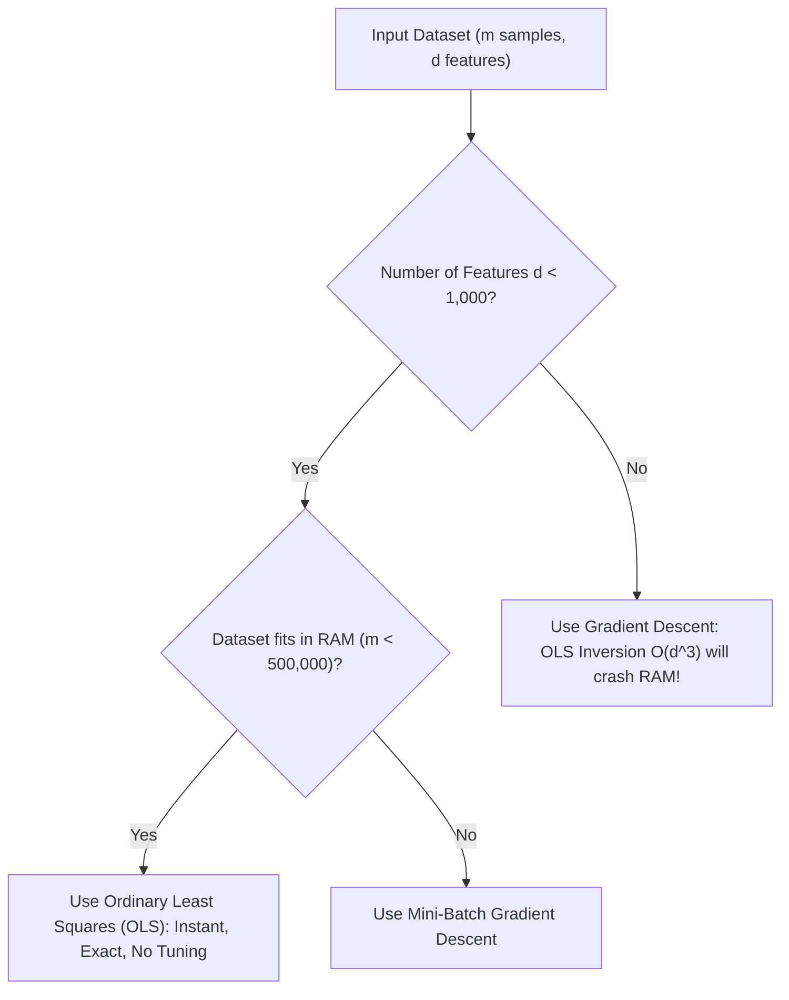

# Lecture 26.08: Linear Regression — Gradient Descent vs Ordinary Least Squares (Algorithmic Trade-offs)

## 📌 Executive Summary
Asymptotic complexity analysis, computational benchmarks, memory constraints, and structural decision matrix comparing Gradient Descent against OLS Normal Equation.

---

## 🔬 Mathematical Formulation & Theory
### 1. Asymptotic Complexity Breakdown
Choosing between Gradient Descent and OLS is one of the classic systems trade-offs in machine learning engineering:

| Criterion | Ordinary Least Squares (OLS) | Gradient Descent (GD) |
| :--- | :--- | :--- |
| **Mathematical Nature** | Exact analytical closed-form solution | Iterative numerical approximation |
| **Time Complexity** | $\mathcal{O}(d^3 + m \cdot d^2)$ (Matrix inversion bottleneck) | $\mathcal{O}(k \cdot m \cdot d)$ ($k$ = number of iterations) |
| **Space Complexity (RAM)** | $\mathcal{O}(d^2)$ to store the Gram matrix $X_b^T X_b$ | $\mathcal{O}(d)$ to store gradient and weight vectors |
| **Hyperparameters** | None (zero tuning required) | Learning rate $\alpha$, epochs $k$, tolerance $\epsilon$ |
| **Behavior with Big Data ($m \gg 10^6$)** | Matrix multiply $X^T X$ is slow but linear in $m$ | Scales naturally with Mini-Batch GD / SGD |
| **Behavior with High Dimensions ($d \gg 10^4$)** | **Fails completely** (Inverting $10^4 \times 10^4$ matrix takes hours/crashes RAM) | **Excels** (Linear in $d$, negligible memory) |
| **Singular Matrix ($m < d$ or collinearity)** | Undefined without pseudo-inverse (`np.linalg.pinv`) | Naturally finds regularized minimum |

### 2. When is Gradient Descent Better than OLS?
As highlighted in the lecture:
1. **When dataset is very large (Big Data)**: When $m > 1,000,000$, streaming mini-batches via GD requires only a few megabytes of RAM.
2. **When features are many (High-Dimensional Space)**: When $d > 10,000$, $\mathcal{O}(d^3)$ matrix inversion requires $> 10^{12}$ operations.
3. **When Regularization is required**: L1 Lasso or non-smooth objectives cannot be solved via closed-form OLS.
4. **When data is streaming / online learning**: OLS cannot update incrementally without full recomputation, whereas SGD updates on each single incoming packet.
5. **When dataset does NOT fit in memory**: Out-of-core learning is native to Gradient Descent.




---

## 💻 Python & NumPy Implementation
```python
import numpy as np
import time

# Empirical Benchmark: OLS vs GD as feature dimension d scales
m = 10000
for d in [10, 100, 500, 1500]:
    X = np.random.randn(m, d)
    y = np.random.randn(m)
    
    # OLS Benchmark
    t0 = time.perf_counter()
    X_b = np.c_[np.ones((m, 1)), X]
    theta_ols = np.linalg.inv(X_b.T @ X_b) @ X_b.T @ y
    t_ols = time.perf_counter() - t0
    
    # GD Benchmark (10 iterations)
    t0 = time.perf_counter()
    w = np.zeros(d)
    b = 0.0
    for _ in range(10):
        y_pred = X @ w + b
        res = y_pred - y
        dw = (1/m) * (X.T @ res)
        db = (1/m) * np.sum(res)
        w -= 0.01 * dw
        b -= 0.01 * db
    t_gd = time.perf_counter() - t0
    
    print(f"Features d={d:<5} | OLS Time: {t_ols:.4f}s | GD (10 iters): {t_gd:.4f}s")

```

---

## 🎯 Key Takeaways & Best Practices
1. **First-Principles Transparency**: Building from scratch demystifies optimizer mechanics, memory layouts, and algorithmic failure modes.
2. **Vectorization vs Loops**: Always eliminate Python `for` loops across sample dimensions by relying on BLAS-accelerated NumPy array operations.
3. **Shape Integrity**: Maintain explicit assertions on input array ranks and shapes (`X.shape == (m, d)`, `y.shape == (m,)`) to prevent silent broadcasting bugs.
