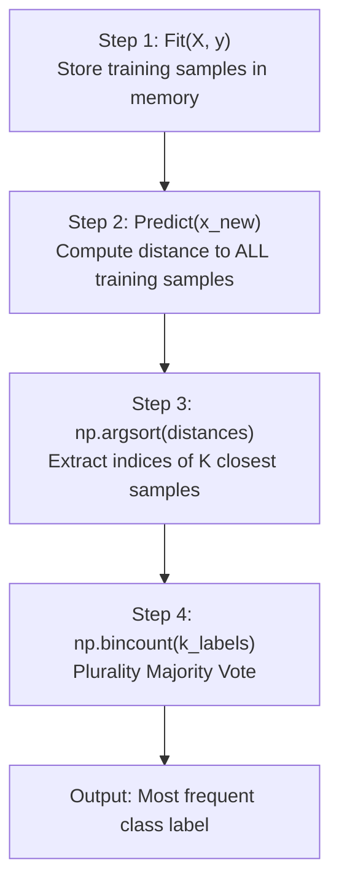

# Lecture 26.11: KNN Classifier (Algorithmic Steps)

## 📌 Topic Overview
In this lecture, Shraddha ma'am outlines the algorithmic mechanics and step-by-step pseudo-code required to build a **k-Nearest Neighbors (kNN) Classifier from Scratch**.

---

## 🏛️ The 4 Core Steps of kNN Scratch
1. **Fit Step**: Store all training points $X_{\text{train}}$ and labels $y_{\text{train}}$ (no weights to optimize!).
2. **Distance Matrix**: For any incoming query point, compute Euclidean distance to all stored points.
3. **Sorting**: Use `np.argsort` to find the indices of the $k$ closest neighbors.
4. **Majority Voting**: Use `np.bincount` to count votes and pick the winning class.

---

## 📊 Visual Diagram: kNN Algorithmic Flow



---

## 💻 Python Implementation

```python
import numpy as np

def compute_euclidean_distance_step(x1, x2):
    """
    Step 1 of kNN: Compute Euclidean distance between two feature vectors:
    d = sqrt(sum((x1 - x2)^2))
    """
    return np.sqrt(np.sum((x1 - x2) ** 2))

def retrieve_top_k_neighbors(distances, labels, k=3):
    """
    Step 2 & 3 of kNN: Sort distances in ascending order
    and retrieve the labels of the top k nearest samples.
    """
    # np.argsort returns indices that would sort an array
    sorted_indices = np.argsort(distances)
    k_nearest_indices = sorted_indices[:k]
    k_nearest_labels = labels[k_nearest_indices]
    return k_nearest_labels

# --- Function Call & Testing ---
p_query = np.array([2.0, 3.0])
p_train = np.array([[1.0, 2.0], [5.0, 5.0], [2.5, 3.5]])
labels  = np.array([0, 1, 0])

dists = [compute_euclidean_distance_step(p_query, pt) for pt in p_train]
top_k_lbls = retrieve_top_k_neighbors(dists, labels, k=2)

print("Distances to query point:", np.round(dists, 4))
print("Top-2 Nearest Labels:   ", top_k_lbls)
```

---

## 🔑 Key Takeaways
1. kNN requires zero training iterations.
2. `np.argsort` and `np.bincount` make vectorized kNN extremely concise in Python.
