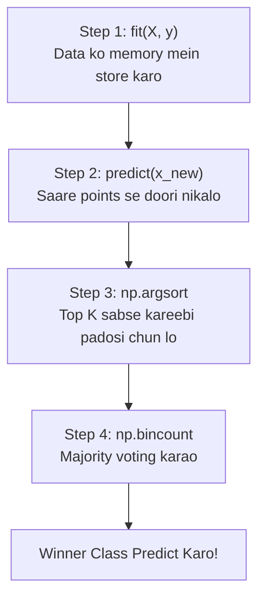

# Notes_26.11: kNN Classifier Ke Steps [Hinglish]

## 📌 Topic Overview
Is lecture mein Shraddha ma'am ne **kNN Classifier ko scratch se code karne ke 4 steps** blackboard par samjhaye hain.

---

### 📋 Is Topic Mein Hum Kya Seekhenge?
- kNN ka `fit()` method itna simple kyu hota hai?
- Naye query point ke liye distance kaise calculate hoti hai.
- `np.argsort()` se top $k$ padosi nikaalna.
- `np.bincount()` se majority vote lena.

---

### 🔍 Har Ek Point Ka Simple & Detailed Explanation

#### 1. Chaar Steps:
1. **`fit(X, y)`**: kNN mein koi formula train nahi hota; sirf training data ko `self.X_train` aur `self.y_train` mein save kar liya jata hai.
2. **Distance Calculation**: Jab naya point aata hai, toh pure training set ke sath uski Euclidean distance nikaalo.
3. **Sorting**: `np.argsort()` chalao taaki sabse kam distance wale top $k$ padosiyon ke index mil jayein.
4. **Majority Vote**: Dekho ki in $k$ padosiyon mein kiske paas sabse zyada votes hain.

---

### 📊 Visual Flowchart: kNN Ke 4 Steps



---

### 💻 Python Code

```python
import numpy as np

def compute_euclidean_distance_step(x1, x2):
    """
    Step 1 of kNN: Compute Euclidean distance between two feature vectors:
    d = sqrt(sum((x1 - x2)^2))
    """
    return np.sqrt(np.sum((x1 - x2) ** 2))

def retrieve_top_k_neighbors(distances, labels, k=3):
    """
    Step 2 & 3 of kNN: Sort distances in ascending order
    and retrieve the labels of the top k nearest samples.
    """
    # np.argsort returns indices that would sort an array
    sorted_indices = np.argsort(distances)
    k_nearest_indices = sorted_indices[:k]
    k_nearest_labels = labels[k_nearest_indices]
    return k_nearest_labels

# --- Function Call & Testing ---
p_query = np.array([2.0, 3.0])
p_train = np.array([[1.0, 2.0], [5.0, 5.0], [2.5, 3.5]])
labels  = np.array([0, 1, 0])

dists = [compute_euclidean_distance_step(p_query, pt) for pt in p_train]
top_k_lbls = retrieve_top_k_neighbors(dists, labels, k=2)

print("Distances to query point:", np.round(dists, 4))
print("Top-2 Nearest Labels:   ", top_k_lbls)
```

---

### 📌 Summary Points
- kNN ka `fit` instant hota hai.
- Prediction ke steps: Distance -> Sort -> Top K -> Vote.
