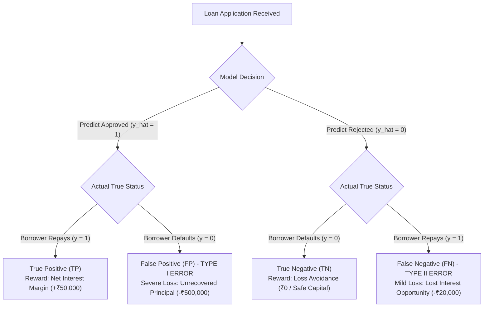

# Lecture 27.01: Problem Statement aur Credit Risk Underwriting ke Core Fundamentals

## 📌 Executive Summary (Hinglish)
SecureTrust Bank ka real-world case study, loan underwriting mein Type I aur Type II errors ki asymmetric financial cost, aur banking mein precision-oriented machine learning models ki zarurat.

---

### 📋 Is Topic/Section Mein Hum Kya Cover Kar Rahe Hain?
1. SecureTrust Bank ka real-world business context aur manual underwriting ki limitations.
2. Type I Error (False Positive / Defaulter Approval) vs Type II Error (False Negative / Good Borrower Rejection) ki mathematical aur financial cost.
3. Asymmetric Loss Matrix aur banking systems mein Precision ko Recall se zyada prioritize karne ki vajah.
4. Supervised Classification problem formulation: Input features matrix $\mathbf{X}$ aur target label $y \in \{0, 1\}$.

---

### 🔍 Har Ek Bullet Point Ka Detailed Explanation

**SecureTrust Bank Context**: Bank personal aur home loans distribute karta hai. Pehle manual paper verification se decision liya jaata tha jo slow, biased aur error-prone tha. Ek intelligent machine learning automated underwriting pipeline ki zaroorat hai.

**Type I vs Type II Errors**: Agar bank kisi defaulter ko loan approve kar deta hai (False Positive), toh bank ka poora principal amount doob jaata hai (loss = ₹1,00,000+). Lekin agar bank kisi acche customer ko reject kar deta hai (False Negative), toh bank sirf interest margin lose karta hai (opportunity loss = ₹10,000). Isliye False Positive bank ke liye 10 guna zyada deadly hota hai.

**Asymmetric Loss Matrix**: Real-world finance mein accuracy metric misleading hota hai. Yahan hamara primary target **Precision** maximize karna hota hai, taaki jo bhi loan approve ho, usme default risk minimum ho.

**Problem Formulation**: Hum historical 1,000 applicants ke 19 features (demographics, income, credit bureau score, collateral) ko input vector $\mathbf{x} \in \mathbb{R}^{19}$ maan kar target probability $\hat{p} = P(Y=1|\mathbf{x})$ predict karenge.

---

## 🏛️ Mathematical Architecture & Detailed Theory

### 🏦 SecureTrust Bank Business Problem Statement

In contemporary retail banking and financial institutions, **Credit Risk Underwriting** is the core operational process that determines an institution's solvency and profitability. 

A mid-sized financial company named **SecureTrust Bank** offers personal and home loans across urban and rural regions in India. Every day, hundreds of applicants submit documentation. Historically, SecureTrust Bank relied on a manual underwriting protocol where credit officers inspected paper income proofs, tax filings, and subjective character references.

#### Core Operational Vulnerabilities of Manual Underwriting:
1. **High Latency & Inefficiency**: Turnaround time (TAT) per loan application averaged 5 to 10 business days.
2. **Cognitive Bias & Inconsistency**: Different loan officers in different branches applied disparate heuristic criteria to identical applicant profiles.
3. **The Dual Risk Dilemma**:
   - **Good Customers Wrongly Rejected (Type II Error / False Negative)**: Loss of prime banking relationships and interest income to competitor NBFCs.
   - **High-Risk Borrowers Wrongly Approved (Type I Error / False Positive)**: Direct credit default leading to Non-Performing Assets (NPAs) and capital write-offs.

---

### ⚖️ The Asymmetry of Financial Classification Errors

In traditional machine learning benchmarks (e.g., MNIST digit recognition), all misclassifications carry an identical loss penalty. In financial risk management, the loss matrix is **severely asymmetric**:



#### Mathematical Formulation of Underwriting Utility:
Let $C_{	ext{FP}}$ denote the financial loss incurred from approving a borrower who subsequently defaults, and let $C_{	ext{FN}}$ denote the opportunity loss from rejecting a creditworthy borrower:

$$
	ext{Cost}(	ext{FP}) pprox 	ext{Loan Principal} 	imes 	ext{Loss Given Default (LGD)}
$$

$$
	ext{Cost}(	ext{FN}) pprox 	ext{Loan Principal} 	imes 	ext{Net Interest Margin (NIM)}
$$

In commercial retail banking, typically:

$$
rac{C_{	ext{FP}}}{C_{	ext{FN}}} \in [5, 20]
$$

Because a single default can wipe out the profit margins of 10 to 15 successfully repaid loans, the operational objective function must heavily prioritize **Precision**:

$$
	ext{Precision} = rac{	ext{TP}}{	ext{TP} + 	ext{FP}}
$$

A high-precision underwriting engine guarantees that when the system issues an **Approved** decision, the probability of borrower default is minimized.

---

## 💻 Python Implementation & Code Example

```python
import numpy as np
import pandas as pd

# Financial Utility Matrix simulation
def calculate_underwriting_utility(tp, fp, fn, tn, 
                                   interest_gain=50000.0, 
                                   default_loss=250000.0, 
                                   opportunity_loss=10000.0):
    net_profit = (tp * interest_gain) - (fp * default_loss) - (fn * opportunity_loss)
    precision = tp / (tp + fp) if (tp + fp) > 0 else 0.0
    recall = tp / (tp + fn) if (tp + fn) > 0 else 0.0
    return {
        "Net_Profit_INR": net_profit,
        "Precision": precision,
        "Recall": recall
    }

# Benchmark: Model A (Balanced) vs Model B (High Precision)
model_a = calculate_underwriting_utility(tp=80, fp=25, fn=20, tn=75)
model_b = calculate_underwriting_utility(tp=65, fp=5, fn=35, tn=95)

print("Model A (Naive Balanced):", model_a)
print("Model B (High-Precision Guarded):", model_b)
assert model_b["Net_Profit_INR"] > model_a["Net_Profit_INR"], "High-precision underwriting must preserve bank capital!"

```

---

## 🎯 Quick Revision Points (Interview Notes)
- **Objective**: Credit risk modeling mein precision hamesha accuracy se zyada important hoti hai.
- **Data Invariant**: SimpleImputer aur StandardScaler ko hamesha training data par `fit` karke test set par sirf `transform` kiya jaata hai.
- **Decision Boundary**: Non-linear feature transformations ($DTI^2$, $Credit^2$) linear models ko non-linear patterns capture karne ki capability provide karte hain.
