# Lecture 27.02: Project Architecture, Pipeline Engineering & Dataset Ingestion

## 📌 Executive Summary
End-to-end machine learning pipeline architecture for the CreditWise loan system, dataset ingestion, schema validation, and memory profiling of loan_approval_data.csv.

---

## 🏛️ Theoretical Formulation & Mathematical Architecture

### 🏗️ CreditWise Machine Learning Pipeline Architecture

To engineer an enterprise-grade automated underwriting solution, the software and statistical pipeline is decoupled into strictly isolated, reproducible stages:

```mermaid
flowchart LR
    A["Raw Data Ingestion<br/>(loan_approval_data.csv)"] --> B["Data Sanitization<br/>& SimpleImputer"]
    B --> C["Exploratory Data Analysis<br/>(Distributions & Outliers)"]
    C --> D["Feature Encoding<br/>(OHE & LabelEncoder)"]
    D --> E["Leakage-Free Partition<br/>(Train-Test Split 80/20)"]
    E --> F["Feature Standardization<br/>(StandardScaler)"]
    F --> G["Multi-Model Benchmark<br/>(LogReg, KNN, Naive Bayes)"]
    G --> H["Non-Linear Feature Eng.<br/>(Polynomials & Ratios)"]
    H --> I["Decision Threshold Tuning<br/>(Optimal Tau Cutoff)"]
```



---

### 📋 Feature Attribute Dictionary

The dataset `loan_approval_data.csv` contains 20 columns across 1,000 applicant records:

| Column Name | Mathematical Type | Domain Description | Invariant Constraint |
| :--- | :--- | :--- | :--- |
| `Applicant_ID` | Discrete Identifier | Unique database primary key | Dropped during preprocessing |
| `Applicant_Income` | Continuous ($\mathbb{R}^+$) | Primary monthly salary or business income (INR) | Non-negative, positive skew |
| `Coapplicant_Income` | Continuous ($\mathbb{R}^+$) | Co-borrower monthly income (INR) | Can be 0.0 (single applicant) |
| `Employment_Status` | Categorical Nominal | `Salaried`, `Self-Employed`, `Business` | Mutually exclusive |
| `Age` | Discrete ($\mathbb{Z}^+$) | Age in completed years | Typically $[21, 65]$ |
| `Marital_Status` | Categorical Binary | `Married`, `Single` | Binary demographic factor |
| `Dependents` | Discrete ($\mathbb{Z}^+$) | Number of financially dependent family members | $[0, 5+]$ |
| `Credit_Score` | Continuous / Ordinal | CIBIL / Experian bureau credit score | Standard range $[300, 900]$ |
| `Existing_Loans` | Discrete ($\mathbb{Z}^+$) | Count of active ongoing EMI credit facilities | Operational leverage indicator |
| `DTI_Ratio` | Continuous ($\mathbb{R}^+$) | Debt-to-Income ratio ($rac{	ext{Monthly Debt}}{	ext{Monthly Income}}$) | Crucial risk driver $[0.0, 1.0+]$ |
| `Savings` | Continuous ($\mathbb{R}^+$) | Liquid savings and liquid deposit reserves (INR) | Liquidity cushion |
| `Collateral_Value` | Continuous ($\mathbb{R}^+$) | Pledged property or asset appraisal value (INR) | Security backstop |
| `Loan_Amount` | Continuous ($\mathbb{R}^+$) | Requested loan principal amount (INR) | Exposure at Default |
| `Loan_Term` | Discrete ($\mathbb{Z}^+$) | Loan tenure in months (e.g., 36, 60, 84, 120, 240) | Duration risk |
| `Loan_Purpose` | Categorical Nominal | `Home`, `Education`, `Personal`, `Car`, `Business` | Risk classification bucket |
| `Property_Area` | Categorical Nominal | `Urban`, `Semiurban`, `Rural` | Geographic location factor |
| `Education_Level` | Categorical Ordinal | `Graduate`, `Postgraduate`, `Not Graduate` | Earning potential proxy |
| `Gender` | Categorical Nominal | `Male`, `Female` | Demographic feature |
| `Employer_Category` | Categorical Nominal | `Govt`, `Private`, `Self` | Income stability metric |
| `Loan_Approved` | Binary Target | `1` (Approved), `0` (Rejected) | Ground truth supervisory label |

---

## 💻 Vectorized Python Implementation

```python
import pandas as pd
import numpy as np

# Load dataset
df = pd.read_csv("loan_approval_data.csv")
print("Dataset Dimensions:", df.shape)

# Memory and schema verification
assert df.shape == (1000, 20), f"Expected shape (1000, 20), got {df.shape}"
num_cols = df.select_dtypes(include=[np.number]).columns.tolist()
cat_cols = df.select_dtypes(exclude=[np.number]).columns.tolist()

print(f"Numerical Features ({len(num_cols)}):", num_cols)
print(f"Categorical Features ({len(cat_cols)}):", cat_cols)

```

---

## 🔬 Key Engineering Takeaways & Invariants
1. **Mathematical Grounding**: Every transformation and classification step directly addresses the underlying empirical distribution and financial risk constraints.
2. **Reproducibility**: Clean, leak-free pipeline partitioning guarantees that performance metrics match production operating realities.
3. **Domain Alignment**: Aligning model evaluation with the asymmetric cost of financial errors protects institutional solvency.
