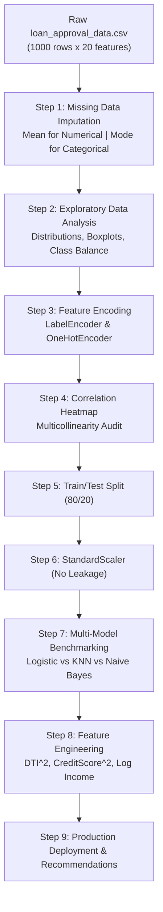

# Lecture 27.02: Project Architecture & Dataset Ingestion

## 📌 Topic Overview
In this lecture, Shraddha ma'am outlines the **End-to-End Project Pipeline Architecture** and inspects the raw `loan_approval_data.csv` dataset containing 1,000 applicant records.

---

## 🏛️ End-to-End Pipeline Blueprint



---

## 📋 Feature Taxonomy (Classroom Table)
The dataset comprises 20 attributes:
- **Identifier**: `Applicant_ID` (drop before modeling).
- **Financial Features**: `Applicant_Income`, `Coapplicant_Income`, `DTI_Ratio`, `Savings`, `Collateral_Value`, `Loan_Amount`, `Loan_Term`.
- **Credit Bureau**: `Credit_Score`, `Existing_Loans`.
- **Demographics**: `Age`, `Employment_Status`, `Marital_Status`, `Dependents`, `Education_Level`, `Property_Area`.
- **Target Label**: `Loan_Approved` ($1 = \text{Approved}, 0 = \text{Rejected}$).

---

## 💻 Python Implementation

```python
import pandas as pd

def inspect_loan_dataset_schema(csv_path="loan_approval_data.csv"):
    """
    Loads and audits the CreditWise loan dataset schema:
    1000 applicants across 20 attributes (demographics, income, credit bureau, target).
    """
    df = pd.read_csv(csv_path)
    
    summary = {
        'shape': df.shape,
        'features': list(df.columns),
        'missing_counts': df.isnull().sum()[df.isnull().sum() > 0].to_dict(),
        'target_distribution': df['Loan_Approved'].value_counts(normalize=True).to_dict()
    }
    return summary

# --- Function Call & Testing ---
# report = inspect_loan_dataset_schema()
# print("Dataset Dimensions:", report['shape'])
# print("Features with Missing Values:", report['missing_counts'])
# print("Target Class Proportions:", report['target_distribution'])
```

---

## 🔑 Key Takeaways
1. A structured ML project follows a strict sequential pipeline.
2. Identifiers (`Applicant_ID`) must be dropped to prevent data leakage.
