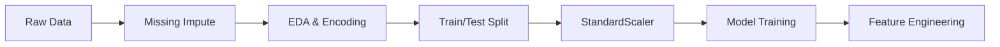

# Notes_27.02: Project Architecture Aur Dataset Ingestion [Hinglish]

## 📌 Topic Overview
Is lecture mein Shraddha ma'am ne **CreditWise Project ke poore pipeline architecture** ka blueprint dikhaya hai aur `loan_approval_data.csv` dataset ke saare columns ka audit kiya hai.

---

### 📋 Is Topic Mein Hum Kya Seekhenge?
- Real-world end-to-end ML project ke 9 mukhya steps.
- Dataset ke 20 columns aur unka meaning.
- ID columns ko model se kyu drop karna zaroori hai.
- Pandas se dataset load karke shape aur columns check karna.

---

### 🔍 Har Ek Point Ka Simple & Detailed Explanation

#### 1. Poore Project Ki 9-Step Pipeline:
1. Raw Data Ingestion (`loan_approval_data.csv`).
2. Missing values handle karna.
3. Exploratory Data Analysis (EDA).
4. Feature Encoding (Categorical text ko numbers banana).
5. Correlation Heatmap dekhna.
6. Train-Test Split (80/20).
7. Feature Scaling (`StandardScaler`).
8. Multi-Model Benchmarking (Logistic, kNN, Naive Bayes).
9. Feature Engineering se model improve karna.

---

### 📊 Visual Flowchart: End-to-End Machine Learning Pipeline



---

### 💻 Python Code

```python
import pandas as pd

def inspect_loan_dataset_schema(csv_path="loan_approval_data.csv"):
    """
    Loads and audits the CreditWise loan dataset schema:
    1000 applicants across 20 attributes (demographics, income, credit bureau, target).
    """
    df = pd.read_csv(csv_path)
    
    summary = {
        'shape': df.shape,
        'features': list(df.columns),
        'missing_counts': df.isnull().sum()[df.isnull().sum() > 0].to_dict(),
        'target_distribution': df['Loan_Approved'].value_counts(normalize=True).to_dict()
    }
    return summary

# --- Function Call & Testing ---
# report = inspect_loan_dataset_schema()
# print("Dataset Dimensions:", report['shape'])
# print("Features with Missing Values:", report['missing_counts'])
# print("Target Class Proportions:", report['target_distribution'])
```

---

### 📌 Summary Points
- Project hamesha structured pipeline se banta hai.
- `Applicant_ID` sirf identifier hai, use feature nahi banana chahiye.
