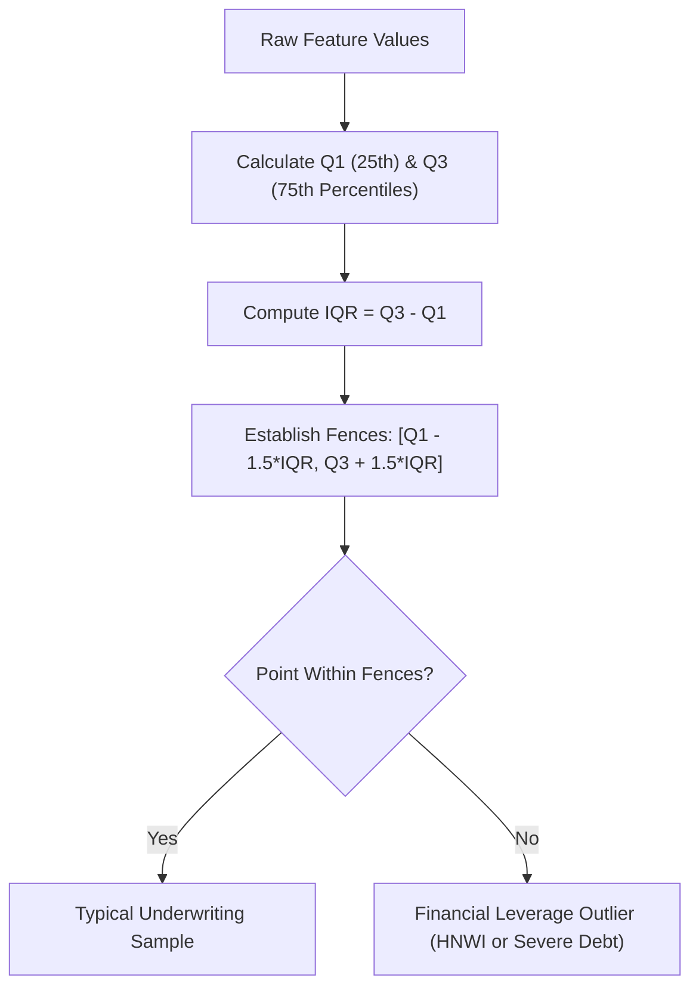

# Lecture 27.04: Exploratory Data Analysis (EDA) — Distribution, Skewness & Outliers

## 📌 Executive Summary
Rigorous exploratory data analysis on the CreditWise dataset, target class imbalance visualization, univariate income distribution skewness, and Tukey boxplot outlier diagnostics.

---

## 🏛️ Theoretical Formulation & Mathematical Architecture

### 📊 Exploratory Statistical Analysis Protocol

Exploratory Data Analysis (EDA) serves as the diagnostic lens revealing underlying probability densities, feature correlations, and structural pathologies before statistical model training.

#### 1. Target Class Imbalance Quantification:
The binary response variable $Y \in \{0, 1\}$ exhibits an empirical prior distribution:

$$
P(Y = 0) = rac{N_0}{N} pprox 68.6\% \qquad	ext{and}\qquad P(Y = 1) = rac{N_1}{N} pprox 31.4\%
$$

This baseline imbalance implies that a naive zero-rule classifier predicting 'Rejected' for every single applicant achieves an apparent accuracy of $68.6\%$, while completely failing to execute any commercial banking operations.

---

### 📦 Tukey's Five-Number Summary & Outlier Fences

To mathematically inspect extreme leverage points and potential data recording errors, we apply John Tukey's Interquartile Range (IQR) fence rule:

Given the ordered rank distribution $\mathcal{D} = \{x_{(1)}, x_{(2)}, \dots, x_{(n)}\}$:

$$
	ext{IQR} = Q_3 - Q_1
$$

The lower and upper outer fences are established at:

$$
F_{	ext{Lower}} = Q_1 - 1.5 	imes 	ext{IQR} \qquad	ext{and}\qquad F_{	ext{Upper}} = Q_3 + 1.5 	imes 	ext{IQR}
$$

Any observation $x_i$ outside $[F_{	ext{Lower}}, F_{	ext{Upper}}]$ is designated an empirical outlier. In financial underwriting:
- Outliers in `Applicant_Income` or `Savings` represent legitimate high-net-worth individuals (HNWIs) rather than measurement errors.
- Outliers in `DTI_Ratio` (> 1.0) signify hyper-leveraged borrowers who spend more on existing debt than their total monthly income.



---

## 💻 Vectorized Python Implementation

```python
import pandas as pd
import numpy as np

# Load preprocessed dataframe
df = pd.read_csv("loan_approval_data.csv")

# Compute class balance
class_counts = df["Loan_Approved"].value_counts(normalize=True)
print("Target Distribution:")
print(class_counts)

# Outlier bounds for Credit_Score and DTI_Ratio
for col in ["Credit_Score", "DTI_Ratio", "Applicant_Income"]:
    series = df[col].dropna()
    q1 = series.quantile(0.25)
    q3 = series.quantile(0.75)
    iqr = q3 - q1
    lower_fence = q1 - 1.5 * iqr
    upper_fence = q3 + 1.5 * iqr
    outliers = series[(series < lower_fence) | (series > upper_fence)]
    print(f"{col} Outliers count: {len(outliers)} (Bounds: [{lower_fence:.2f}, {upper_fence:.2f}])")

```

---

## 🔬 Key Engineering Takeaways & Invariants
1. **Mathematical Grounding**: Every transformation and classification step directly addresses the underlying empirical distribution and financial risk constraints.
2. **Reproducibility**: Clean, leak-free pipeline partitioning guarantees that performance metrics match production operating realities.
3. **Domain Alignment**: Aligning model evaluation with the asymmetric cost of financial errors protects institutional solvency.
