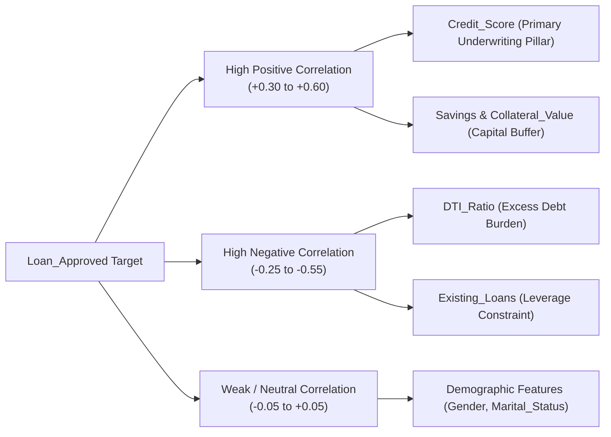

# Lecture 27.06: Correlation Analysis & Multicollinearity Diagnostics

## 📌 Executive Summary
Pearson correlation coefficient formulation, correlation matrix heatmaps, identifying primary risk predictors for loan approval, and diagnosing feature collinearity.

---

## 🏛️ Theoretical Formulation & Mathematical Architecture

### 📈 Pearson Product-Moment Correlation Formulation

The linear association between two continuous random variables $X$ and $Y$ across a sample of $m$ observations is measured by the **Pearson Correlation Coefficient** $r_{xy}$:

$$
oxed{
r_{xy} = rac{\sum_{i=1}^m (x_i - ar{x})(y_i - ar{y})}{\sqrt{\sum_{i=1}^m (x_i - ar{x})^2} \sqrt{\sum_{i=1}^m (y_i - ar{y})^2}} = rac{	ext{Cov}(X, Y)}{\sigma_X \sigma_Y}
}
$$

Where:
- $r_{xy} \in [-1.0, +1.0]$.
- $r_{xy} = +1.0$ indicates perfect deterministic positive collinearity.
- $r_{xy} = -1.0$ indicates perfect deterministic inverse collinearity.
- $r_{xy} = 0.0$ signifies the complete absence of any linear dependency.

---

### 🔍 Credit Risk Correlation Ranking Hierarchy

In our encoded SecureTrust Bank design matrix, sorting features by their absolute correlation with the supervisory label `Loan_Approved` yields critical domain insights:



#### Multicollinearity Alert:
Features displaying severe pairwise correlation ($|r_{jk}| > 0.85$) inflate the parameter standard errors in linear models. In baseline loan data, `Applicant_Income` and `Total_Income` will naturally exhibit strong covariance, warranting careful ratio-based feature engineering.

---

## 💻 Vectorized Python Implementation

```python
import pandas as pd

# Load and compute correlation against target
# Assume df_encoded is ready
corr_series = df_encoded.corr()["Loan_Approved"].sort_values(ascending=False)
print("--- Features Positively Correlated with Loan Approval ---")
print(corr_series[corr_series > 0].head(5))

print("
--- Features Negatively Correlated with Loan Approval ---")
print(corr_series[corr_series < 0].tail(5))

```

---

## 🔬 Key Engineering Takeaways & Invariants
1. **Mathematical Grounding**: Every transformation and classification step directly addresses the underlying empirical distribution and financial risk constraints.
2. **Reproducibility**: Clean, leak-free pipeline partitioning guarantees that performance metrics match production operating realities.
3. **Domain Alignment**: Aligning model evaluation with the asymmetric cost of financial errors protects institutional solvency.
