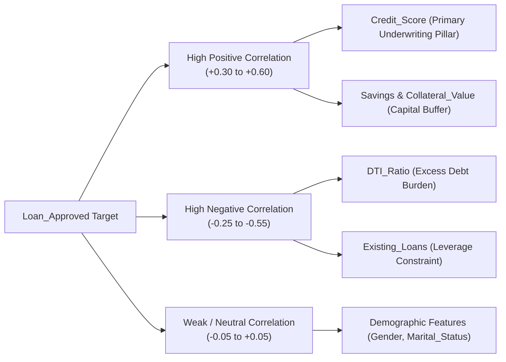

# Lecture 27.06: Correlation Analysis aur Multicollinearity Diagnostics

## 📌 Executive Summary (Hinglish)
Pearson correlation coefficient ka mathematical derivation, correlation heatmap visualization, loan approval ke primary risk drivers ki ranking, aur collinearity diagnostics.

---

### 📋 Is Topic/Section Mein Hum Kya Cover Kar Rahe Hain?
1. Pearson correlation coefficient ($r$) ka mathematical formula aur interpretation range $[-1, +1]$.
2. Target variable `Loan_Approved` ke sath numerical features ke correlation ki ranking.
3. Top positive drivers: `Credit_Score`, `Savings`, `Collateral_Value` ka empirical correlation impact.
4. Top negative risk drivers: `DTI_Ratio` aur `Existing_Loans` ka default correlation.

---

### 🔍 Har Ek Bullet Point Ka Detailed Explanation

**Pearson Correlation**: Correlation measure karta hai ki do features ke beech linear relationship kitni strong hai. $r = +1$ perfect positive linear correlation hai aur $r = -1$ perfect negative.

**Target Correlation Ranking**: Cleaned dataset mein target `Loan_Approved` ke sath sabse highest correlation `Credit_Score` (positive) aur `DTI_Ratio` (negative) ka hota hai.

**Positive Asset Drivers**: Jin applicants ke paas high savings reserves aur collateral assets hote hain, unka creditworthiness score naturally boost hota hai.

**Debt Burden Drivers**: `DTI_Ratio` badhne par default probability exponential rate se badhti hai, isliye iska correlation negative hota hai.

---

## 🏛️ Mathematical Architecture & Detailed Theory

### 📈 Pearson Product-Moment Correlation Formulation

The linear association between two continuous random variables $X$ and $Y$ across a sample of $m$ observations is measured by the **Pearson Correlation Coefficient** $r_{xy}$:

$$
oxed{
r_{xy} = rac{\sum_{i=1}^m (x_i - ar{x})(y_i - ar{y})}{\sqrt{\sum_{i=1}^m (x_i - ar{x})^2} \sqrt{\sum_{i=1}^m (y_i - ar{y})^2}} = rac{	ext{Cov}(X, Y)}{\sigma_X \sigma_Y}
}
$$

Where:
- $r_{xy} \in [-1.0, +1.0]$.
- $r_{xy} = +1.0$ indicates perfect deterministic positive collinearity.
- $r_{xy} = -1.0$ indicates perfect deterministic inverse collinearity.
- $r_{xy} = 0.0$ signifies the complete absence of any linear dependency.

---

### 🔍 Credit Risk Correlation Ranking Hierarchy

In our encoded SecureTrust Bank design matrix, sorting features by their absolute correlation with the supervisory label `Loan_Approved` yields critical domain insights:



#### Multicollinearity Alert:
Features displaying severe pairwise correlation ($|r_{jk}| > 0.85$) inflate the parameter standard errors in linear models. In baseline loan data, `Applicant_Income` and `Total_Income` will naturally exhibit strong covariance, warranting careful ratio-based feature engineering.

---

## 💻 Python Implementation & Code Example

```python
import pandas as pd

# Load and compute correlation against target
# Assume df_encoded is ready
corr_series = df_encoded.corr()["Loan_Approved"].sort_values(ascending=False)
print("--- Features Positively Correlated with Loan Approval ---")
print(corr_series[corr_series > 0].head(5))

print("
--- Features Negatively Correlated with Loan Approval ---")
print(corr_series[corr_series < 0].tail(5))

```

---

## 🎯 Quick Revision Points (Interview Notes)
- **Objective**: Credit risk modeling mein precision hamesha accuracy se zyada important hoti hai.
- **Data Invariant**: SimpleImputer aur StandardScaler ko hamesha training data par `fit` karke test set par sirf `transform` kiya jaata hai.
- **Decision Boundary**: Non-linear feature transformations ($DTI^2$, $Credit^2$) linear models ko non-linear patterns capture karne ki capability provide karte hain.
