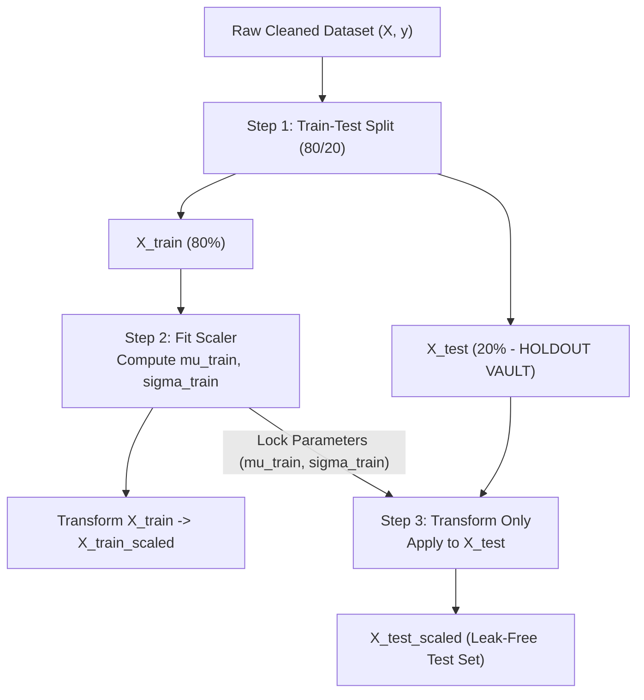

# Lecture 27.07: Feature Scaling & Train-Test Splitting — Data Leakage Prevention

## 📌 Executive Summary
Z-score standardization mechanics, train-test splitting with random_state=42, and the strict engineering invariants preventing data leakage across validation folds.

---

## 🏛️ Theoretical Formulation & Mathematical Architecture

### 🛡️ The Architecture of Data Leakage Prevention

In applied machine learning pipelines, **Data Leakage** occurs when information from outside the training dataset is inadvertently utilized to build or transform the model.



---

### 📐 Standardization Mathematics (Z-Score)

For any continuous feature vector $\mathbf{x} = [x_1, x_2, \dots, x_m]^T$:

$$
\mu = rac{1}{m} \sum_{i=1}^m x_i \qquad	ext{and}\qquad \sigma = \sqrt{rac{1}{m} \sum_{i=1}^m (x_i - \mu)^2}
$$

The standardized feature coordinate $z_i$ is given by:

$$
oxed{z_i = rac{x_i - \mu}{\sigma}}
$$

#### Mathematical Necessity in Classification:
1. **Distance-Based Learners (KNN)**:
   In unscaled space, Euclidean distance $\|\mathbf{x}_a - \mathbf{x}_b\|_2 = \sqrt{\Delta \text{Income}^2 + \Delta \text{DTI}^2}$ is $100\%$ dominated by the income term ($10^4$ vs $10^{-1}$), rendering the DTI ratio completely inert.
2. **Gradient-Based Learners (Logistic Regression)**:
   Standardization sphericalizes the cost function Hessian matrix condition number $\kappa(\mathbf{H}) \approx 1$, preventing zigzagging oscillations and ensuring rapid parameter convergence.

---

## 💻 Vectorized Python Implementation

```python
from sklearn.model_selection import train_test_split
from sklearn.preprocessing import StandardScaler

# Assume X and y are defined
X_train, X_test, y_train, y_test = train_test_split(X, y, test_size=0.2, random_state=42)

scaler = StandardScaler()
# Strict contract: fit on train only
X_train_scaled = scaler.fit_transform(X_train)
# Transform test using train parameters
X_test_scaled = scaler.transform(X_test)

print("X_train_scaled shape:", X_train_scaled.shape)
print("X_test_scaled shape:", X_test_scaled.shape)
assert abs(X_train_scaled.mean()) < 1e-10, "Standardized train mean must be ~0.0"

```

---

## 🔬 Key Engineering Takeaways & Invariants
1. **Mathematical Grounding**: Every transformation and classification step directly addresses the underlying empirical distribution and financial risk constraints.
2. **Reproducibility**: Clean, leak-free pipeline partitioning guarantees that performance metrics match production operating realities.
3. **Domain Alignment**: Aligning model evaluation with the asymmetric cost of financial errors protects institutional solvency.
