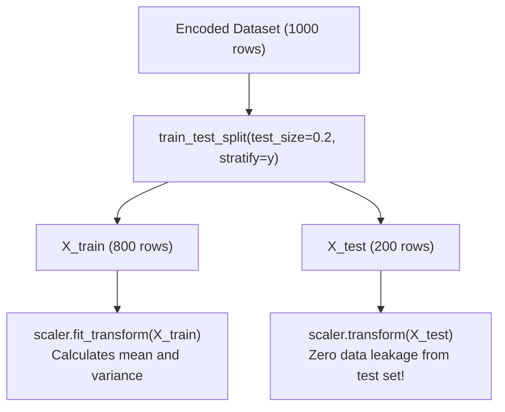

# Lecture 27.07: Feature Scaling & Data Leakage Prevention

## 📌 Topic Overview
In this lecture, Shraddha ma'am executes the **Train/Test split** (80% training, 20% testing) and standardizes all numerical features using `StandardScaler` while strictly avoiding data leakage.

---

## ⚠️ The Golden Data Leakage Rule
1. Split the data **first**.
2. Call `scaler.fit_transform(X_train)` on training data only.
3. Call `scaler.transform(X_test)` on test data.



---

## 💻 Python Implementation

```python
from sklearn.model_selection import train_test_split
from sklearn.preprocessing import StandardScaler

def prepare_train_test_data(df, target_col='Loan_Approved', test_size=0.2):
    """
    Executes leak-free Train/Test partitioning and feature standardization:
    - Drops ID and target column from feature matrix X
    - 80/20 train/test split with stratification
    - Fits StandardScaler ONLY on X_train, then transforms X_test
    """
    drop_cols = [target_col]
    if 'Applicant_ID' in df.columns:
        drop_cols.append('Applicant_ID')

    X = df.drop(columns=drop_cols)
    y = df[target_col]

    # 1. Stratified 80/20 split
    X_train, X_test, y_train, y_test = train_test_split(
        X, y, test_size=test_size, stratify=y, random_state=42
    )

    # 2. Scaling without data leakage
    scaler = StandardScaler()
    X_train_scaled = scaler.fit_transform(X_train)
    X_test_scaled  = scaler.transform(X_test)

    return X_train_scaled, X_test_scaled, y_train, y_test, scaler

# --- Function Call & Testing ---
# X_tr, X_te, y_tr, y_te, trained_scaler = prepare_train_test_data(encoded_df)
# print("Scaled Training Matrix Shape:", X_tr.shape)
# print("Scaled Test Matrix Shape:    ", X_te.shape)
```

---

## 🔑 Key Takeaways
1. Stratification ensures that the 68/32 class balance is maintained across both train and test splits.
2. `fit_transform` computes and applies; `transform` only applies.
