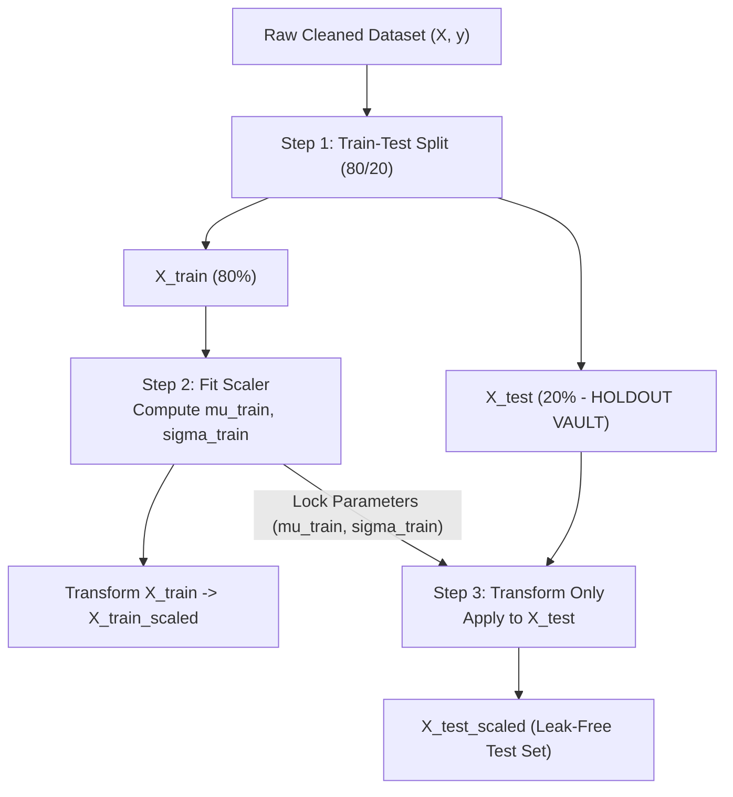

# Lecture 27.07: Feature Scaling aur Train-Test Splitting — Data Leakage Prevention

## 📌 Executive Summary (Hinglish)
StandardScaler ka Z-score standardization mechanics, 80/20 train-test partitioning, aur data leakage se bachne ke strict software invariants.

---

### 📋 Is Topic/Section Mein Hum Kya Cover Kar Rahe Hain?
1. Train-Test Partitioning (80/20 split) aur reproducible random seeding (`random_state=42`).
2. Z-score standardization formula: $z = \frac{x - \mu}{\sigma}$ (`StandardScaler`).
3. Data Leakage ka mathematical khatra: scaling parameters $(\mu, \sigma)$ ko sirf training set se fit karna.
4. `fit_transform(X_train)` vs `transform(X_test)` ka strict engineering contract.

---

### 🔍 Har Ek Bullet Point Ka Detailed Explanation

**Train-Test Partitioning**: Model ko unbiased evaluate karne ke liye dataset ko 80% training set ($N=760$) aur 20% test set ($N=190$) mein split kiya jaata hai.

**Z-Score Standardization**: Har numerical feature ki mean 0 aur standard deviation 1 banayi jaati hai taaki large magnitude features (jaise ₹50,000 Income) small magnitude features (jaise DTI 0.4) ko dominate na karein.

**Data Leakage Prevention**: Agar hum pure dataset par scaling pehle fit kar dein, toh test set ka mean aur standard deviation training phase mein leak ho jaata hai, leading to over-optimistic evaluation.

**Fit vs Transform**: `scaler.fit_transform()` sirf `X_train` par call hota hai jo parameters $\mu_{\text{train}}, \sigma_{\text{train}}$ learn karta hai. `X_test` par sirf `scaler.transform()` call hota hai.

---

## 🏛️ Mathematical Architecture & Detailed Theory

### 🛡️ The Architecture of Data Leakage Prevention

In applied machine learning pipelines, **Data Leakage** occurs when information from outside the training dataset is inadvertently utilized to build or transform the model.



---

### 📐 Standardization Mathematics (Z-Score)

For any continuous feature vector $\mathbf{x} = [x_1, x_2, \dots, x_m]^T$:

$$
\mu = rac{1}{m} \sum_{i=1}^m x_i \qquad	ext{and}\qquad \sigma = \sqrt{rac{1}{m} \sum_{i=1}^m (x_i - \mu)^2}
$$

The standardized feature coordinate $z_i$ is given by:

$$
oxed{z_i = rac{x_i - \mu}{\sigma}}
$$

#### Mathematical Necessity in Classification:
1. **Distance-Based Learners (KNN)**:
   In unscaled space, Euclidean distance $\|\mathbf{x}_a - \mathbf{x}_b\|_2 = \sqrt{\Delta \text{Income}^2 + \Delta \text{DTI}^2}$ is $100\%$ dominated by the income term ($10^4$ vs $10^{-1}$), rendering the DTI ratio completely inert.
2. **Gradient-Based Learners (Logistic Regression)**:
   Standardization sphericalizes the cost function Hessian matrix condition number $\kappa(\mathbf{H}) \approx 1$, preventing zigzagging oscillations and ensuring rapid parameter convergence.

---

## 💻 Python Implementation & Code Example

```python
from sklearn.model_selection import train_test_split
from sklearn.preprocessing import StandardScaler

# Assume X and y are defined
X_train, X_test, y_train, y_test = train_test_split(X, y, test_size=0.2, random_state=42)

scaler = StandardScaler()
# Strict contract: fit on train only
X_train_scaled = scaler.fit_transform(X_train)
# Transform test using train parameters
X_test_scaled = scaler.transform(X_test)

print("X_train_scaled shape:", X_train_scaled.shape)
print("X_test_scaled shape:", X_test_scaled.shape)
assert abs(X_train_scaled.mean()) < 1e-10, "Standardized train mean must be ~0.0"

```

---

## 🎯 Quick Revision Points (Interview Notes)
- **Objective**: Credit risk modeling mein precision hamesha accuracy se zyada important hoti hai.
- **Data Invariant**: SimpleImputer aur StandardScaler ko hamesha training data par `fit` karke test set par sirf `transform` kiya jaata hai.
- **Decision Boundary**: Non-linear feature transformations ($DTI^2$, $Credit^2$) linear models ko non-linear patterns capture karne ki capability provide karte hain.
