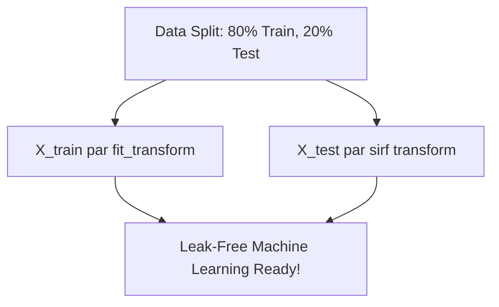

# Notes_27.07: Feature Scaling Aur Data Leakage Se Bachav [Hinglish]

## 📌 Topic Overview
Is lecture mein Shraddha ma'am ne **Train-Test Split (80/20)** kiya hai aur `StandardScaler` lagakar features ko scale kiya hai bina kisi data leakage ke.

---

### 📋 Is Topic Mein Hum Kya Seekhenge?
- `Applicant_ID` ko feature matrix se drop karna.
- Stratified 80/20 split ka faayda.
- `StandardScaler.fit_transform()` vs `transform()`.
- Data leakage se bachne ka golden rule.

---

### 🔍 Har Ek Point Ka Simple & Detailed Explanation

#### 1. Stratified Split Kyu Zaroori Hai?
Agar hamare data mein 68% Approved hain aur 32% Rejected:
`stratify=y` lagane se yeh guarantee milti hai ki training set aur testing set dono mein exactly wahi 68/32 ka proportion maintain rahega.

#### 2. Golden Scaling Rule:
- Train data par: `scaler.fit_transform(X_train)`
- Test data par: `scaler.transform(X_test)`

---

### 📊 Visual Flowchart: Scaling Workflow



---

### 💻 Python Code

```python
from sklearn.model_selection import train_test_split
from sklearn.preprocessing import StandardScaler

def prepare_train_test_data(df, target_col='Loan_Approved', test_size=0.2):
    """
    Executes leak-free Train/Test partitioning and feature standardization:
    - Drops ID and target column from feature matrix X
    - 80/20 train/test split with stratification
    - Fits StandardScaler ONLY on X_train, then transforms X_test
    """
    drop_cols = [target_col]
    if 'Applicant_ID' in df.columns:
        drop_cols.append('Applicant_ID')

    X = df.drop(columns=drop_cols)
    y = df[target_col]

    # 1. Stratified 80/20 split
    X_train, X_test, y_train, y_test = train_test_split(
        X, y, test_size=test_size, stratify=y, random_state=42
    )

    # 2. Scaling without data leakage
    scaler = StandardScaler()
    X_train_scaled = scaler.fit_transform(X_train)
    X_test_scaled  = scaler.transform(X_test)

    return X_train_scaled, X_test_scaled, y_train, y_test, scaler

# --- Function Call & Testing ---
# X_tr, X_te, y_tr, y_te, trained_scaler = prepare_train_test_data(encoded_df)
# print("Scaled Training Matrix Shape:", X_tr.shape)
# print("Scaled Test Matrix Shape:    ", X_te.shape)
```

---

### 📌 Summary Points
- Hamesha pehle split karein, fir scale karein.
- `X_test` par kabhi `fit()` mat lagayein.
