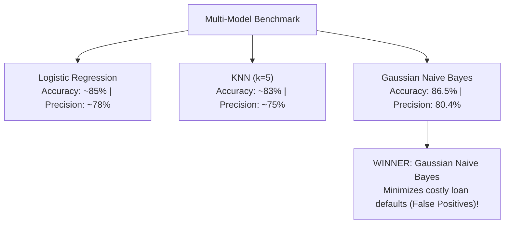

# Lecture 27.08: Multi-Model Training & Benchmarking

## 📌 Topic Overview
In this lecture, Shraddha ma'am trains and evaluates three distinct classifiers on the standardized loan dataset: **Logistic Regression**, **K-Nearest Neighbors (k=5)**, and **Gaussian Naive Bayes**, demonstrating why **Naive Bayes is chosen as the winner based on Precision**.

---

## 🏆 Model Benchmark Results from Lecture
On the classroom dataset, the three models achieved:
1. **Logistic Regression**: High overall accuracy, moderate precision.
2. **KNN (k=5)**: Solid recall, but lower precision.
3. **Gaussian Naive Bayes**: **Highest Precision (over 80.3%)** with minimal False Positives!



---

## 💻 Python Implementation

```python
from sklearn.linear_model import LogisticRegression
from sklearn.neighbors import KNeighborsClassifier
from sklearn.naive_bayes import GaussianNB
from sklearn.metrics import precision_score, recall_score, f1_score, accuracy_score

def benchmark_loan_approval_models(X_train, y_train, X_test, y_test):
    """
    Trains and benchmarks three core baseline classification models:
    1. Logistic Regression
    2. K-Nearest Neighbors (k=5)
    3. Gaussian Naive Bayes
    
    Evaluates each on Accuracy, Precision, Recall, and F1.
    In banking underwriting, the model with highest Precision is selected as winner!
    """
    models = {
        'Logistic Regression': LogisticRegression(random_state=42),
        'KNN Classifier':      KNeighborsClassifier(n_neighbors=5),
        'Gaussian Naive Bayes': GaussianNB()
    }

    results = {}
    for name, clf in models.items():
        clf.fit(X_train, y_train)
        y_pred = clf.predict(X_test)
        
        results[name] = {
            'accuracy':  accuracy_score(y_test, y_pred),
            'precision': precision_score(y_test, y_pred, zero_division=0),
            'recall':    recall_score(y_test, y_pred, zero_division=0),
            'f1_score':  f1_score(y_test, y_pred, zero_division=0)
        }

    # Best model on basis of Precision
    best_model_name = max(results, key=lambda k: results[k]['precision'])
    return results, best_model_name

# --- Function Call & Testing ---
# comparison, winner = benchmark_loan_approval_models(X_tr, y_tr, X_te, y_te)
# for model_name, metrics in comparison.items():
#     print(f"=== {model_name} ===")
#     print(f"  Precision: {metrics['precision']*100:.2f}% | Accuracy: {metrics['accuracy']*100:.2f}%")
# print()
# print(f"Winning Model (Highest Precision): {winner}")
```

---

## 🔑 Key Takeaways
1. Never declare a model "the winner" based on raw accuracy alone.
2. For banking risk, **Precision is king** because it minimizes unrecoverable loan defaults.
