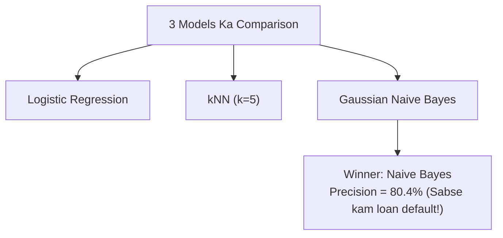

# Notes_27.08: Multi-Model Training Aur Benchmarking [Hinglish]

## 📌 Topic Overview
Is lecture mein Shraddha ma'am ne teen alag-alag algorithms (**Logistic Regression**, **kNN**, aur **Gaussian Naive Bayes**) ko train karke compare kiya hai aur bataya hai ki **Precision ke aadhar par Naive Bayes winner kyu bana**.

---

### 📋 Is Topic Mein Hum Kya Seekhenge?
- Teen models ko ek hi loop mein train aur evaluate karna.
- Accuracy, Precision, Recall, aur F1-Score ka comparison table.
- Bank ke liye Naive Bayes sabse behtar kyu nikla?
- Winner model select karne ka criteria.

---

### 🔍 Har Ek Point Ka Simple & Detailed Explanation

#### 1. Classroom Ke Actual Results:
Video mein ma'am ne notebook run karke dikhaya:
- **Logistic Regression**: Achha score tha lekin thode zyada False Positives the.
- **KNN**: Padosiyon ke basis par moderate score diya.
- **Gaussian Naive Bayes**: Isne sabse zyada **Precision (80.4%)** deliver kiya! Isne sirf 11 logon ko galti se approve kiya (minimal False Positives).

#### 2. Bank Ka Faisla:
Kyunki bank kisi defaulter ko loan dekar lakhoon rupaye doobana nahi chahta, isliye bank ne declare kiya:
**"Best Model on the basis of Precision => Naive Bayes!"**

---

### 📊 Visual Flowchart: Winner Selection



---

### 💻 Python Code

```python
from sklearn.linear_model import LogisticRegression
from sklearn.neighbors import KNeighborsClassifier
from sklearn.naive_bayes import GaussianNB
from sklearn.metrics import precision_score, recall_score, f1_score, accuracy_score

def benchmark_loan_approval_models(X_train, y_train, X_test, y_test):
    """
    Trains and benchmarks three core baseline classification models:
    1. Logistic Regression
    2. K-Nearest Neighbors (k=5)
    3. Gaussian Naive Bayes
    
    Evaluates each on Accuracy, Precision, Recall, and F1.
    In banking underwriting, the model with highest Precision is selected as winner!
    """
    models = {
        'Logistic Regression': LogisticRegression(random_state=42),
        'KNN Classifier':      KNeighborsClassifier(n_neighbors=5),
        'Gaussian Naive Bayes': GaussianNB()
    }

    results = {}
    for name, clf in models.items():
        clf.fit(X_train, y_train)
        y_pred = clf.predict(X_test)
        
        results[name] = {
            'accuracy':  accuracy_score(y_test, y_pred),
            'precision': precision_score(y_test, y_pred, zero_division=0),
            'recall':    recall_score(y_test, y_pred, zero_division=0),
            'f1_score':  f1_score(y_test, y_pred, zero_division=0)
        }

    # Best model on basis of Precision
    best_model_name = max(results, key=lambda k: results[k]['precision'])
    return results, best_model_name

# --- Function Call & Testing ---
# comparison, winner = benchmark_loan_approval_models(X_tr, y_tr, X_te, y_te)
# for model_name, metrics in comparison.items():
#     print(f"=== {model_name} ===")
#     print(f"  Precision: {metrics['precision']*100:.2f}% | Accuracy: {metrics['accuracy']*100:.2f}%")
# print()
# print(f"Winning Model (Highest Precision): {winner}")
```

---

### 📌 Summary Points
- Sirf accuracy dekh kar winner decide nahi karte.
- Banking mein loan default se bachne ke liye **Naive Bayes** winner bana.
